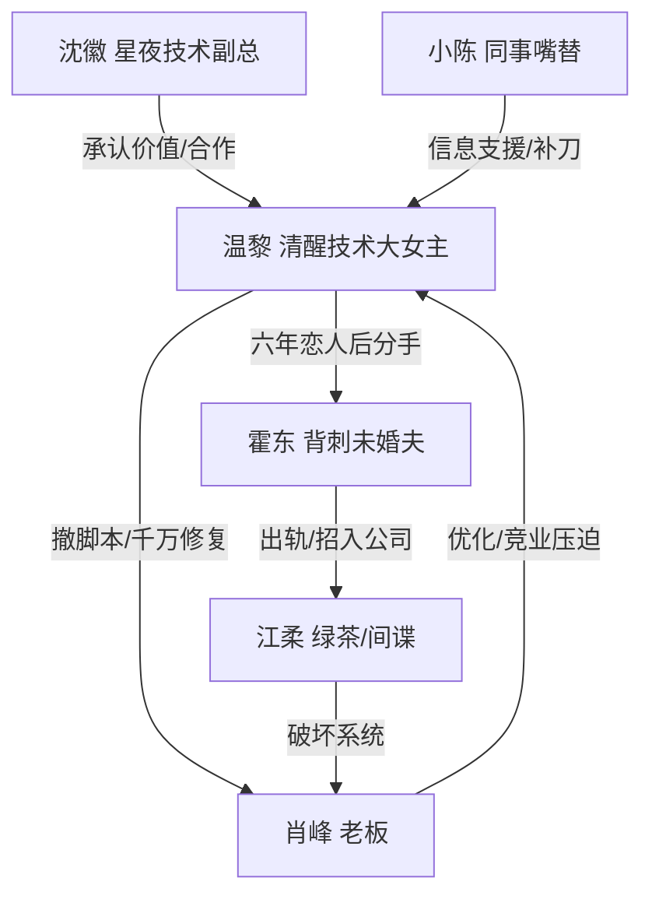

# 角色标签图谱

## 角色清单

### 温黎 — 清醒技术大女主
- 叙事功能: 主角、价值反噬执行者、情绪债清算者
- 核心标签: 技术核心、冷静止损、不依附
- 弧光: 被优化羞辱 → 拒签断婚 → 职业升维 → 情感重启
- 台词风格: 短句、反问、账目化
- 关键行为: 签赔偿、拒竞业、撤脚本、入职星夜、千万接单、买下房子
- 读者情绪关系: 心疼、佩服、爽

### 霍东 — 背刺软饭未婚夫
- 叙事功能: 情感压迫者、规则滥用者、最终崩塌对象
- 核心标签: 出轨、傲慢、吃女主红利
- 弧光: 销售总监自信 → 求和失败 → 失业落魄
- 台词风格: 先爹味说教，后感情绑架
- 关键行为: 提议优化温黎、招江柔进公司、占用女主车、要求女主救公司
- 读者情绪关系: 恨、鄙夷、看他倒霉的爽

### 江柔 — 绿茶实习生/商业间谍
- 叙事功能: 直接挑衅者、系统危机触发者
- 核心标签: 青梅、上位、内奸
- 弧光: 转正实习生挑衅 → 接不住技术 → 被查出间谍 → 判刑
- 台词风格: 装乖、阴阳怪气、求助时慌乱
- 关键行为: 叫霍东老公、接手技术工作、删除关键数据
- 读者情绪关系: 恨、期待报应

### 肖峰 — 算计型老板
- 叙事功能: 职场压迫者、低估技术的代价承担者
- 核心标签: 白嫖、现实、识时务
- 弧光: 默许优化 → 威胁求救 → 承认低估 → 千万签约
- 台词风格: 商人式权衡，先压后求
- 关键行为: 同意优化、拟竞业协议、求女主回公司、支付一千万
- 读者情绪关系: 解气，但比霍东更具现实复杂度

### 沈徽 — 价值承认型新男主
- 叙事功能: 职业补偿、情感补偿、价值新坐标
- 核心标签: 高平台、尊重能力、温柔理性
- 弧光: 技术副总面谈 → 合作伙伴 → 正式恋人
- 台词风格: 官方、直接、尊重边界
- 关键行为: 给出10%股份、允许女主处理旧公司问题、提醒别吃亏
- 读者情绪关系: 安心、补偿、甜

### 小陈 — 群众嘴替
- 叙事功能: 外部见证者、爽点放大器
- 核心标签: 维护女主、补刀、信息传递
- 弧光: 替女主不忿 → 发截图 → 当众补刀霍东
- 台词风格: 网感、直接
- 关键行为: 发公司群聊、说出星夜10%股份价值
- 读者情绪关系: 爽、代入吃瓜

## 关系网络

## 角色功能对照表（供改编参考）

| 原角色 | 极致标签 | 叙事功能 | 读者情绪功能 | 改编时必须保留的 |
|--------|---------|---------|-------------|---------------|
| 温黎 | 清醒技术大女主 | 反杀执行者 | 爽、佩服 | 冷静结算、不依附、专业不可替代 |
| 霍东 | 背刺软饭男 | 情感压迫源 | 恨、打脸爽 | 受过女主扶持却反咬 |
| 江柔 | 绿茶内奸 | 挑衅与危机触发 | 恨、报应期待 | “我能替你”后接不住 |
| 肖峰 | 算计老板 | 职场压迫源 | 现实打脸 | 低估技术后付费求回 |
| 沈徽 | 价值承认者 | 补偿与升维 | 安心、甜 | 尊重女主能力，不救世主化 |
| 小陈 | 群众嘴替 | 信息传递 | 爽点放大 | 替读者把话说出来 |
