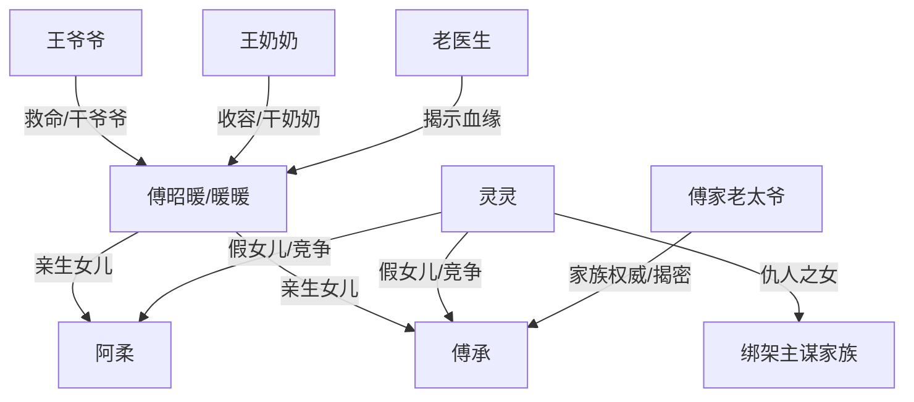

# 角色标签图谱

## 角色清单

### 我 / 暖暖 / 傅昭暖 — 被弃真千金
- 叙事功能: 承受全部误判与亏欠，作为亲情债的核心债权人。
- 核心标签: 被抛弃、坚韧、渴望温暖
- 弧光: 地窖孩子 → 傅家污点 → 亲生女儿 → 昭暖新生
- 台词风格: 短、怯、后期冰冷坚定
- 关键行为: 送玉佩救母、献血救傅承、逃离孤儿院、用支票救王爷爷、改名昭暖
- 读者情绪关系: 心疼、憋屈、期待她被珍惜

### 阿柔 / 妈妈 — 创伤错认母亲
- 叙事功能: 最大情感伤害源，也是后期追悔补偿源。
- 核心标签: 被拐创伤、逃避、迟来的母爱
- 弧光: 被救受害者 → 抛弃亲女 → 真相崩溃 → 笨拙补偿
- 台词风格: 前期回避崩溃，后期哽咽道歉
- 关键行为: 不看女主、抱走灵灵、自虐式悔恨、接受女主新身份
- 读者情绪关系: 前期怨，后期复杂心疼但需赎罪

### 傅承 / 傅总 — 冷酷错认父亲
- 叙事功能: 权力压迫和追悔执行者。
- 核心标签: 冷酷、掌控欲、悔恨偏执
- 弧光: 把女主当孽债 → 威胁囚禁 → 发现亲女 → 疯狂寻找 → 默默补偿
- 台词风格: 命令式、低沉威胁、后期哀求
- 关键行为: 送孤儿院、被女主献血救活、追查真相、拿视频清算灵灵、承担治疗费
- 读者情绪关系: 恨其冷酷，爽其崩溃，最终看其偿债

### 灵灵 — 恶毒假女儿
- 叙事功能: 外部反派，推动女主受辱和二次伤害。
- 核心标签: 伪善、嫉妒、鸠占鹊巢
- 弧光: 被宠假千金 → 恐惧失位 → 恶意谋害 → 被揭穿清算
- 台词风格: 甜腻假装、尖叫控诉
- 关键行为: 羞辱女主、砸伤手、误导搜寻、推热汤、认罪崩溃
- 读者情绪关系: 强恨点，负责被惩罚爽点

### 王爷爷 — 无条件保护者
- 叙事功能: 对照傅家血缘冷漠，证明“家”不是血缘自动成立。
- 核心标签: 善良、保护、替身父辈温暖
- 弧光: 面馆老人 → 救命恩人 → 干爷爷
- 台词风格: 朴素温暖
- 关键行为: 救治女主、用后背挡沸汤、醒来先问女主有没有烫着
- 读者情绪关系: 心疼、敬重、希望他被补偿

### 王奶奶 — 温暖收容者
- 叙事功能: 提供女主第一次无算计的善意。
- 核心标签: 慈爱、朴素、家的温度
- 弧光: 救助陌生孩子 → 给女主命名暖暖 → 成为干奶奶
- 台词风格: 生活化、轻柔
- 关键行为: 掏钱治病、喂面、护住女主
- 读者情绪关系: 安全感和治愈感来源

### 老医生 — 真相触发器
- 叙事功能: 发现 RH 阴性血和 DNA 真相。
- 核心标签: 专业、见证、揭露
- 弧光: 来访医生 → 救手伤 → 揭开亲子真相
- 台词风格: 震惊短句
- 关键行为: 包扎女主、发现血型、宣布 DNA 结果
- 读者情绪关系: 期待他说出真相

### 傅家老太爷 / 爷爷 — 权威清算者
- 叙事功能: 前期冷酷排斥，后期揭露灵灵背景。
- 核心标签: 家族权威、现实、迟来的纠偏
- 弧光: 视女主为孽债 → 交易献血 → 揭露阴谋
- 台词风格: 权威判断式
- 关键行为: 命人处理女主、拍板献血交易、揭穿灵灵
- 读者情绪关系: 前期厌恶，后期工具性解恨

## 关系网络

## 角色功能对照表（供改编参考）

| 原角色 | 极致标签 | 叙事功能 | 读者情绪功能 | 改编时必须保留的 |
|--------|---------|---------|-------------|---------------|
| 傅昭暖 | 被弃真千金 | 承债与最终命名 | 心疼、补偿期待 | 儿童弱势视角和求生本能 |
| 阿柔 | 创伤母亲 | 亲情伤害核心 | 怨与复杂心疼 | “看见她就想起创伤”的逃避逻辑 |
| 傅承 | 冷酷父亲 | 权力压迫与清算 | 恨、爽、看赎罪 | 威胁女主和后期崩溃追悔 |
| 灵灵 | 恶毒假女儿 | 明面反派 | 恨点集中 | 二次谋害与被铁证揭穿 |
| 王爷爷奶奶 | 非血缘家人 | 治愈对照 | 暖、心疼 | 无条件救助女主 |
| 老医生 | 真相触发器 | 身份反转 | 期待爆点 | 血型/DNA类硬证据 |
