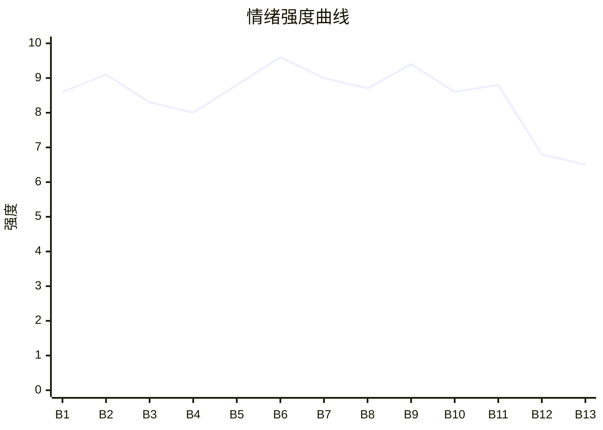

# Beat Sheet 节拍器

## 全文概况

- 总字数: 约 11500 字
- 节拍数: 13 幕
- 核心母题（Logline）: 被长期占便宜的职场软包子，为夺回尊严与劳动权益，面对吸血同事、冷漠同事和滥权老板的围剿，用对方规则与法律证据完成反杀并离开旧环境。
- 情绪模式: 极致打压 → 群体围剿 → 触底拒绝 → 规则清算 → 边界重建

## 节拍详表

### Beat 1: 倒叙钩子，换班恩怨立刻爆开 [开篇-“不换”]

- **字数**: 约 360 字（占比 3.1%）
- **核心事件**: 开篇交代孙晓晓长期换班，奶奶病危时拒绝女主，半个月后儿子车祸求换班被女主拒绝。
- **情绪标签**: 震惊、憋屈、期待反杀
- **情绪强度**: 8.6/10
- **情绪方向**: ⚡突变
- **冲突类型**: 大转折
- **悬念钩子**: 女主为什么能在孩子车祸时说“不换”？
- **叙事速度**: 快
- **对话占比**: 35%
- **reversal_mechanism**: [M3, M5]
- **hook_strength**: 8.7/10
- **关键句**: “我只说了两个字:‘不换。’”
- **原文摘录**: 同事孙晓晓总爱找我换班。她要看演唱会，要去旅游，要喝喜酒，要接孩子，每次我都答应了。我以为这叫相互帮忙。直到我奶奶病重，我要去见老人最后一面，求孙晓晓跟我换班，她一口拒绝道:“不换，我下午还要去做美容呢。”“你奶死了关你啥事？有这闲工夫还不如赶紧把方案做完，哪有整天麻烦别人的？”半个月后，孙晓晓的儿子突发车祸，医生要求她马上到医院签字手术。孙晓晓哭着来求我和她换班。我只说了两个字:“不换。”

### Beat 2: 奶奶病危，孙晓晓公开羞辱 [“换不了”-电话噩耗]

- **字数**: 约 1050 字（占比 9.1%）
- **核心事件**: 女主低声求换班，孙晓晓高声羞辱，老板也以制度拒绝请假，奶奶去世。
- **情绪标签**: 憋屈、愤怒、心疼
- **情绪强度**: 9.1/10
- **情绪方向**: ↓下降
- **冲突类型**: 大转折
- **悬念钩子**: 女主会如何面对这笔无法偿还的亲情债？
- **叙事速度**: 快
- **对话占比**: 45%
- **reversal_mechanism**: [M3, M5]
- **hook_strength**: null
- **关键句**: “你奶死了关你啥事？”
- **原文摘录**: 孙晓晓用“美容”拒绝换班，并把女主的临终请求说成“整天麻烦别人”。女主翻出六百多条换班记录，发现两年里自己十次有八次答应。她向刘总请假，刘总以“提前三天”为由拒绝。孙晓晓当众嘲笑“拿家里人做借口”。电话里母亲哭着说，奶奶已经去世。

### Beat 3: 奶茶收买，舆论倒向施害者 [丧假后-“聊天记录我这里都有”]

- **字数**: 约 1250 字（占比 10.9%）
- **核心事件**: 孙晓晓给所有同事买奶茶却故意漏掉女主，再装委屈引导同事围攻；女主用换班记录初步反击。
- **情绪标签**: 恶心、孤立、压抑
- **情绪强度**: 8.3/10
- **情绪方向**: ↓下降后小幅回升
- **冲突类型**: 微冲突
- **悬念钩子**: 证据能否改变办公室舆论？
- **叙事速度**: 中
- **对话占比**: 50%
- **reversal_mechanism**: [M3]
- **hook_strength**: null
- **关键句**: “她占尽便宜，还要反咬我一口。”
- **原文摘录**: 孙晓晓拎奶茶分给每个同事，记得少冰、七分糖、生理期补气血，唯独到女主这里袋子空了。她说“下次一定请你喝”。女主想起每次换班后的空头支票。孙晓晓装哭，说自己当时真有事，几个同事拿了奶茶后立刻指责女主自私。女主冷眼列出三月五次、四月三次、五月反悔的换班记录，并用“聊天记录我这里都有”压住孙晓晓。

### Beat 4: 电影逃班，客户流失，锅甩给女主 [下午两点-绩效全扣]

- **字数**: 约 1600 字（占比 13.9%）
- **核心事件**: 孙晓晓命令女主换班看电影，女主明确拒绝；孙晓晓擅自离岗导致客户流失，老板和同事试图甩锅。
- **情绪标签**: 厌恶、紧张、初爽
- **情绪强度**: 8.0/10
- **情绪方向**: ↑上升
- **冲突类型**: 大转折
- **悬念钩子**: 孙晓晓会不会被真正追责？
- **叙事速度**: 快
- **对话占比**: 45%
- **reversal_mechanism**: [M3]
- **hook_strength**: null
- **关键句**: “我说不行，这两个字的意思很难理解吗？”
- **原文摘录**: 孙晓晓下午命令女主替岗去看电影，女主两次说“不行”。孙晓晓在同事起哄和晚饭吹捧中离开。小张故意撞掉女主文件。三点二十五客户来找孙晓晓，因无人对接取消合作。六点刘总追责，小张指女主负责，女主系紧鞋带后说明自己从未同意。孙晓晓回来仍说“我和许长青换班了”，被女主用“不行”堵回。公司损失几十万，孙晓晓被记旷工，组内绩效奖金被扣，众人又反过来恨女主。

### Beat 5: 孤立升级，车祸求援进入道德极限 [众矢之的-食堂求救]

- **字数**: 约 1050 字（占比 9.1%）
- **核心事件**: 女主被全办公室孤立，孙晓晓突然崩溃求换班，因为儿子车祸等签字手术。
- **情绪标签**: 冷、压抑、悬疑
- **情绪强度**: 8.8/10
- **情绪方向**: ⚡突变
- **冲突类型**: 大转折
- **悬念钩子**: 女主会不会为了孩子破例？
- **叙事速度**: 快
- **对话占比**: 35%
- **reversal_mechanism**: [M3, M5]
- **hook_strength**: null
- **关键句**: “我儿子出车祸了，医生让我马上过去签字！”
- **原文摘录**: 从那天起，女主成了众矢之的。办公室聊天因她出现而安静，会议不通知，文件不发，对接敷衍。群里孙晓晓请大家吃烤肉，众人吹捧她“人美心善”。女主独自吃红烧肉盖饭时，孙晓晓披头散发冲来，说儿子车祸、医生要求马上签字，请女主换班一下午。

### Beat 6: “不换”回旋，群体伪善暴露 [食堂冲突-医院电话]

- **字数**: 约 1550 字（占比 13.5%）
- **核心事件**: 孙晓晓下跪、砸盘、群里道德绑架；女主反问他们为何不换，所有人退缩，女主最终拒绝。
- **情绪标签**: 道德撕扯、痛快、恐惧
- **情绪强度**: 9.6/10
- **情绪方向**: ↑急升
- **冲突类型**: 大转折
- **悬念钩子**: 孙晓晓的儿子是否会死？后果会怎样反噬？
- **叙事速度**: 快
- **对话占比**: 55%
- **reversal_mechanism**: [M3, M5]
- **hook_strength**: null
- **关键句**: “觉得我不近人情的，你们自己为什么不跟孙晓晓换班？”
- **原文摘录**: 女主扒完最后一口饭，说“不换”。孙晓晓砸碎盘子、撞头、哭求“我儿子才八岁”。群里同事说人命关天、孩子无辜。女主短暂想到孩子无辜，又想起奶奶临终、同事孤立、孙晓晓原话。她在群里问“觉得我不近人情的，你们自己为什么不跟孙晓晓换班？”群里死寂，随后人人说自己有事。女主回“我也有事，换不了”。孙晓晓老公打电话威胁，女主硬刚报警。医院来电通知患者已经离世。

### Beat 7: 儿子死亡，孙晓晓家庭崩塌 [死讯后-“赶紧把方案做完”]

- **字数**: 约 900 字（占比 7.8%）
- **核心事件**: 孙晓晓遭丈夫和婆家清算，昔日捧她的同事全沉默；女主用原话回敬。
- **情绪标签**: 残酷、反讽、初步清算
- **情绪强度**: 9.0/10
- **情绪方向**: ↑上升
- **冲突类型**: 大转折
- **悬念钩子**: 这场死亡会不会被公司继续利用？
- **叙事速度**: 快
- **对话占比**: 40%
- **reversal_mechanism**: [M3, M5]
- **hook_strength**: null
- **关键句**: “不要把个人情绪带到工作上，有这闲工夫你还不如赶紧把方案做完。”
- **原文摘录**: 孙晓晓儿子死后，丈夫、公婆冲进公司对她连踢带踹，要求离婚净身出户。那些喝奶茶、喊孙姐的同事全不吱声。孙晓晓被婆婆抓破脸，王浩只留一句“离婚协议签好了交给我”。众人散开，没人安慰她。孙晓晓质问女主是否满意，女主喝水后轻声回敬：“不要把个人情绪带到工作上，有这闲工夫你还不如赶紧把方案做完。”

### Beat 8: 强制捐款，老板把压迫制度化 [周五工资-投诉前]

- **字数**: 约 1150 字（占比 10.0%）
- **核心事件**: 公司强扣全员工资慰问孙晓晓，额外扣女主一千；女主意识到权力压迫，准备投诉。
- **情绪标签**: 愤怒、荒唐、决断
- **情绪强度**: 8.7/10
- **情绪方向**: ↓后↑
- **冲突类型**: 大转折
- **悬念钩子**: 女主能否撬动公司权力？
- **叙事速度**: 中
- **对话占比**: 35%
- **reversal_mechanism**: [M1]
- **hook_strength**: null
- **关键句**: “我不同意，这种强制捐款的行为不合规。”
- **原文摘录**: 周五工资到账，女主少了一千。刘总通知，为安抚孙晓晓，部门每人扣五百、其他部门每人扣三百，女主因“不团结集体”额外扣一千。众人不满五百块被扣。女主当面说强制捐款不合规，刘总回应“通知你们，不是和你们商量”，暗示不服从就主动辞职。孙晓晓朋友圈晒五万七千多入账。女主握紧拳头，第二天带身份证、劳动关系证明、侵权证据去劳动监察大队投诉。

### Beat 9: 劳动监察入场，证据死环成型 [三天后-录音播放]

- **字数**: 约 1350 字（占比 11.7%）
- **核心事件**: 劳动监察立案调查，刘总谎称按业绩扣款，被制度证据与录音反杀。
- **情绪标签**: 紧张、痛快、降维清算
- **情绪强度**: 9.4/10
- **情绪方向**: ↑上升
- **冲突类型**: 大转折
- **悬念钩子**: 孙晓晓拿了钱花掉会如何偿还？
- **叙事速度**: 快
- **对话占比**: 50%
- **reversal_mechanism**: [M1]
- **hook_strength**: null
- **关键句**: “你要证据是吗？我有证据。”
- **原文摘录**: 劳动监察工作人员到公司，点名许长青、负责人和孙晓晓。会议室里，刘总否认强制捐款，说扣钱是业绩不达标。工作人员要求出示制度条款，他拿不出来，只说“刚定下还没公布”。工作人员指出女主业绩第八，孙晓晓倒数后三名却未扣款。孙晓晓叫嚣没有证据。女主拿出录音笔，播放刘总强制扣款与“不服从可以辞职”的原话。工作人员确认录音有效，女主又拿出银行流水和群公告。

### Beat 10: 金镯子反噬，孙晓晓跪求放过 [退还款项-办公室道歉]

- **字数**: 约 950 字（占比 8.3%）
- **核心事件**: 劳动监察要求退还扣款，孙晓晓钱已买金镯子，求女主心软；女主拒绝，同事态度转向。
- **情绪标签**: 冷爽、清醒、失望
- **情绪强度**: 8.6/10
- **情绪方向**: ↑后→
- **冲突类型**: 微冲突
- **悬念钩子**: 女主会继续留在这个环境吗？
- **叙事速度**: 中
- **对话占比**: 35%
- **reversal_mechanism**: [M1, M3]
- **hook_strength**: null
- **关键句**: “没钱自己想办法，否则，我们法院见。”
- **原文摘录**: 工作人员要求公司尽快全额退还被扣款项。孙晓晓摸着五万元金镯子后退，说钱都花了，一分钱都没了，又可怜巴巴求女主放过。女主回想刚认识时自己因心软不断换班，也想起奶奶临终念叨她的名字。她冷漠移开视线：“没钱自己想办法，否则，我们法院见。”回办公室后，小张弱声叫“许姐”，感谢她维权。女主回答：“我不是在帮你，我是帮我自己。”

### Beat 11: 辞职离场，总部举报完成二次清算 [收拾东西-刘磊判刑]

- **字数**: 约 850 字（占比 7.4%）
- **核心事件**: 女主辞职，并向总部举报刘总长期收贿、拖欠工资，刘总停职调查后被判刑。
- **情绪标签**: 决绝、痛快、告别
- **情绪强度**: 8.8/10
- **情绪方向**: ↑上升
- **冲突类型**: 大转折
- **悬念钩子**: 女主离开后能否重新建立正常关系？
- **叙事速度**: 快
- **对话占比**: 25%
- **reversal_mechanism**: [M1]
- **hook_strength**: null
- **关键句**: “辞职，不在这干了。”
- **原文摘录**: 女主收拾东西，小张问她去哪。女主回：“辞职，不在这干了。”并告诫小张好自为之。她还给刘总留了一份礼物：向总部举报刘磊利用职务之便、长期收受贿赂、拖欠员工工资，附带文字信息与证据截图。总部第一时间停职调查，发现情况属实，刘磊被告上法庭，判处三年有期徒刑。

### Beat 12: 新公司边界重建，正常拒绝被允许 [入职新公司-奶茶询问]

- **字数**: 约 750 字（占比 6.5%）
- **核心事件**: 女主进入新公司，学会礼貌拒绝换班；新同事正常接受，工作关系回归边界。
- **情绪标签**: 松弛、修复、补偿
- **情绪强度**: 6.8/10
- **情绪方向**: →平稳上扬
- **冲突类型**: 无
- **悬念钩子**: 旧世界是否真的过去？
- **叙事速度**: 慢
- **对话占比**: 45%
- **reversal_mechanism**: [M5]
- **hook_strength**: null
- **关键句**: “这里没有人对我进行道德绑架。”
- **原文摘录**: 女主入职新公司，HR说公司欣赏她处理问题的能力。新环境很好，但她和所有人保持礼貌距离，不再一味付出。有人问周三能不能换班，女主犹豫后婉拒，同事自然接受。这里没人道德绑架，没人劝她让一让。下午同事请奶茶，认真问她有什么偏好，女主点了杨枝甘露。

### Beat 13: 道歉转账，阳光收束 [短信-全文完]

- **字数**: 约 300 字（占比 2.6%）
- **核心事件**: 女主收到一千块转账和“对不起”，淡然放下。
- **情绪标签**: 释然、余味
- **情绪强度**: 6.5/10
- **情绪方向**: →平稳
- **冲突类型**: 无
- **悬念钩子**: 无，完成收束
- **叙事速度**: 慢
- **对话占比**: 20%
- **reversal_mechanism**: [M5]
- **hook_strength**: null
- **关键句**: “都过去了。”
- **原文摘录**: 手机震动，女主收到一条转账短信，一千块钱，留言三个字：“对不起。”同事问她怎么了，她摇头，把手机放回兜里。阳光透过海棠树叶，洒下一地斑驳光影。她说：“都过去了。”

## 情绪曲线可视化

## 节拍密度检测

- 平均每 885 字一个节拍
- 微冲突密度: 每约 1900 字一次
- 大转折密度: 每约 1150 字一次
- 判定: 符合高频节拍器标准；中段“车祸求换班”和后段“劳动监察入场”是双峰。

## 反转机制清单(Reversal Mechanisms)

| 机制 ID | 机制名 | 承载 Beat | 关键段落/金句 | 等价改编提示 |
|--------|--------|-----------|--------------|-------------|
| M1 | 死环反杀 | Beat 8-11 | “扣钱是因为她业绩不达标”对上“请出示公司的规章制度”；录音与流水让老板无法自圆其说 | 固化载体必须换但死环结构不换；证据可换成考勤、合同、验收单、监控，高潮必须是规则闭环 |
| M3 | 因果回旋反讽 | Beat 1-7, Beat 10 | “不换”“你奶死了关你啥事”“赶紧把方案做完”被女主原结构还回去 | 金句回旋是命脉；必须保留施害者原句与女主回敬，重复度要高 |
| M5 | 温度反转曲线 | Beat 2, Beat 6-7, Beat 12-13 | 女主从“我以为这叫相互帮忙”到“我不是在帮你，我是帮我自己” | 必须显式写出曾经信任与后来归零，结尾用正常关系补偿主角边界感 |
