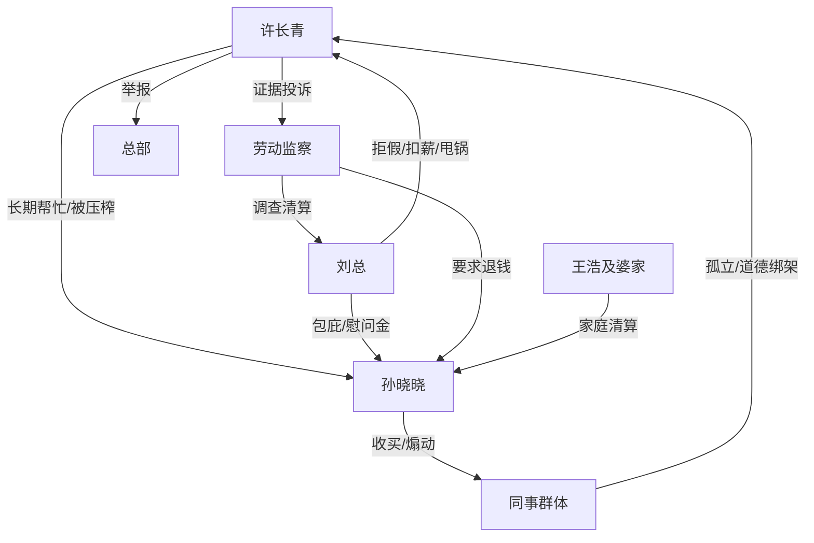

# 角色标签图谱

## 角色清单

### 许长青 — 边界觉醒型职场大女主

- 叙事功能: 被长期压榨的受害者、证据反杀执行者、价值观出口。
- 核心标签: 好说话、证据控、边界觉醒
- 弧光: 软包子式付出 → 冷静拒绝 → 规则维权 → 礼貌疏离
- 台词风格: 短、稳、冷，关键处用反问。
- 关键行为: 拒绝换班、群里反问、录音取证、劳动监察投诉、总部举报、辞职。
- 读者情绪关系: 心疼她错过奶奶临终，期待她反击，结尾获得代偿。

### 孙晓晓 — 嘴甜心苦的吸血型同事

- 叙事功能: 主压迫者、道德绑架源头、回旋反讽承受者。
- 核心标签: 爱占便宜、会收买人心、推责
- 弧光: 高高在上占便宜 → 假委屈操控舆论 → 儿子车祸崩溃 → 金钱反噬
- 台词风格: 命令式、装可怜式、道德扣帽子。
- 关键行为: 长期换班、拒绝奶奶病危、买奶茶孤立女主、擅自离岗、求换班、拿慰问金买金镯子。
- 读者情绪关系: 恨、恶心、等她被反噬。

### 刘总/刘磊 — 制度滥权型老板

- 叙事功能: 把个人压迫升级为组织压迫，提供 M1 规则反杀对象。
- 核心标签: 冷漠、滥权、虚伪
- 弧光: 拒批请假 → 扣绩效甩锅 → 强制扣薪 → 劳动监察前崩盘 → 被总部清算
- 台词风格: 官腔、压迫式通知、不商量。
- 关键行为: 拒绝病重请假、扣全组绩效、强制捐款、伪称业绩扣款。
- 读者情绪关系: 厌恶，期待法律制裁。

### 小张 — 看人下菜碟的墙头草同事

- 叙事功能: 群体舆论缩影，展示小恩小惠如何扭曲职场关系。
- 核心标签: 势利、胆小、反复
- 弧光: 受女主帮助 → 跟风孤立女主 → 损失后感谢维权 → 被女主告别
- 台词风格: 前期刻薄，后期弱声示好。
- 关键行为: 撞掉文件、甩锅女主、最后称“许姐”。
- 读者情绪关系: 讨厌但不值得主线清算，起衬托作用。

### 同事群体 — 慷他人之慨的旁观者

- 叙事功能: 群体道德绑架放大器，也是强制扣薪后的反噬承受者。
- 核心标签: 从众、伪善、自利
- 弧光: 捧孙晓晓 → 围攻女主 → 自己被扣钱后沉默/转向
- 台词风格: 群聊式口号、办公室议论。
- 关键行为: 喝奶茶站队、群里劝女主换班、无人自己换班、被扣钱后不满。
- 读者情绪关系: 愤怒、轻蔑。

### 王浩及婆家 — 反噬执行者

- 叙事功能: 对孙晓晓形成家庭层清算。
- 核心标签: 冷酷、迁怒、利益导向
- 弧光: 电话威胁女主 → 儿子死后转向攻击孙晓晓
- 台词风格: 威胁、辱骂、命令。
- 关键行为: 堵门威胁、公司打骂孙晓晓、要求离婚净身出户。
- 读者情绪关系: 不被喜爱，但承担“恶人自有恶人磨”的报应功能。

## 关系网络

## 角色功能对照表（供改编参考）

| 原角色 | 极致标签 | 叙事功能 | 读者情绪功能 | 改编时必须保留的 |
|--------|---------|---------|-------------|---------------|
| 许长青 | 边界觉醒女主 | 承压与反杀 | 心疼、爽 | 从心软到证据反击的弧光 |
| 孙晓晓 | 吸血同事 | 主压迫者 | 恨、等报应 | 嘴甜心苦、原话回旋 |
| 刘总 | 滥权老板 | 升级压迫 | 怒、期待法治 | 强制扣薪/规则伪装 |
| 小张 | 墙头草 | 群体缩影 | 厌恶、寒心 | 前受惠后背刺 |
| 同事群体 | 慷他人之慨者 | 道德围攻 | 憋屈、反讽 | 劝别人付出，自己不付出 |
| 劳动监察/总部 | 公共规则 | 清算工具 | 安全感、痛快 | 证据链落地 |
