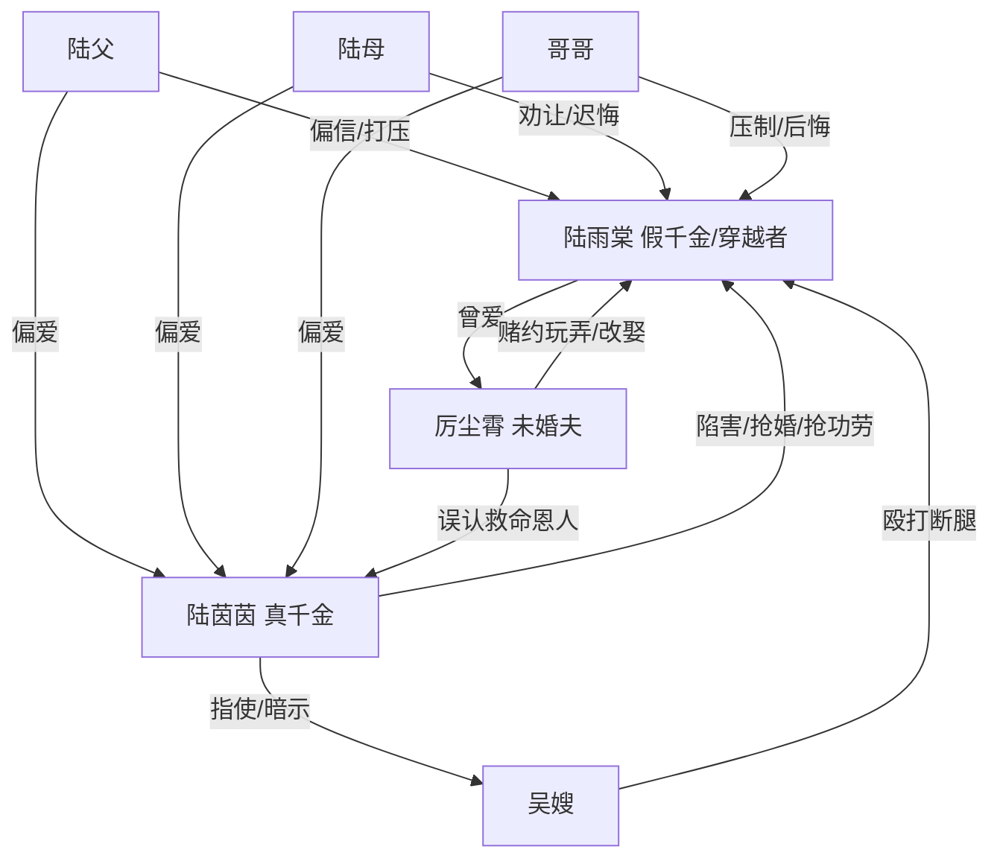

# 角色标签图谱

## 角色清单

### 陆雨棠 — 清醒退场型假千金/穿越者
- 叙事功能: 受害者、规则外逃者、死亡反杀触发器
- 核心标签: 假千金、穿越者、主动断亲
- 弧光: 以为拥有家庭与爱人 → 被献祭羞辱 → 主动死亡回家 → 拒绝回归
- 台词风格: 冷静、反讽、短句质问
- 关键行为: 选择跳楼脱离世界；留下录音、日记和死亡现场
- 读者情绪关系: 心疼、憋屈、爽、释然

### 陆茵茵 — 装病绿茶真千金/身份窃取者
- 叙事功能: 核心施害者，制造家庭偏爱和长期冤屈
- 核心标签: 真千金、装抑郁、抢功劳
- 弧光: 被全家偏爱 → 装病失效 → 证据塌房 → 被逐出与惩罚
- 台词风格: 哭诉、自怜、倒打一耙
- 关键行为: 抢婚、指使殴打、装病、抢救命恩人功劳
- 读者情绪关系: 恨、厌恶、等待报应

### 厉尘霄 — 赌约未婚夫/迟来悔恨者
- 叙事功能: 爱情线背叛源，后期清算执行者
- 核心标签: 赌约、眼盲、暴力
- 弧光: 玩弄女主 → 娶真千金 → 发现救命恩人真相 → 悔恨求回
- 台词风格: 命令式、羞辱式，后期哀求式
- 关键行为: 接亲改娶、掐女主、夺救护车、惩罚陆茵茵
- 读者情绪关系: 恨、爽点工具、迟来的活该

### 陆家哥哥 — 顶流偏心兄长/第一反噬者
- 叙事功能: 家庭权威之一，后期第一个击穿陆茵茵装病规则
- 核心标签: 顶流、偏心、悔恨
- 弧光: 帮真千金压制女主 → 认尸崩溃 → 质问装病逻辑 → 调查真相
- 台词风格: 暴躁、命令、后期质问
- 关键行为: 阻止送医、发现手机录音、质问自杀百次
- 读者情绪关系: 前恨后痛快，但不可完全原谅

### 陆父 — 首富父亲/冷硬父权
- 叙事功能: 家庭裁判权的象征
- 核心标签: 首富、冷漠、断亲
- 弧光: 认定女主占便宜 → 撤气垫默许 → 认尸崩溃 → 逐出陆茵茵
- 台词风格: 武断、利益化、命令式
- 关键行为: 扇女主、要求撤气垫、联系公关、断绝陆茵茵关系
- 读者情绪关系: 恨其冷血，爽其悔恨

### 陆母 — 影后母亲/迟来心疼者
- 叙事功能: 母爱缺席与悔恨承载者
- 核心标签: 影后、软弱、迟来崩溃
- 弧光: 劝女主让姐姐 → 认尸崩溃 → 读日记醒悟 → 梦中求回
- 台词风格: 哭诉、劝让、后期哀求
- 关键行为: 拉住女主、读日记、梦中挽回
- 读者情绪关系: 心痛与怨并存

### 吴嫂 — 豪门恶仆/物理迫害者
- 叙事功能: 将家庭偏爱落实为身体伤害
- 核心标签: 恶仆、棒球棍、伪证
- 弧光: 持棍威胁 → 打断腿 → 录音暴露 → 被怒扇
- 台词风格: 粗暴、狗仗人势
- 关键行为: 指使保镖殴打、伪造女主闹婚礼叙事
- 读者情绪关系: 直接仇恨

## 关系网络

## 角色功能对照表（供改编参考）

| 原角色 | 极致标签 | 叙事功能 | 读者情绪功能 | 改编时必须保留的 |
|--------|---------|---------|-------------|---------------|
| 陆雨棠 | 清醒退场假千金 | 受害与反杀触发 | 心疼、爽、释然 | 主动选择死亡/离开，不回头 |
| 陆茵茵 | 装病真千金 | 长期陷害者 | 恨与等待报应 | 伪弱规则必须被反身击穿 |
| 厉尘霄 | 赌约未婚夫 | 爱情背叛 | 恨与迟悔爽 | 曾玩弄感情，后知真相崩溃 |
| 陆家父母兄长 | 偏心家人 | 家庭伦理压迫 | 憋屈与悔恨补偿 | 必须多次不信女主 |
| 吴嫂 | 恶仆 | 身体伤害执行 | 愤怒 | 必须有具体暴力证据 |
