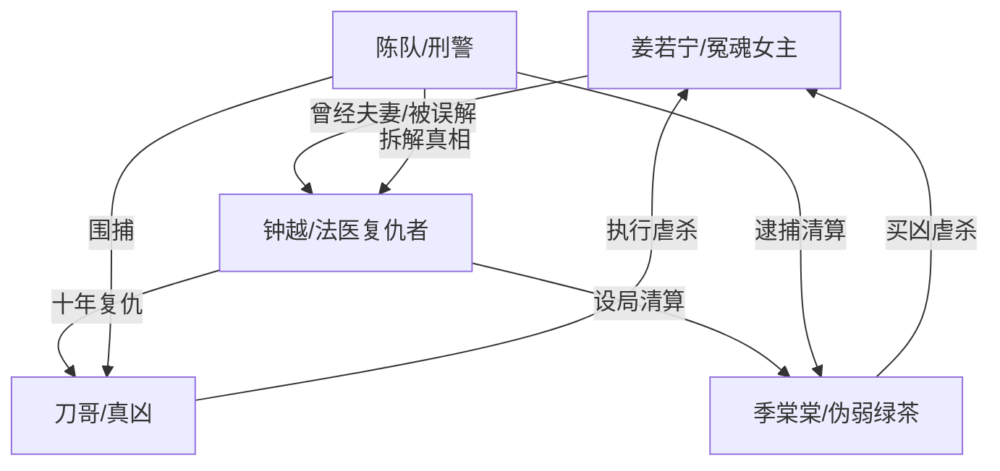

# 角色标签图谱

## 角色清单

### 姜若宁 — 死后旁观的冤魂女主
- 叙事功能: 受害者、见证者、情绪锚点。
- 核心标签: 被虐杀、灵魂旁观、迟来被爱。
- 弧光: 误以为被抛弃 → 见证真相 → 获得公道与重逢幻觉。
- 台词风格: 少量内心独白，冷静、哀伤、克制。
- 关键行为: 生前求生、写谅解书、死后旁观钟越复仇。
- 读者情绪关系: 心疼、替她恨、替她等一个公道。

### 钟越 — 隐忍十年的法医复仇者
- 叙事功能: 误导型男主、反转核心、复仇执行者。
- 核心标签: 法医、伪装冷血、脑癌晚期。
- 弧光: 疑似渣夫从犯 → 露出裂缝 → 十年复仇者 → 殉情追随。
- 台词风格: 前期冷硬理性，后期短句带血。
- 关键行为: 伪造报告保命、藏真实报告、AI设局、诱捕刀哥、最终坠崖。
- 读者情绪关系: 前半恨，后半心疼，结尾复杂痛感。

### 季棠棠 — 疯批绿茶施害者
- 叙事功能: 主要压迫者、家庭入侵者、女主死亡直接策划者。
- 核心标签: 装病、装弱、恶毒夺爱。
- 弧光: 被保护的“病人” → 录音暴露真面目 → 供出真凶 → 死刑。
- 台词风格: 撒娇伪弱与疯癫炫耀两套面孔。
- 关键行为: 偷首饰、诬陷女主、硫酸伤害、买凶杀人、误供刀哥。
- 读者情绪关系: 极致恨点，读者期待她被剥掉伪装。

### 刀哥 — 荒诞残忍的连环杀人犯
- 叙事功能: 终极肉身凶手、钟越设局目标。
- 核心标签: 碎花裙杀人狂、自负、厌女。
- 弧光: 隐身真凶 → 被模仿引出 → 被警方围捕。
- 台词风格: 粗俗、轻蔑、非人化。
- 关键行为: 接受季棠棠委托、虐杀姜若宁、因自尊赴约。
- 读者情绪关系: 厌恶、恐惧、要求重判。

### 陈队 — 理性刑警与真相拆解者
- 叙事功能: 公权力、推理揭示者、读者代理。
- 核心标签: 老刑警、敏锐、克制。
- 弧光: 配合审讯 → 怀疑钟越 → 拆穿复仇局 → 见证结局。
- 台词风格: 简洁、审讯式、证据导向。
- 关键行为: 稳住现场、拆穿衬衣与报告、诱捕刀哥。
- 读者情绪关系: 安全感、秩序感。

## 关系网络

## 角色功能对照表（供改编参考）

| 原角色 | 极致标签 | 叙事功能 | 读者情绪功能 | 改编时必须保留的 |
|--------|---------|---------|-------------|---------------|
| 姜若宁 | 死后旁观冤魂 | 受害与见证 | 心疼、代入 | 已死、不能行动、贴身旁观 |
| 钟越 | 隐忍复仇法医 | 误导与反转 | 先恨后疼 | 前期像从犯，后期证明确为复仇 |
| 季棠棠 | 疯批绿茶 | 压迫源 | 极致恨点 | 装弱、夺爱、炫耀式施害 |
| 刀哥 | 连环杀人犯 | 终极恶 | 恐惧与愤怒 | 荒诞轻蔑的杀人动机 |
| 陈队 | 刑警拆解者 | 真相秩序 | 安全感 | 用证据层层拆穿 |
