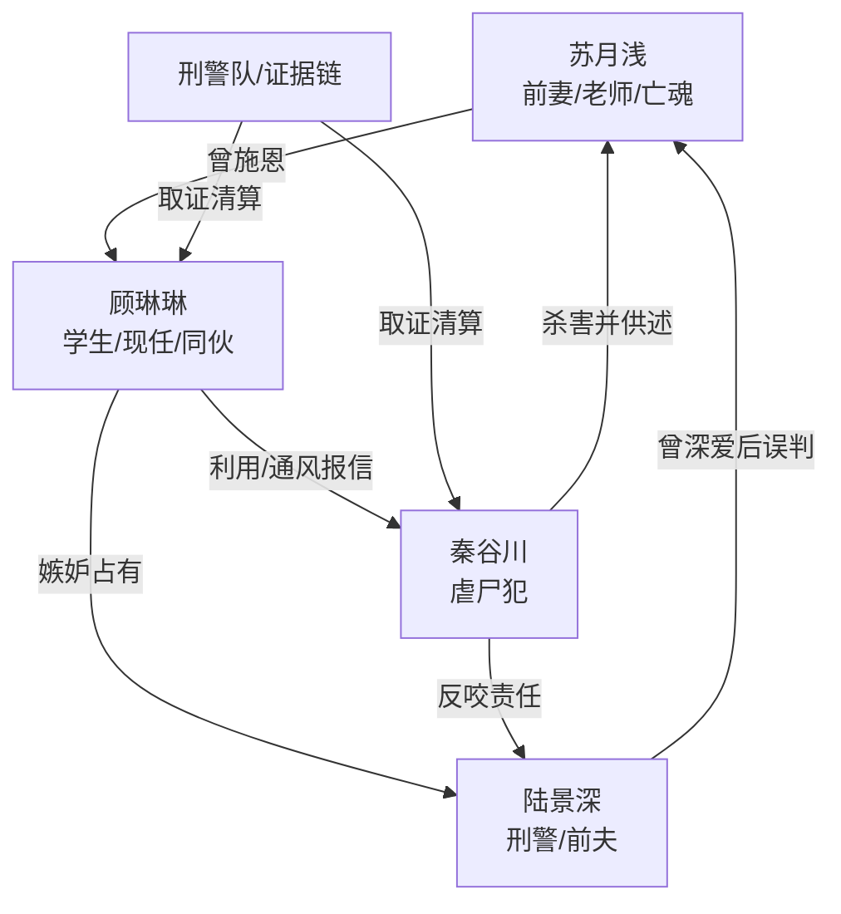

# 角色标签图谱

## 角色清单

### 苏月浅 — 亡魂旁观的清醒受害者
- 叙事功能: 情绪锚点、被误解者、迟来真相的承受者。
- 核心标签: 温柔施恩、孕中被害、冷淡释然。
- 弧光: 期待丈夫信任 → 被网暴与杀害 → 看见迟来悔恨后放下执念。
- 台词风格: 生前克制解释，死后多为冷静旁白。
- 关键行为: 收留顾琳琳、试图证明清白、签下离婚协议、临死保护孩子。
- 读者情绪关系: 心疼、替她憋屈、最后为她释然。

### 陆景深 — 迟来悔疯的护短刑警
- 叙事功能: 误判者、追悔者、真相接受容器。
- 核心标签: 护短、执法者、自负误判。
- 弧光: 护顾琳琳 → 否认前妻死亡 → 证据击穿 → 举报现任 → 殉死追随。
- 台词风格: 前期冷硬、质疑；中期崩溃；后期低声补偿。
- 关键行为: 公开指责苏月浅、认出雕塑、录音顾琳琳、安葬苏月浅。
- 读者情绪关系: 前期恨，后期看他痛苦偿债。

### 顾琳琳 — 恩将仇报的白眼狼学生
- 叙事功能: 核心施害者、婚姻入侵者、道德倒置源头。
- 核心标签: 装弱、自导自演、贪婪占有。
- 弧光: 受助学生 → 伪装受害者 → 杀人同伙 → 狱中崩溃。
- 台词风格: 委屈撒娇与冷酷坦白并存。
- 关键行为: 亲吻陆景深、散布流言、伪造报告、浇筑石膏、给秦谷川通风报信。
- 读者情绪关系: 强恨点，承担最大道德债。

### 秦谷川 — 变态虐尸真相投递者
- 叙事功能: 凶手、供述者、推动证据链的人形炸弹。
- 核心标签: 癫狂、艺术化杀人、被利用后反噬。
- 弧光: 逃脱三年 → 落网供述 → 反咬顾琳琳 → 死刑。
- 台词风格: 玩味、残忍、带舞台感。
- 关键行为: 杀害苏月浅、供出藏尸地、揭露顾琳琳与陆景深的责任链。
- 读者情绪关系: 恶寒与工具性爽感并存。

### 王主任/刑警队员 — 公权力证据链
- 叙事功能: 传话、验证、执行程序。
- 核心标签: 克制、程序、见证者。
- 弧光: 通知陆景深 → 现场取证 → 检测确认。
- 台词风格: 工作化、报告式。
- 关键行为: 找到病房、组织取证、出具 DNA 与指纹结果。
- 读者情绪关系: 提供可信度和清算感。

## 关系网络

## 角色功能对照表（供改编参考）

| 原角色 | 极致标签 | 叙事功能 | 读者情绪功能 | 改编时必须保留的 |
|--------|---------|---------|-------------|---------------|
| 苏月浅 | 亡魂孕妻 | 被误解的情绪锚点 | 心疼、憋屈、释然 | 已死旁观、临死护孩子、后期不再执着 |
| 陆景深 | 误判执法者 | 迟来追悔载体 | 前恨后看偿债 | 曾经深爱、公开误判、证据后崩塌 |
| 顾琳琳 | 白眼狼第三者 | 核心施害者 | 恨点 | 受恩反噬、伪装弱者、亲手参与杀害 |
| 秦谷川 | 癫狂杀人犯 | 真相投递者 | 恶寒、推进爽点 | 供出细节、给出藏尸点、反咬责任链 |
| 刑警队 | 程序清算者 | 证据可信度 | 正义落地 | 指纹/DNA/录音等硬证据 |
