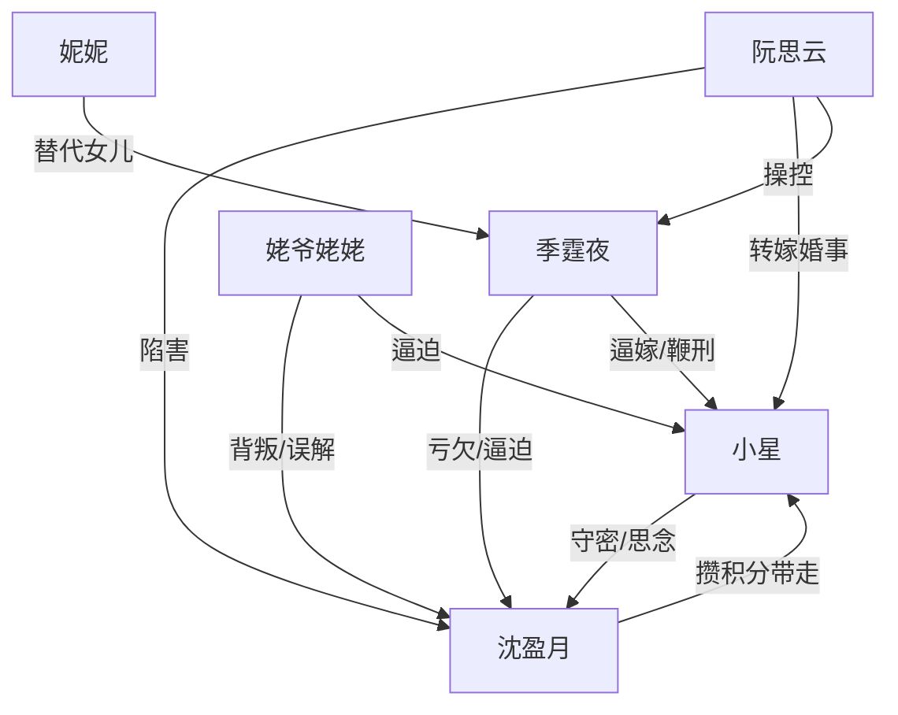

# 角色标签图谱

## 角色清单

### 小星 — 隐忍守密的小女儿

- 叙事功能: 第一视角受害者、情绪债承载者、母女补偿对象。
- 核心标签: 八岁、守密、濒死逃离
- 弧光: 被牺牲的女儿 → 成为新宿主 → 被母亲接回新生活
- 台词风格: 少话、冷静反问、关键处直击伦理
- 关键行为: 隐瞒母亲死亡五年、撕结婚证、守灵位、选择穿越
- 读者情绪关系: 心疼、保护欲、替她等报应

### 沈盈月 — 被榨干后脱离系统的母亲

- 叙事功能: 被亏欠对象、情绪债源头、最终补偿提供者。
- 核心标签: 留洋大小姐、系统宿主、温柔强者
- 弧光: 被困大院的妻子 → 死亡/脱离 → 新世界集团创始人
- 台词风格: 温柔、克制、保护性强
- 关键行为: 喝下打胎药、临终让小星保密、攒积分带走女儿
- 读者情绪关系: 心疼、敬佩、希望她被补偿

### 季霆夜 — 迟来悔疯的偏心父亲

- 叙事功能: 最大情绪债制造者、悔恨清算对象。
- 核心标签: 父权、偏袒、迟来悔恨
- 弧光: 掌控大院的父亲 → 逼死女儿 → 跪灵位崩溃
- 台词风格: 命令式、赌气式、后期破碎重复
- 关键行为: 接寡嫂入宅、逼母亲打胎、过继小星、下令鞭刑
- 读者情绪关系: 恨、期待其悔疯、不接受原谅

### 阮思云 — 白莲寡嫂/寄生型反派

- 叙事功能: 持续陷害者、父亲偏袒的触发器。
- 核心标签: 白莲、装弱、夺位
- 弧光: 寡嫂入宅 → 假女主人 → 被审判清算
- 台词风格: 委屈、退让式进攻、以孩子绑架
- 关键行为: 割腕陷害、指使灌药、撒平安符谎、污蔑灵位
- 读者情绪关系: 强恨点，清算需求明确

### 妮妮 — 表演懂事的替代女儿

- 叙事功能: 对照小星，触发父亲最后决断。
- 核心标签: 假懂事、既得利益者、工具人
- 弧光: 被写进族谱 → 下跪表演 → 随母被逐
- 台词风格: 早熟表演式牺牲
- 关键行为: 跪求自己嫁，反向刺激父亲惩罚小星
- 读者情绪关系: 厌烦、识破感

### 姥爷姥姥 — 亲情背叛的外部证明

- 叙事功能: 扩大家庭伦理背叛范围，使母亲孤立无援。
- 核心标签: 偏听、体面、迟来崩溃
- 弧光: 逼外孙女替嫁 → 见灵位不信 → 得知真相下跪
- 台词风格: 道德绑架、长辈训斥
- 关键行为: 认可替嫁、掌掴小星、后来殴打阮思云
- 读者情绪关系: 恨其糊涂，接受其崩溃但不完全原谅

## 关系网络

## 角色功能对照表（供改编参考）

| 原角色 | 极致标签 | 叙事功能 | 读者情绪功能 | 改编时必须保留的 |
|--------|---------|---------|-------------|---------------|
| 小星 | 隐忍守密女儿 | 受害者与见证人 | 心疼、补偿期待 | 年幼却主动守密 |
| 沈盈月 | 被亏欠母亲 | 情绪债核心 | 心疼、希望重逢 | 死亡/离开与最终补偿 |
| 季霆夜 | 悔疯父亲 | 施压与清算对象 | 恨、爽 | 曾爱过但亲手毁掉 |
| 阮思云 | 白莲寡嫂 | 持续陷害 | 强恨点 | 装弱夺利、证据清算 |
| 妮妮 | 替代女儿 | 刺激对比 | 厌恶 | 表演懂事 |
| 姥爷姥姥 | 背叛亲族 | 扩大压迫 | 憋屈 | 亲生父母反逼女儿 |
