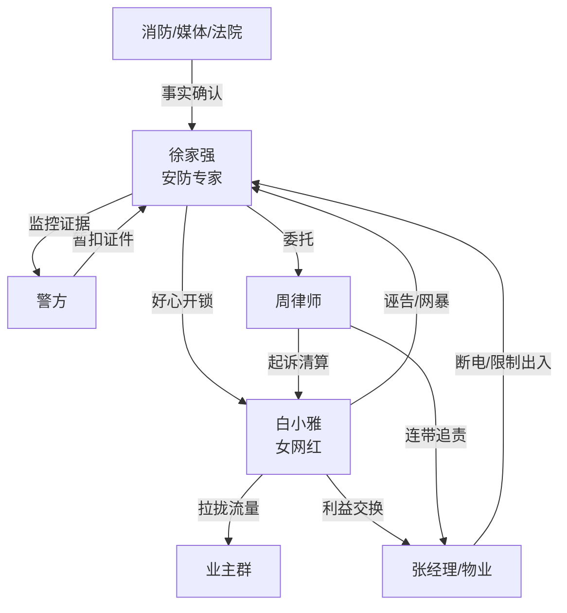

# 角色标签图谱

## 角色清单

### 徐家强 — 冷静技术流复仇男主

- 叙事功能: 被诬陷者、规则守护者、最终清算者。
- 核心标签: 安防专家、证据控、克制狠人。
- 弧光: 好心邻居 → 被污名化底层锁匠 → 合法反击者 → 刑侦顾问/科技公司老板。
- 台词风格: 短句、冷静、法律化，关键时刻用因果句砸脸。
- 关键行为: 上交证件、保存监控、停用工具、拒绝非法开锁、起诉清算、最后公开救人。
- 读者情绪关系: 前半心疼，火灾段代入痛快，后半获得价值认同。

### 白小雅 — 恩将仇报的流量女网红

- 叙事功能: 核心施害者、舆论暴力发起者、因果反噬对象。
- 核心标签: 擦边网红、绿茶造谣者、流量恶人。
- 弧光: 被救者 → 诬告者 → 网暴煽动者 → 火灾被困者 → 被判刑失信者。
- 台词风格: 夸张、直播腔、道德绑架、高频使用“家人们”“底层男”。
- 关键行为: 诬告性骚扰、直播带节奏、煽动网暴、炫耀电子锁、火场求救。
- 读者情绪关系: 强恨点；报应越重，读者越爽。

### 张经理 — 逐利墙头草物业

- 叙事功能: 二级反派，放大群体压迫。
- 核心标签: 小人得志、趋炎附势、违法断电。
- 弧光: 阴阳怪气压迫主角 → 断电逼迁 → 跪地求饶 → 拘役赔偿。
- 台词风格: 油滑、讥讽、欺软怕硬。
- 关键行为: 拒调监控、没收门禁卡、非法断电、上门赔礼。
- 读者情绪关系: 增加现实憋屈感，后期跪求带来次级爽点。

### 年轻警官/所长 — 制度修正者

- 叙事功能: 前期流程压力来源，后期秩序纠偏者。
- 核心标签: 程序化、尴尬、纠错。
- 弧光: 暂扣证件 → 查明真相 → 传唤训诫 → 归还证件并道歉。
- 台词风格: 官方、克制。
- 关键行为: 暂扣许可证、查验监控、发布通报、送还证件。
- 读者情绪关系: 前期带来制度无力感，后期恢复公平。

### 业主群男业主 — 群体暴力合唱团

- 叙事功能: 扩大舆论压迫，制造“全世界都误解我”的低谷。
- 核心标签: 护花使者、墙头草、键盘暴民。
- 弧光: 威胁主角 → 撤回消息 → 道歉甩锅。
- 台词风格: 粗俗、跟风、表情包式。
- 关键行为: 群内辱骂威胁、风向逆转后刷屏掩盖。
- 读者情绪关系: 群体厌恶点；被打脸时提供附加爽感。

### 周律师 — 清算工具人

- 叙事功能: 将复仇转入法律执行层。
- 核心标签: 专业、冷静、证据链。
- 弧光: 接收证据 → 发起诉讼 → 法庭获胜。
- 台词风格: 专业简洁。
- 关键行为: 整理证据、起诉、庭审陈述。
- 读者情绪关系: 强化“主角不是私刑，是合法清算”。

## 关系网络

## 角色功能对照表（供改编参考）

| 原角色 | 极致标签 | 叙事功能 | 读者情绪功能 | 改编时必须保留的 |
|--------|---------|---------|-------------|---------------|
| 徐家强 | 冷静技术流复仇者 | 承压、取证、合法清算 | 心疼转爽 | 专业技能、证件/资质、克制不冲动 |
| 白小雅 | 恩将仇报流量恶人 | 制造压迫并被反噬 | 恨点核心 | 被救后反咬、煽动舆论、火场求救 |
| 张经理 | 趋炎附势物业小人 | 二级压迫 | 次级恨点 | 违法帮凶行为和跪求清算 |
| 业主群 | 墙头草暴民 | 群体压力 | 现实愤怒 | 先骂后舔的风向逆转 |
| 警方/法院 | 秩序修正者 | 制度裁决 | 公平补偿 | 通报、判决、公开道歉 |
