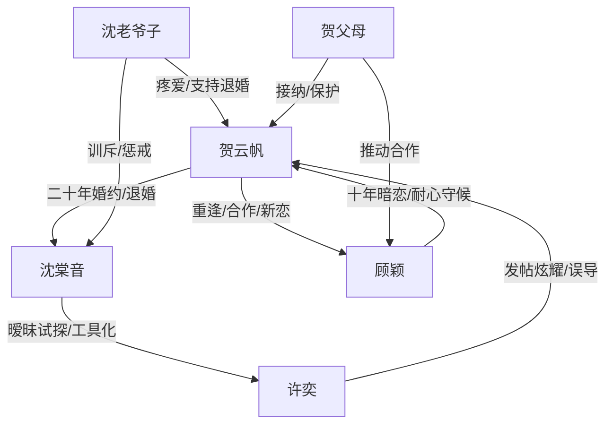

# 角色标签图谱

## 角色清单

### 贺云帆 — 清醒撤资型男主

- 叙事功能: 承担受害者、清算者与新生活开启者。
- 核心标签: 克制、体面、边界感
- 弧光: 满心旧爱 → 证据累积后退婚 → 远走重建 → 接受新爱
- 台词风格: 短句、冷静、定性强
- 关键行为: 寿宴前退婚、拉黑离开、拒绝解释、确认顾颖、婚礼终局
- 读者情绪关系: 心疼前半隐忍，爽于后半清醒不回头。

### 沈棠音 — 任性掌权人/迟来悔恨旧爱

- 叙事功能: 主要施害者，也是后半悔恨承载体。
- 核心标签: 自负、爱面子、控制欲
- 弧光: 轻慢未婚夫 → 用助理试探 → 发现退婚 → 追夫失败 → 终身悔恨
- 台词风格: 撒娇与强势切换，前期自辩，后期哀求
- 关键行为: 带许奕参加寿宴、取消合作、默认暧昧、追到加拿大、参加婚礼
- 读者情绪关系: 前期招恨，后期提供悔恨爽点。

### 许奕 — 绿茶男助理/工具人反噬者

- 叙事功能: 催化矛盾、放大沈棠音越界、提供外部证据。
- 核心标签: 装乖、炫耀、越界
- 弧光: 受宠助理 → 社交平台暗示上位 → 被揭穿 → 被辞退
- 台词风格: 怯生生、撒娇、装委屈
- 关键行为: 发帖炫耀、接男主电话、坐秋千、故意挂电话、刺激沈棠音
- 读者情绪关系: 令人厌恶，但最终被“工具人”身份反杀。

### 顾颖 — 温柔守候型新欢

- 叙事功能: 后半补偿性关系，证明男主值得被珍惜。
- 核心标签: 分寸感、耐心、深情
- 弧光: 旧玩伴重逢 → 合作伙伴 → 暗恋揭示 → 女朋友 → 妻子
- 台词风格: 温柔、克制、边界清晰
- 关键行为: 接电话制造反向信息差、尊重男主恢复节奏、停车场维护男主、婚礼圆满
- 读者情绪关系: 提供治愈与补偿，降低男主结尾孤苦感。

### 沈老爷子 — 道德裁判/退婚见证人

- 叙事功能: 代表家族伦理和公正长辈，给男主退婚合法性。
- 核心标签: 护短、明理、威严
- 弧光: 劝阻退婚 → 看清孙女荒唐 → 支持男主 → 病倒促使沈棠音回国
- 台词风格: 直接、暴躁、护云帆
- 关键行为: 寿宴训斥、接受退婚、打沈棠音、通风报信
- 读者情绪关系: 替读者骂人，增强男主道德站位。

### 贺父母 — 家庭补偿与新秩序支持者

- 叙事功能: 接住男主离开后的生活，推动顾颖线。
- 核心标签: 保护、现实、温暖
- 弧光: 反对退婚 → 看到事实后支持 → 促成新合作与婚礼
- 台词风格: 家常、关心、轻松
- 关键行为: 接机、安排合作、揭示顾颖暗恋、出席婚礼
- 读者情绪关系: 让男主不是孤立复仇，而是回归被爱的生活。

## 关系网络

## 角色功能对照表（供改编参考）

| 原角色 | 极致标签 | 叙事功能 | 读者情绪功能 | 改编时必须保留的 |
|--------|---------|---------|-------------|---------------|
| 贺云帆 | 清醒撤资型男主 | 受害者与清算者 | 心疼、爽、认同 | 不吵不闹，证据充分后离开 |
| 沈棠音 | 任性掌权旧爱 | 施害者与悔恨者 | 恨、看她悔 | 自负合理化与迟来崩溃 |
| 许奕 | 绿茶工具人 | 引爆暧昧证据 | 厌恶、看掉皮 | 社交平台炫耀和装乖反差 |
| 顾颖 | 温柔守候新欢 | 补偿与新秩序 | 治愈、甜爽 | 分寸感和长期暗恋 |
| 沈老爷子 | 道德裁判 | 退婚合法性 | 代骂、站队 | 明确支持男主 |
