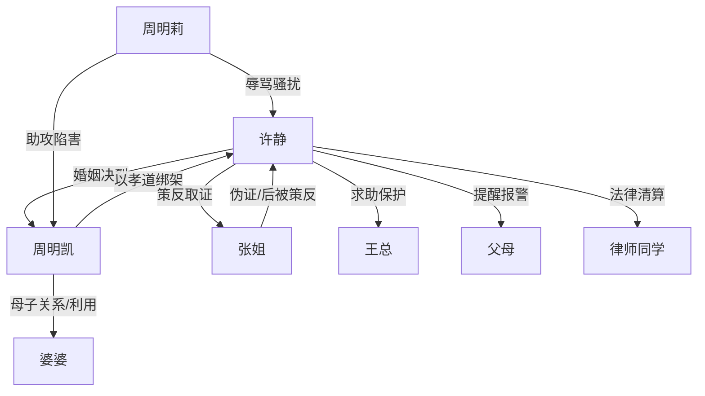

# 角色标签图谱

## 角色清单

### 许静 — 清醒算账型离婚大女主

- 叙事功能: 被压迫者、反击执行者、读者代偿对象。
- 核心标签: 冷静、会取证、拒绝自我牺牲。
- 弧光: 被通知睡客厅的妻子 → 主动离家培训 → 证据链反杀 → 拥有新生活的自由人。
- 台词风格: 短句、反问少但准、关键时刻给二选一。
- 关键行为: 报封闭培训、拉黑丈夫、提前报备、起草离婚协议、策反护工、录音反杀。
- 读者情绪关系: 心疼、代入、痛快。

### 周明凯 — 伪孝自私丈夫

- 叙事功能: 主要压迫者，制造情绪债与反杀对象。
- 核心标签: 伪孝、转嫁成本、权威崩塌。
- 弧光: 自我感动的孝子 → 狼狈求妻回归 → 设局陷害 → 净身出户、前途尽毁。
- 台词风格: 道德绑架、命令、哀求、威胁切换。
- 关键行为: 擅自搬主卧、逼妻睡客厅、失联逼妻回城、参与伪证局。
- 读者情绪关系: 恨、厌恶、期待被清算。

### 周明莉 — 疯批助攻型小姑子

- 叙事功能: 升级冲突、外部骚扰、暴露周家恶意。
- 核心标签: 泼妇、嚣张、低智恶毒。
- 弧光: 电话辱骂 → 闹公司和娘家失败 → 民政局撒泼 → 录音曝光后崩溃。
- 台词风格: 尖锐、侮辱性强、逻辑荒唐。
- 关键行为: 威胁女主、闹事、收买护工、阻止离婚。
- 读者情绪关系: 恨、解压打脸。

### 张姐 — 被收买后反转的棋子护工

- 叙事功能: 伪证载体、证据突破口。
- 核心标签: 贪心、恐惧、可策反。
- 弧光: 高价护工 → 婆婆摔伤现场人 → 民政局伪证者 → 交出录音的证人。
- 台词风格: 怯懦、哭诉、断续。
- 关键行为: 打电话叫回女主、当众认罪、交录音、复述阴谋。
- 读者情绪关系: 前期疑，后期工具性释放爽点。

### 婆婆 — 瘫痪母亲/孝道道具

- 叙事功能: 触发家庭照护矛盾，是周明凯伪孝的“道德盾牌”。
- 核心标签: 瘫痪、被利用、家庭负担实体化。
- 弧光: 被搬进主卧 → 摔伤进 ICU → 被儿女当成阻止离婚的工具。
- 台词风格: 几乎无台词。
- 关键行为: 无主动行为，存在本身制造伦理压力。
- 读者情绪关系: 复杂；主要厌恶的是利用她的人。

### 许薇/父母/王总/律师同学 — 女主外部支持系统

- 叙事功能: 提供信息、现实保护、法律支撑。
- 核心标签: 家人、职场保护、法律支援。
- 弧光: 被动卷入 → 按女主策略避险 → 支持女主清算。
- 台词风格: 实用、辅助。
- 关键行为: 报警、公司挡骚扰、法律分析、处理财产。
- 读者情绪关系: 稳定感、现实可信度。

## 关系网络

## 角色功能对照表（供改编参考）

| 原角色 | 极致标签 | 叙事功能 | 读者情绪功能 | 改编时必须保留的 |
|--------|---------|---------|-------------|---------------|
| 许静 | 清醒算账型离婚大女主 | 反击主轴 | 代偿、爽 | 冷静、抽身、取证、二选一反杀 |
| 周明凯 | 伪孝自私丈夫 | 主反派 | 恨、等报应 | 擅自牺牲妻子利益、转嫁照护责任 |
| 周明莉 | 疯批小姑子 | 升级冲突 | 厌恶、打脸爽 | 外部骚扰与伪证助攻 |
| 张姐 | 可策反棋子 | 证据载体 | 紧张、破局爽 | 先被收买，后交出关键证据 |
| 婆婆 | 瘫痪孝道道具 | 伦理压力源 | 复杂、压迫感 | 被反派用作道德武器 |
