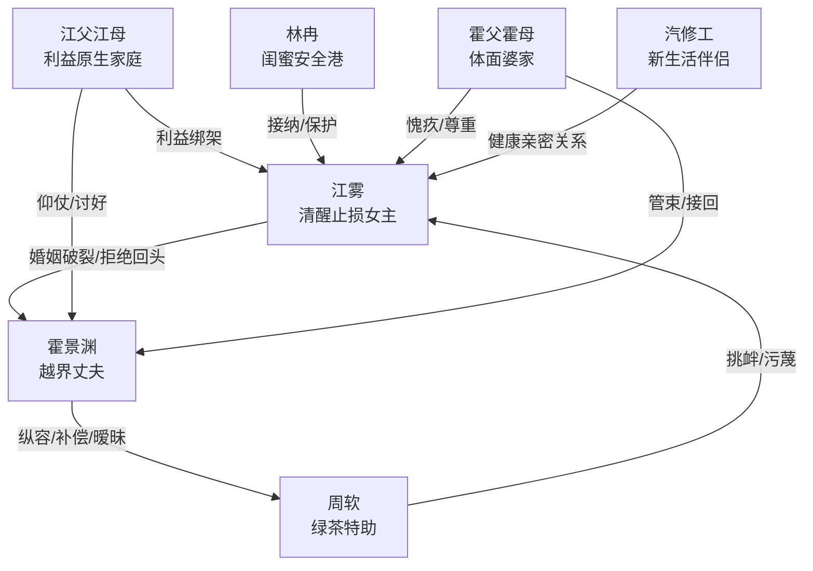

# 角色标签图谱

## 角色清单

### 江雾 — 清醒止损型豪门太太

- 叙事功能: 第一人称主角，承载受伤、决断、反击、重生全链路。
- 核心标签: 清醒、自尊、爱过但不回头
- 弧光: 联姻中爱上丈夫 → 发现越界果断离婚 → 人流出国 → 再婚生女获得新生
- 台词风格: 短句、冷静、带刺；关键时刻直接宣判
- 关键行为: 提离婚、预约人流、录下周软挑衅、留下流产单和照片、出国断联、拒听告白
- 读者情绪关系: 心疼她的失子与孤立，爽于她不回头、不原谅、不自欺

### 霍景渊 — 爱而不自知的越界丈夫

- 叙事功能: 核心施害者与追妻火葬场承载者。
- 核心标签: 傲慢、迟钝、边界崩坏
- 弧光: 自认清白且维护周软 → 失去妻子和孩子后崩溃 → 追到异国求原谅 → 跳海伤腿被迫放手
- 台词风格: 控制型安抚，常用“理智”“大度”“小姑娘”压女主
- 关键行为: 撕离婚协议、替周软辩解、带周软上门道歉、游乐园抛下江雾、拆礼物崩溃、赴新西兰纠缠
- 读者情绪关系: 前半让读者恨，后半让读者看他悔恨偿债

### 周软 — 伪天真绿茶特助

- 叙事功能: 婚姻边界破坏者，诱发女主止损与证据收集。
- 核心标签: 小太阳伪装、炫耀、越界
- 弧光: 改平板密码挑衅 → 上门道歉炫耀 → 被录音 → 网上反咬 → 被霍家清算
- 台词风格: 活泼撒娇、装无辜、挑衅时露出攻击性
- 关键行为: 改密码、穿定制服、声称夫妻之实、握住流产秘密、网上污蔑
- 读者情绪关系: 强恨点；她越“可爱”，读者越厌恶霍景渊的偏袒

### 江父江母 — 利益至上的原生家庭

- 叙事功能: 扩大女主孤立感，证明她不是只失去婚姻，而是要切断全部旧枷锁。
- 核心标签: 重男轻女、功利、剥削女儿
- 弧光: 劝忍离婚 → 讨好霍景渊 → 母亲递药 → 被女主精神切割
- 台词风格: 道德绑架、利益计算、伪关心
- 关键行为: 给霍景渊通风报信、要求女主为弟弟要地皮、递粉色药水
- 读者情绪关系: 憋屈和恶心；为女主“通通不要”提供爽感依据

### 林冉 — 异国新生承接者

- 叙事功能: 女主的安全港和情绪补偿入口。
- 核心标签: 闺蜜、热烈、护短
- 弧光: 接机安抚 → 陪女主吐槽 → 见证她拒绝霍景渊 → 见证她新恋情
- 台词风格: 口语化、犀利、带生活气
- 关键行为: 接江雾、骂渣男、帮处理晕倒的霍景渊、陪伴新生活
- 读者情绪关系: 提供温暖和松弛，缓解前半压迫

### 霍父霍母 — 体面但无力的婆家

- 叙事功能: 与江家父母形成对照，承认女主委屈，负责带走霍景渊。
- 核心标签: 体面、愧疚、尊重
- 弧光: 期待孩子 → 得知破裂 → 接走儿子 → 承诺不再骚扰
- 台词风格: 克制、歉疚
- 关键行为: 接手晕倒的霍景渊、承诺看好他、寄黄金礼物
- 读者情绪关系: 降低结尾戾气，补偿女主被尊重的需求

### 汽修工 — 新生幸福的现实落点

- 叙事功能: 证明女主不是“离开渣男后孤独终老”，而是获得更健康的亲密关系。
- 核心标签: 年轻、健壮、生活化
- 弧光: 出现于尾声 → 恋爱结婚 → 生女
- 台词风格: 原文未展开
- 关键行为: 与江雾组成新家庭
- 读者情绪关系: 直接补偿；把“吃上好的了”变成轻松爽点

## 关系网络

## 角色功能对照表（供改编参考）

| 原角色 | 极致标签 | 叙事功能 | 读者情绪功能 | 改编时必须保留的 |
|--------|---------|---------|-------------|---------------|
| 江雾 | 清醒止损型豪门太太 | 主角与反击执行者 | 心疼、爽、敬佩 | 爱过但不回头；主动离开；有证据反击 |
| 霍景渊 | 爱而不自知的越界丈夫 | 施害者和悔恨载体 | 前恨后爽 | 前期维护第三者，后期具体崩溃 |
| 周软 | 伪天真绿茶特助 | 越界催化剂 | 厌恶、想看报应 | “不懂事”伪装和公开挑衅 |
| 江父江母 | 利益至上原生家庭 | 扩大压迫 | 憋屈、恶心 | 为利益逼女主忍让 |
| 林冉 | 护短闺蜜 | 新生承接 | 安慰、轻松 | 无条件站女主 |
| 霍父霍母 | 体面婆家 | 收束秩序 | 迟来尊重 | 承认女主委屈，不强迫复合 |
| 汽修工 | 新幸福象征 | 终局补偿 | 爽、松弛 | 新生活具体、健康、有欲望感 |
