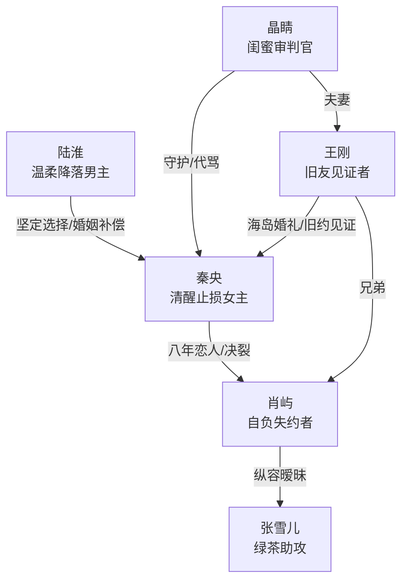

# 角色标签图谱

## 角色清单

### 秦央 — 清醒止损型女主
- 叙事功能: 承受失约、完成转身、提供读者代入与情绪补偿。
- 核心标签: 八年等待、守约、清醒离开
- 弧光: 期待肖屿兑现承诺 → 一次次失望 → 独自告别 → 接受陆淮并获得新生
- 台词风格: 克制、短句、体面告别
- 关键行为: 拦住晶睛、收拾东西、机场说再也不见、赴海岛结婚、劝肖屿放下
- 读者情绪关系: 前半心疼，后半替她松一口气并获得补偿性爽感

### 肖屿 — 自负迟钝型失约者
- 叙事功能: 制造情绪债，承担火葬场惩罚。
- 核心标签: 温柔表象、自我中心、迟来后悔
- 弧光: 轻慢秦央 → 纵容女助理 → 逃避婚礼 → 笃定秦央会等 → 亲眼失去 → 永久困住
- 台词风格: 解释合理、轻描淡写、后期破碎重复
- 关键行为: 送出旅游券、拒绝共同婚礼、陪张雪儿出差与考核、拉黑秦央、接机崩溃、写信等待
- 读者情绪关系: 前半恨，后半看其无能为力获得火葬场爽感

### 陆淮 — 温柔降落型补偿男主
- 叙事功能: 补偿肖屿欠下的承诺，证明秦央值得被坚定选择。
- 核心标签: 青梅竹马、机长、稳定奔赴
- 弧光: 默默喜欢 → 袒露心意 → 陪秦央完成婚礼 → 建立海岛家庭
- 台词风格: 温柔、有职业隐喻、情绪稳定
- 关键行为: 陪看场地、拍星星、机场护住秦央、为她披披肩、辞去繁忙航线
- 读者情绪关系: 安心、补偿、替女主被珍惜的满足

### 张雪儿 — 绿茶助攻型女配
- 叙事功能: 外部诱因，放大肖屿的轻慢与摇摆。
- 核心标签: 年轻撒娇、越界试探、装无辜
- 弧光: 公开收券 → 邀约同行 → 出差贴近 → 拦下肖屿 → 被肖屿疏远
- 台词风格: 甜腻、示弱、半撒娇半胁迫
- 关键行为: 当众邀肖屿同行、坐副驾、睡衣敲门、哭求陪考、接机同行
- 读者情绪关系: 厌烦，但真正恨点仍落在肖屿的选择上

### 晶睛 — 闺蜜审判官
- 叙事功能: 替读者骂出憋屈，守护女主转身。
- 核心标签: 护短、暴脾气、清醒
- 弧光: 帮秦央助攻 → 愤怒护友 → 担心秦央赌气 → 确认她幸福 → 当众审判肖屿
- 台词风格: 直接、火爆、口语化
- 关键行为: 年会质问、让王刚助攻、阻止王刚劝和、机场痛骂肖屿
- 读者情绪关系: 代嘴、解气、可靠

### 王刚 — 旧友见证者
- 叙事功能: 连接旧约与现实婚礼，提供男性友谊侧的尴尬与证词。
- 核心标签: 好兄弟、婚礼发起者、迟疑见证
- 弧光: 公开助攻 → 想劝秦央再给机会 → 接受陆淮 → 对肖屿叹息
- 台词风格: 玩笑中带真诚
- 关键行为: 台上邀请肖屿、举办海岛婚礼、向肖屿传递秦央后续生活碎片
- 读者情绪关系: 中性偏正，见证肖屿错失

## 关系网络

## 角色功能对照表（供改编参考）

| 原角色 | 极致标签 | 叙事功能 | 读者情绪功能 | 改编时必须保留的 |
|--------|---------|---------|-------------|---------------|
| 秦央 | 清醒止损型女主 | 从受伤者到新生活拥有者 | 心疼、代入、解脱 | 多次给机会后才离开，不可写成冲动报复 |
| 肖屿 | 自负迟钝失约者 | 欠债与受罚主体 | 恨、爽、后期冷眼旁观 | 每次关键节点都选错 |
| 陆淮 | 温柔降落型补偿男主 | 偿还承诺与陪伴债 | 安心、补偿 | 行动比甜言蜜语更重 |
| 张雪儿 | 绿茶助攻型女配 | 引爆男主轻慢 | 厌烦、助推恨点 | 她越界，男主必须默许 |
| 晶睛 | 闺蜜审判官 | 代读者发声 | 解气 | 机场审判段必须保留等价功能 |
| 王刚 | 旧约见证者 | 见证八年与婚礼 | 惋惜、旁证 | 公开助攻与后续叹息 |
