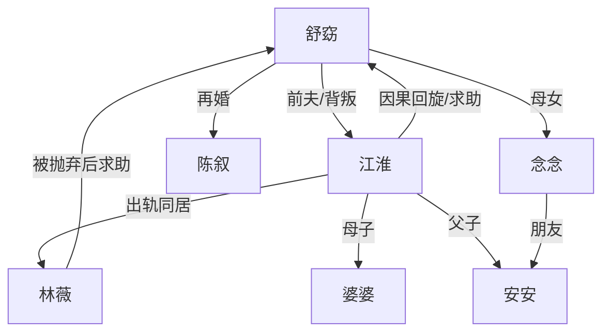

# 角色标签图谱

## 角色清单

### 舒窈 — 清醒自救型原配
- 叙事功能: 第一视角承受背叛并完成切割重建。
- 核心标签: 清醒、边界感、重建力
- 弧光: 被欺骗的妻子 → 坚持离婚的自救者 → 拥有新生活的母亲
- 台词风格: 短句、反问、冷静拒绝
- 关键行为: 拍房产证、捉奸、找律师、离婚、卖房、拒绝小三、拒绝复合
- 读者情绪关系: 心疼、代入、爽、安心

### 江淮 — 自私伪善型丈夫
- 叙事功能: 主要施害者，制造房租骗局与婚外背叛，后期承担因果回旋。
- 核心标签: 自私、伪善、迟来悔恨
- 弧光: 温柔丈夫假象 → 出轨骗子 → 失去后悔者 → 被背叛的单亲父亲
- 台词风格: 哀求与推责交替，后期自责
- 关键行为: 隐瞒房产、收妻子房租、养小三、拒绝离婚、后来被出轨
- 读者情绪关系: 恨、恶心、后期复杂但不洗白

### 林薇 — 挑衅型小三
- 叙事功能: 将婚姻背叛具象化，负责二次羞辱女主。
- 核心标签: 年轻、炫耀、利己
- 弧光: 得意占位者 → 被抛弃者 → 低位求助者 → 道歉路人
- 台词风格: 前期娇柔挑衅，后期求饶怨恨
- 关键行为: 挽住江淮、炫耀房子和房租、上门借钱、后来短信道歉
- 读者情绪关系: 恨、痛快、轻度释然

### 婆婆 — 传统母亲/软性压力源
- 叙事功能: 一边给女主情感慰藉，一边代表“劝忍”的传统家庭观。
- 核心标签: 愧疚、传统、心软
- 弧光: 好婆婆 → 劝和压力 → 接受离婚
- 台词风格: 哭诉、劝说、道歉
- 关键行为: 劝女主回来、说“没有哪个男人不出轨”、给十万补偿
- 读者情绪关系: 复杂、轻微反感、可理解

### 陈叙 — 坦诚修复型伴侣
- 叙事功能: 承接女主重建后的情感补偿，证明新关系可以建立在坦诚上。
- 核心标签: 稳定、坦诚、边界成熟
- 弧光: 合作对象 → 伴侣 → 丈夫与父亲
- 台词风格: 平实、真诚、不夸口
- 关键行为: 接纳女主过去、陪她去医院帮安安、尊重她与旧人的边界
- 读者情绪关系: 安心、补偿、治愈

### 安安/念念 — 后半段伦理缓冲
- 叙事功能: 让旧关系从爱情纠葛转为成年人边界内的孩子互助。
- 核心标签: 无辜、连接、未来
- 弧光: 新生活里的孩子 → 旧人与新人之间的温和连接
- 台词风格: 童真、简单
- 关键行为: 公园相识、急病求助、成为朋友
- 读者情绪关系: 柔软、缓和、希望

## 关系网络

## 角色功能对照表（供改编参考）

| 原角色 | 极致标签 | 叙事功能 | 读者情绪功能 | 改编时必须保留的 |
|--------|---------|---------|-------------|---------------|
| 舒窈 | 清醒原配 | 承受背叛并自救 | 心疼、爽感、代入 | 不原谅、不纠缠、保留边界 |
| 江淮 | 伪善丈夫 | 施害与被反噬 | 恨点、回旋爽点 | 欺骗必须具体，后期报应同构 |
| 林薇 | 挑衅小三 | 二次羞辱与低位反转 | 恨、痛快 | 必须亲口炫耀不义所得 |
| 婆婆 | 劝忍长辈 | 传统压力 | 憋屈、复杂 | “为你好”的软压迫 |
| 陈叙 | 坦诚新伴侣 | 情感补偿 | 安心 | 不霸总化，重在坦诚 |
