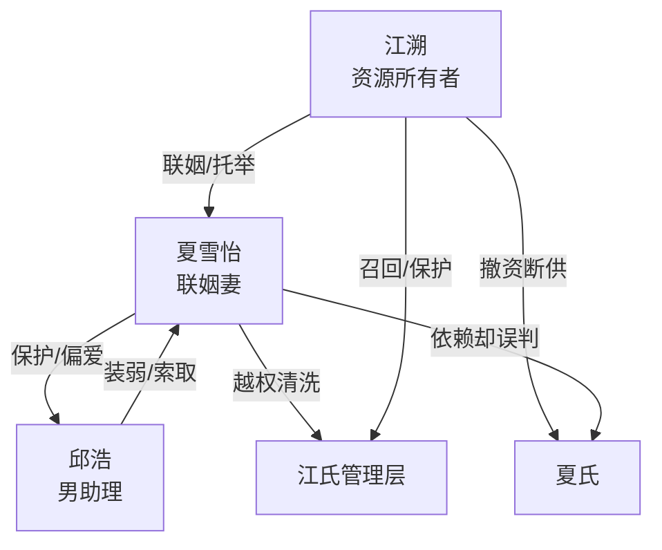

# 角色标签图谱

## 角色清单

### 江溯 — 冷酷权贵裁决者

- 叙事功能: 第一人称主角、资源所有者、清算执行人。
- 核心标签: 权贵、冷酷、边界感执法者
- 弧光: 容忍观察 → 三次警告 → 撤婚撤职 → 资本清算
- 台词风格: 短句、反问、命令式
- 关键行为: 逼喝茅台、索赔两千万、撤销任命、离婚撤职、冻结副卡、撤资断供
- 读者情绪关系: 爽感投射对象，但狠度存在争议风险

### 夏雪怡 — 越界联姻妻/伪清醒总裁

- 叙事功能: 背叛者、越界者、被清算对象。
- 核心标签: 装懂事、恋爱脑、忘本
- 弧光: 体面妻子 → 护短越界 → 公司夺权 → 官宣挑衅 → 资源坍塌
- 台词风格: 前期温柔解释，后期情绪化质问
- 关键行为: 给邱浩挡酒、借庄园、保邱浩职位、开除旧管理层、任命邱浩、签字离婚、抢表
- 读者情绪关系: 恨点核心，后期轻微狼狈但主要承担报应

### 邱浩 — 绿茶小白脸/装弱引爆器

- 叙事功能: 挑拨器、妻子越界的试金石。
- 核心标签: 装弱、贪婪、低位索取
- 弧光: 男助理 → 被保护对象 → 副总裁幻想 → 专柜翻车
- 台词风格: 道歉、退让、自贬、以退为进
- 关键行为: 戴项链、让夏雪怡挡酒、占庄园、装自杀、接受副总裁、晒表
- 读者情绪关系: 恶心、厌烦、期待被打脸

### 江氏管理层 — 秩序见证人

- 叙事功能: 见证男主权力与夏雪怡越权。
- 核心标签: 旧臣、专业、被误伤者
- 弧光: 被开除 → 被召回 → 见证清洗
- 台词风格: 简短汇报
- 关键行为: 汇报邱浩失误、离职电话、被召回会议
- 读者情绪关系: 强化“夏雪怡乱权”的证据

## 关系网络

## 角色功能对照表（供改编参考）

| 原角色 | 极致标签 | 叙事功能 | 读者情绪功能 | 改编时必须保留的 |
|--------|---------|---------|-------------|---------------|
| 江溯 | 冷酷权贵裁决者 | 资源撤回与终局清算 | 爽感、威慑 | 三次机会、资源归属、终局揭底 |
| 夏雪怡 | 越界联姻妻 | 反复越界、忘本 | 恨点、报应期待 | 护短外人、滥用主角资源、自以为能独立 |
| 邱浩 | 绿茶小白脸 | 引诱反派暴露站队 | 恶心、打脸期待 | 装弱台词、以退为进、贪婪升级 |
| 管理层 | 秩序见证人 | 证明公司权力归属 | 辅助爽感 | 被错误清洗后由主角召回 |
