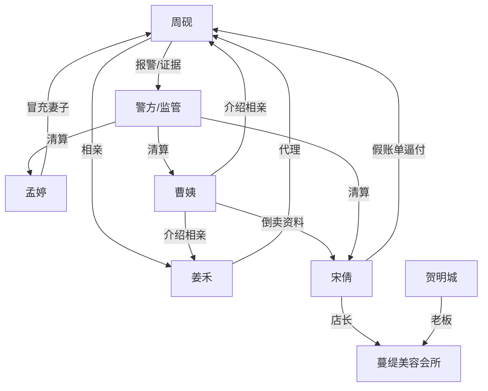

# 角色标签图谱

## 角色清单

### 周砚 — 清醒证据型男主
- 叙事功能: 被压迫者、反杀执行者、价值观输出者。
- 核心标签: 未婚、开公司、体面但不怂。
- 弧光: 被当众羞辱 → 冷静留证 → 揭开黑产 → 守住名誉与边界。
- 台词风格: 短句、反问、证据列举。
- 关键行为: 报警、录像、查门锁记录、公开澄清、拒绝谅解。
- 读者情绪关系: 心疼、代入、爽。

### 姜禾 — 证据型律师女主
- 叙事功能: 证人、专业援助、感情补偿线。
- 核心标签: 律师、冷静、看证据。
- 弧光: 相亲旁观者 → 同场受害者 → 代理律师 → 真正伴侣。
- 台词风格: 平静、精准、法务清单式。
- 关键行为: 要求证据、录像、证据保全、改道歉声明、代理诉讼。
- 读者情绪关系: 安全感、欣赏、甜爽。

### 宋倩 — 职业逼单恶女
- 叙事功能: 主要压迫者、骗局执行者。
- 核心标签: 店长、话术高手、贪婪。
- 弧光: 当众控场 → 堵门威胁 → 证据崩盘 → 刑事处罚。
- 台词风格: 道德绑架、抬高音量、虚假弱者化。
- 关键行为: 制作假账单、派人堵门、威胁直播、使用私人收款码。
- 读者情绪关系: 恨、厌恶、期待报应。

### 孟婷 — 假妻子工具人
- 叙事功能: 谎言增强器、电话信息差制造者。
- 核心标签: 冒充、怂、配合诈骗。
- 弧光: 电话里强势骂人 → 现场露馅 → 推锅认罪。
- 台词风格: 熟人式指责、转移话题。
- 关键行为: 冒充妻子、配合电话确认、谎称在周砚家。
- 读者情绪关系: 厌恶、嘲讽。

### 曹姨/曹秀兰 — 熟人背刺型信息贩子
- 叙事功能: 黑产源头、亲友信任崩塌点。
- 核心标签: 热心婚介、贪小利、卖资料。
- 弧光: 邻里介绍人 → 资料泄露源 → 刑事处罚。
- 台词风格: 哭诉、求情、装糊涂。
- 关键行为: 打包出售相亲资料、求男主谅解。
- 读者情绪关系: 恶心、愤怒。

### 贺明城 — 失控老板
- 叙事功能: 机构责任承载者。
- 核心标签: 品牌老板、甩锅、被迫道歉。
- 弧光: 声称不知情 → 被要求公开道歉 → 店铺倒闭。
- 台词风格: 商务道歉、试图降损。
- 关键行为: 提赔偿方案、发布声明、配合调查。
- 读者情绪关系: 不信任、冷眼旁观。

## 关系网络

## 角色功能对照表（供改编参考）

| 原角色 | 极致标签 | 叙事功能 | 读者情绪功能 | 改编时必须保留的 |
|--------|---------|---------|-------------|---------------|
| 周砚 | 清醒证据型男主 | 被害与反杀 | 代入、爽 | 不怕丢脸、主动留证、合法反杀 |
| 姜禾 | 证据型律师女主 | 专业辅助与甜爽补偿 | 安全感、欣赏 | 第一次见面但站证据，不盲信男主 |
| 宋倩 | 职业逼单恶女 | 压迫与骗局执行 | 恨、期待报应 | 当众羞辱、堵门威胁、私人码 |
| 孟婷 | 假身份工具人 | 信息差强化 | 嘲讽、厌恶 | 能说公开资料，答不上现场细节 |
| 曹姨 | 熟人背刺信息贩子 | 黑产源头 | 愤怒、寒意 | 熟人信任被售卖，价格低廉刺痛 |
| 贺明城 | 机构责任人 | 社会层清算 | 冷眼、补偿 | 不能一句个人行为免责 |
