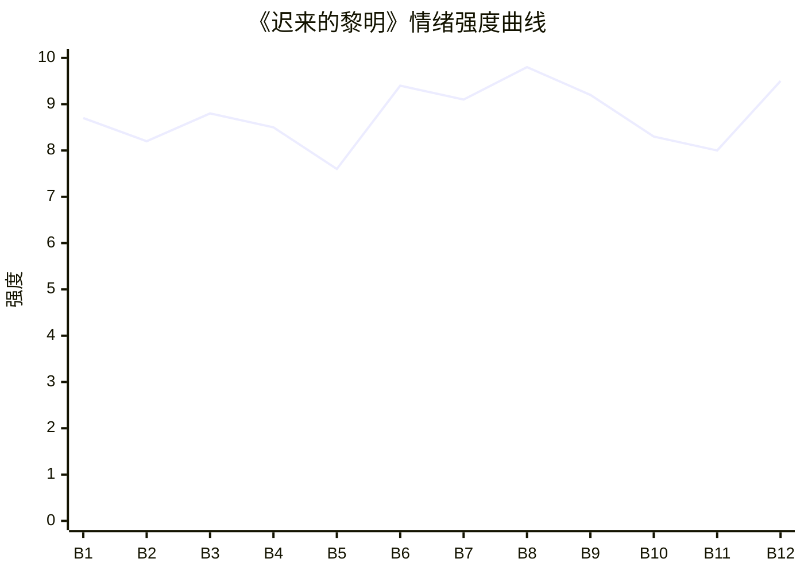

# Beat Sheet 节拍器

## 全文概况

- 总字数: 约 14500 字
- 节拍数: 12 幕
- 核心母题（Logline）: 缉毒警向辰死后被污为叛徒，灵魂旁观前未婚妻陈青禾一步步发现真相，清算真正叛徒林默，最终陈青禾继承他的遗愿牺牲在黎明前。
- 情绪模式: 极致冤屈 → 误解加深 → 证据逼近 → 真相爆炸 → 血债清算 → 精神继承
- 主导 Hook: H1 倒叙冲突式，强度 8.6/10
- 主导反转机制: M4 灵魂线视角、M5 温度反转曲线、M6 多层递进反转、M3 因果回旋反讽

## 节拍详表

### Beat 1: 女毒枭供出“叛徒已死” [开篇-审讯室门被推开]
- **字数**: 约 900 字（占比 6.2%）
- **核心事件**: 女毒枭被捕后告诉陈青禾，向辰并非叛徒，而是被虐杀在边境铁丝网上。
- **情绪标签**: 震惊、残忍、疑云
- **情绪强度**: 8.7/10
- **情绪方向**: ⚡突变
- **冲突类型**: 大转折
- **悬念钩子**: 向辰到底是叛徒，还是被人坐实叛徒名声的牺牲者？
- **叙事速度**: 快
- **对话占比**: 65%
- **reversal_mechanism**: [M4, M6]
- **hook_strength**: 8.6/10（极端度 2.8/3，信息密度 2.6/3，悬念 1.7/2，节奏 1.5/2）
- **关键句**: “天亮时，人已经硬了。”
- **原文摘录**: 边境围剿行动收网，轰动全国的女毒枭终落网。审讯室里，陈青禾穿着警服坐在她对面，反复追问同一个名字。“那个叛徒向辰，现在到底在哪？”女毒枭说他们把向辰绑在铁架上，殴打、注射毒品、敲碎膝盖和脚踝，最后铐在边境铁丝网上。陈青禾摔文件否认，坚称监控拍到向辰传递情报、掩护毒贩撤离。女毒枭大笑，指出真正递消息的人是向辰救下的人质，条件是带走向辰，坐实叛徒名声，好接手他的老婆。

### Beat 2: 林默登场并完成伪装加固 [林默冲入-陈青禾拒信]
- **字数**: 约 1100 字（占比 7.6%）
- **核心事件**: 林默以受害者姿态冲进审讯室，借父母惨死身份洗白自己，陈青禾和警员集体站队他。
- **情绪标签**: 憋屈、被蒙蔽、愤怒
- **情绪强度**: 8.2/10
- **情绪方向**: ↑上升
- **冲突类型**: 微冲突
- **悬念钩子**: 林默的悲痛是真实，还是表演？
- **叙事速度**: 快
- **对话占比**: 70%
- **reversal_mechanism**: [M6]
- **hook_strength**: null
- **关键句**: “这种挑拨，太低级了。”
- **原文摘录**: 林默冲进来追问辰哥下落，看到女毒枭后红眼扑上去，喊着还他爸妈命。陈青禾拽住他，并用他的仇恨反证他不可能与毒贩同谋。林默难以置信地说自己怎么可能害辰哥，警员们也说阿默是什么样的人大家都清楚，反倒认定向辰最会拿捏人心。向辰的灵魂站在角落，意识到自己若真擅长洞察人心，当初就不会看不出林默别有居心。

### Beat 3: 毒枭手机反击，陈青禾二次误判 [手机来电-外勤集合]
- **字数**: 约 1300 字（占比 9.0%）
- **核心事件**: 女毒枭用向辰手机证明酷刑细节，陈青禾却把供述当成向辰藏匿线索。
- **情绪标签**: 心痛、窒息、荒谬
- **情绪强度**: 8.8/10
- **情绪方向**: ↑上升
- **冲突类型**: 大转折
- **悬念钩子**: 陈青禾找到的会是活着的“逃犯”，还是死去的向辰？
- **叙事速度**: 快
- **对话占比**: 45%
- **reversal_mechanism**: [M4, M5]
- **hook_strength**: null
- **关键句**: “因为你每天往这个手机发的语音，真他妈肉麻，正好给我们折磨那个小警察的时候，当背景音乐。”
- **原文摘录**: 陈青禾接起显示“向辰”的来电，开口便质问他为了脱罪装死陷害林默。电话那头传来嬉笑，女毒枭晃着向辰失踪时的手机，说她留着手机，是因为陈青禾每天发来的语音适合做折磨背景音。她详细描述殴打、敲断腿再接上、凌迟和处理尸体，警员头皮发麻，向辰的灵魂也因熟悉的钝痛发抖。陈青禾却笑称故事编得不错，送走林默后命令外勤去边境荒山搜捕向辰。

### Beat 4: 仓库尸骨出现，陈青禾三次否认 [荒山搜查-警服封存]
- **字数**: 约 1300 字（占比 9.0%）
- **核心事件**: 警队在仓库发现酷刑现场、碎骨和向辰警服，陈青禾仍以逻辑推断否认真相。
- **情绪标签**: 惊悚、憋屈、期待真相
- **情绪强度**: 8.5/10
- **情绪方向**: →平稳高压
- **冲突类型**: 大转折
- **悬念钩子**: DNA 检测会否强行击穿陈青禾的心理防线？
- **叙事速度**: 中
- **对话占比**: 35%
- **reversal_mechanism**: [M4, M6]
- **hook_strength**: null
- **关键句**: “这警服也一定是他设的障眼法，我们不能被她蒙蔽！”
- **原文摘录**: 陈青禾带队进入废弃仓库，里面血腥味浓烈，墙上深色血渍、断裂铁链、生锈钝器显示有人遭受非人虐待。队员发现一堆高度碎裂的骨头，旁边是褪色警服和向辰警号。有人问犯人说的是不是真的，陈青禾立刻否认，称尸骨死了两年以上，而一年前仍有人熟悉警方战术地避开布控，所以那人一定是向辰。她命令送检 DNA，继续扩大搜索。

### Beat 5: 爱情闪回与林默种因 [抽烟-任务前夜]
- **字数**: 约 2100 字（占比 14.5%）
- **核心事件**: 向辰回忆与陈青禾相识相爱、救下林默并接纳他，铺垫林默背叛的恶性。
- **情绪标签**: 温暖、酸涩、预痛
- **情绪强度**: 7.6/10
- **情绪方向**: ↓下降后蓄力
- **冲突类型**: 微冲突
- **悬念钩子**: 林默从被救者变成背叛者的动机是什么？
- **叙事速度**: 慢
- **对话占比**: 35%
- **reversal_mechanism**: [M5]
- **hook_strength**: null
- **关键句**: “但我从没想过，这只看似温顺的小猫，会在暗地里磨尖了爪子。”
- **原文摘录**: 陈青禾靠在警车旁抽烟，向辰想起两人警校演练初见，她夸他战术头脑该来刑侦，后来递水、陪练、送药膏，被他在训练场角落问是不是喜欢。毕业后他们成了警队金童玉女。劫持案中林默父母死亡，向辰救了林默并负伤，将林默带回家照顾，教他格斗，陈青禾也帮他联系心理医生。婚期前一个月，行动前夜林默端来热牛奶，向辰没多想一饮而尽。

### Beat 6: 向辰死亡真相完整揭开 [任务失控-天亮了]
- **字数**: 约 1500 字（占比 10.3%）
- **核心事件**: 回忆揭示林默下药、泄密、害死向辰父母和兄弟，向辰用假情报换取毒贩势力重创，最终被杀。
- **情绪标签**: 极痛、敬意、愤怒
- **情绪强度**: 9.4/10
- **情绪方向**: ↑上升
- **冲突类型**: 大转折
- **悬念钩子**: 陈青禾何时看到真相？
- **叙事速度**: 快
- **对话占比**: 40%
- **reversal_mechanism**: [M4, M3, M6]
- **hook_strength**: null
- **关键句**: “我用我这条命，换了他们大半势力覆灭，这是我唯一能做的事。”
- **原文摘录**: 向辰行动当天头晕失力，醒来后一切无可挽回。他在囚禁中听见林默和女毒枭通话，林默怨恨向辰救他，要求向辰好人做到底给他一个家，并承认害死向辰父母、传递警方消息，只要向辰不出现打扰他和陈青禾结婚生子。向辰之后交代第一条假消息，令毒贩损失惨重，遭受更残酷报复，铁链勒断肋骨，钝器砸碎四肢，最后一锤穿心，被铐在铁丝网上，没有撑过天亮。

### Beat 7: U盘录音爆破，林默身份反转 [DNA消息-U盘最早录音]
- **字数**: 约 1200 字（占比 8.3%）
- **核心事件**: 仓库 U盘播放录音，证明林默下药、泄密、制造向辰叛徒假象。
- **情绪标签**: 震惊、痛快、崩塌前夜
- **情绪强度**: 9.1/10
- **情绪方向**: ⚡突变
- **冲突类型**: 大转折
- **悬念钩子**: DNA 报告是否会确认尸骨就是向辰？
- **叙事速度**: 快
- **对话占比**: 55%
- **reversal_mechanism**: [M6, M3]
- **hook_strength**: null
- **关键句**: “放心，我已经在向辰的牛奶里下了药。”
- **原文摘录**: 队员找到藏在石缝里的 U盘，警员猜测可能是向辰藏的犯罪证据。陈青禾表示若真有犯罪证据绝不姑息。技术部打开文件夹，里面有上百条录音，按日期排列，正好覆盖向辰失踪后三年。最早录音里，林默确认明天行动，并说已在向辰牛奶里下药，让毒贩按计划伪装成向辰泄露消息、掩护撤离，还要求处理干净警队的人，多补几枪，别留活口。

### Beat 8: DNA与视频真相击穿陈青禾 [DNA确认-最终章视频]
- **字数**: 约 1900 字（占比 13.1%）
- **核心事件**: DNA 确认死者是向辰，酷刑视频证明他至死未泄密，陈青禾彻底崩溃并为他正名。
- **情绪标签**: 爆哭、悔恨、迟来正义
- **情绪强度**: 9.8/10
- **情绪方向**: ↑冲顶
- **冲突类型**: 大转折
- **悬念钩子**: 陈青禾将如何清算林默？
- **叙事速度**: 中快
- **对话占比**: 35%
- **reversal_mechanism**: [M4, M5, M6]
- **hook_strength**: null
- **关键句**: “他不是叛徒，他是英雄，是我们对不起他，错怪了他三年。”
- **原文摘录**: 录音继续揭露林默三年里偷取陈青禾处的布控、路线和队员信息。陈青禾想起尸骨和未读 DNA 报告，点开后确认送检尸骨与向辰 DNA 相似度 99.99%。随后她打开视频，看见向辰被绑在铁椅上，铁链勒脖、钝器砸四肢、烟头烫皮肤，却没有求饶也没有泄露半句警方内幕。最终章里，向辰被毒贩质问为何给假情报，他啐血反击，说正义永不会缺席。视频结束，年轻警员哽咽地说向辰不是叛徒，是英雄。

### Beat 9: 林默家庭清算与小产死局 [回家-报警]
- **字数**: 约 1800 字（占比 12.4%）
- **核心事件**: 陈青禾回家揭穿林默，林默试图用怀孕绑架她，孩子意外流产后威胁彻底失效。
- **情绪标签**: 痛快、残酷、疯感
- **情绪强度**: 9.2/10
- **情绪方向**: ↓偿还
- **冲突类型**: 大转折
- **悬念钩子**: 林默会受到怎样的法律惩罚？
- **叙事速度**: 快
- **对话占比**: 60%
- **reversal_mechanism**: [M3, M5]
- **hook_strength**: null
- **关键句**: “孩子没了，你还有什么能威胁我的？”
- **原文摘录**: 陈青禾回家，看见林默炖汤装作温柔丈夫。她说找到向辰了，林默假装惊喜并称要向辰解释误会。陈青禾摔勺怒斥他下药、泄密、害死师父师母和十几个兄弟。林默求饶说只是太爱她，嫉妒向辰能拥有她。陈青禾要拖他走时，林默拿出 B超单说她怀了自己的孩子，劝她帮自己瞒住。陈青禾冷笑，认为孩子比不上枉死兄弟、师父师母、阿辰三年折磨和冤屈。拉扯间她撞到桌角小产，随后平静报警。

### Beat 10: 烈士归位与法律清算 [葬礼-判决]
- **字数**: 约 1300 字（占比 9.0%）
- **核心事件**: 向辰被安葬为烈士，林默和女毒枭被判死刑，陈青禾被开除公职承担责任。
- **情绪标签**: 安慰、悲怆、迟来的补偿
- **情绪强度**: 8.3/10
- **情绪方向**: ↓回落
- **冲突类型**: 微冲突
- **悬念钩子**: 陈青禾被开除后会如何赎罪？
- **叙事速度**: 中
- **对话占比**: 15%
- **reversal_mechanism**: [M5]
- **hook_strength**: null
- **关键句**: “我终于回家了。”
- **原文摘录**: 一周后，向辰葬礼在烈士墓园举行，细雨绵绵，全省公安干警到场，墓碑刻着“烈士向辰之墓”。他被安放在父亲墓旁，警员们整齐敬礼。葬礼结束后陈青禾坐在墓前说起过去和悔恨。法院判决林默因故意杀人罪、泄露国家机密罪数罪并罚死刑，因精神失常暂缓执行；女毒枭多罪并罚死刑立即执行。陈青禾因林默泄露的消息来自她，负不可推卸责任，被警局开除。

### Beat 11: 陈青禾成为“辰光”卧底 [开除后-两年卧底]
- **字数**: 约 1100 字（占比 7.6%）
- **核心事件**: 陈青禾没有真正离开警队，而是成为代号“辰光”的卧底，带着向辰遗愿继续缉毒。
- **情绪标签**: 赎罪、紧张、宿命感
- **情绪强度**: 8.0/10
- **情绪方向**: ↑再起
- **冲突类型**: 微冲突
- **悬念钩子**: 她会否重复向辰的命运？
- **叙事速度**: 中
- **对话占比**: 10%
- **reversal_mechanism**: [M5, M3]
- **hook_strength**: null
- **关键句**: “她主动申请，成为了一名卧底警察，代号‘辰光’。”
- **原文摘录**: 所有人都为陈青禾被开除惋惜，她却淡淡一笑，因为这是她应得的惩罚。但没有人知道，她主动申请成为卧底警察，代号“辰光”。她潜入另一个跨国毒贩集团，学抽烟、说脏话，用冷漠眼神应对试探，把曾经的刑侦队长藏进骨血，伪装成唯利是图的亡命之徒。她一边偷拍、录音、记录交易网络，一边加密传回警局，惊心动魄地走了两年。

### Beat 12: 同等酷刑与迟来的黎明 [身份暴露-结尾]
- **字数**: 约 1000 字（占比 6.9%）
- **核心事件**: 陈青禾身份暴露，被施以与向辰相似酷刑，至死不吐露情报，最后看见阳光说“天亮了”。
- **情绪标签**: 殉道、释然、余痛
- **情绪强度**: 9.5/10
- **情绪方向**: ⚡升华
- **冲突类型**: 大转折
- **悬念钩子**: 收束，无外部悬念，留下精神余韵。
- **叙事速度**: 中
- **对话占比**: 30%
- **reversal_mechanism**: [M3, M5]
- **hook_strength**: null
- **关键句**: “阿辰，天亮了……”
- **原文摘录**: 两年后的雨夜，陈青禾身份暴露，被铁链锁在铁椅上，和向辰当年一模一样。毒贩给她注射毒品，逼问警方卧底联络点。毒瘾发作时，她用额头撞铁椅强行清醒，棍棒、皮带、铁锤轮番上阵，她却半个字都没吐。她缓缓睁眼，嘴角淌血，扯出像极了向辰的轻蔑笑，说“你们……输定了。”生命最后，一缕阳光照在她脸上，她想起两人初入警局时在国徽前宣誓，最后看着阳光说：“阿辰，天亮了……”

## 情绪曲线可视化

## 节拍密度检测

- 平均每 1208 字一个节拍
- 微冲突密度: 每 2900 字一次
- 大转折密度: 每 1450 字一次
- 判定: 符合高频节拍器标准；强转折略密，适合短篇虐爽平台阅读。

## 反转机制清单(Reversal Mechanisms)

| 机制 ID | 机制名 | 承载 Beat | 关键段落/金句 | 等价改编提示 |
|--------|--------|-----------|--------------|-------------|
| M4 | 灵魂线视角 | Beat 2-12 | “我站在角落，心里说不出什么滋味。” | 死亡必须前置，灵魂贴近施害者与误判者旁观，保留只有死者知道的信息差炸弹。 |
| M5 | 温度反转曲线 | Beat 5, 8, 10-12 | “注意安全，一定要完完整整地回来做我的新郎。” / “阿辰，天亮了……” | 必须显式写出曾经相爱，再写归零误判，最后让失去不可逆并以极端赎罪落底。 |
| M6 | 多层递进反转 | Beat 1, 4, 7, 8 | 女毒枭口供、警服尸骨、U盘录音、DNA视频逐层推翻“叛徒”判断 | 反转层数不能少，每层从口供到物证到铁证到价值正名，量级递增。 |
| M3 | 因果回旋反讽 | Beat 6, 9, 12 | 向辰被酷刑守密，陈青禾最终同样被酷刑守密；“天亮时，人已经硬了”回旋为“阿辰，天亮了” | 必须保留施害/牺牲动作的镜像与结尾回旋金句，句式和意象重复度要高。 |
