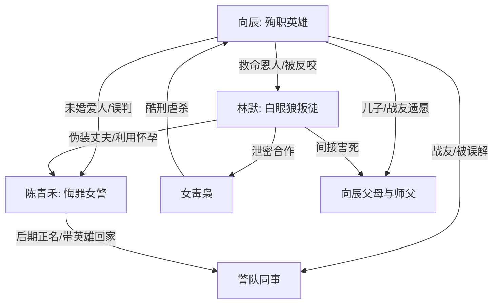

# 角色标签图谱

## 角色清单

### 向辰 — 被污名的殉职英雄
- 叙事功能: 第一人称灵魂视角、最大情绪债承载者、迟来正义的中心。
- 核心标签: 缉毒警、忠诚、被误解三年
- 弧光: 爱人和警队骨干 → 被污为叛徒 → 死后正名为烈士
- 台词风格: 克制、硬气、信仰感强
- 关键行为: 救林默、执行收网、被囚后给假情报、至死不泄密
- 读者情绪关系: 心疼、敬意、替他不平，期待他被正名

### 陈青禾 — 迟来醒悟的悔罪女警
- 叙事功能: 误判制造者、真相接收者、清算执行者、遗愿继承者。
- 核心标签: 冷静刑警、被洗脑爱人、赎罪卧底
- 弧光: 深爱向辰 → 坚信他背叛 → 被证据击穿 → 牺牲赎罪
- 台词风格: 前期铿锵审判式，后期破碎悔恨，结尾悲壮克制
- 关键行为: 拒信毒枭、带队搜仓库、打开录音视频、抓林默、成为“辰光”
- 读者情绪关系: 前期恨其眼盲，后期看她痛苦偿还，最终复杂心疼

### 林默 — 白眼狼绿茶叛徒
- 叙事功能: 主反派，承担背叛、夺爱、泄密、杀亲、污名化全部恨点。
- 核心标签: 被救者反咬、伪装受害者、极端占有欲
- 弧光: 可怜遗孤 → 温顺弟弟 → 真凶暴露 → 精神崩溃等死
- 台词风格: 前期柔弱无辜，真相中阴狠刺骨，清算时求饶卖惨
- 关键行为: 给牛奶下药、泄露布控、害死向辰父母、坐实叛徒名声、用孩子威胁陈青禾
- 读者情绪关系: 高强度厌恶，期待被揭穿和重判

### 女毒枭 — 残忍真相投放者
- 叙事功能: 开篇 Hook 触发器、真相提示者、酷刑叙述者。
- 核心标签: 残忍、戏谑、掌握真相
- 弧光: 被捕毒枭 → 抖出真相 → 死刑清算
- 台词风格: 玩味、恶毒、细节残忍
- 关键行为: 供述向辰死状、展示手机、描述酷刑
- 读者情绪关系: 恨，但她的信息让读者追真相

### 警队同事 — 集体误判与集体正名者
- 叙事功能: 放大舆论误判，后期提供迟来承认和烈士仪式感。
- 核心标签: 被蒙蔽、纪律性、迟来愧疚
- 弧光: 认定向辰叛徒 → 录音视频后沉默 → 为英雄敬礼
- 台词风格: 前期笃定，后期哽咽
- 关键行为: 安抚林默、质疑尸骨、播放证据、葬礼敬礼
- 读者情绪关系: 前期憋屈，后期获得群体正名补偿

### 向辰父母/师父师母 — 被牵连的伦理重债
- 叙事功能: 加重林默罪孽，扩大向辰被害的代价。
- 核心标签: 家庭温度、师承责任、无辜枉死
- 弧光: 祝福婚事/接纳林默 → 被害或气死 → 墓旁团圆
- 台词风格: 温暖朴实
- 关键行为: 父亲托付陈青禾，母亲照顾林默
- 读者情绪关系: 心疼，强化清算正当性

## 关系网络

## 角色功能对照表（供改编参考）

| 原角色 | 极致标签 | 叙事功能 | 读者情绪功能 | 改编时必须保留的 |
|--------|---------|---------|-------------|---------------|
| 向辰 | 被污名的殉职英雄 | 承载冤屈与信仰 | 心疼、敬意 | 至死守密、死后旁观、最终正名 |
| 陈青禾 | 迟来醒悟的悔罪女警 | 误判与赎罪 | 前恨后痛 | 曾深爱、长期误判、证据击穿、以命赎罪 |
| 林默 | 白眼狼绿茶叛徒 | 主反派 | 恨与清算期待 | 被救反咬、夺爱、泄密、伪装受害 |
| 女毒枭 | 残忍真相投放者 | Hook 与证据导火索 | 惊悚、厌恶 | 用残忍细节说出真相 |
| 警队同事 | 集体误判者 | 舆论与仪式 | 憋屈、补偿 | 前期错信、后期公开正名 |
