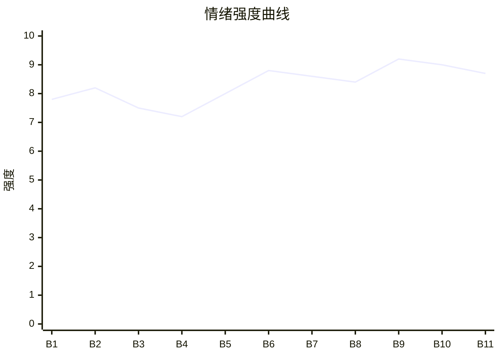

# Beat Sheet 节拍器

## 全文概况

- 总字数: 约 12000 字
- 节拍数: 11 幕
- 核心母题（Logline）: 一个长期低价补贴朋友的隐藏大佬妆娘，被新人和旧友以“杀熟”名义赶走后，借专业实力、市场对比和身份曝光完成价值反杀，最终拒绝回头友情。
- 情绪模式: 友情背刺 → 克制退出 → 劣质翻车 → 专业对照 → 舆论清算 → 官方加冕 → 永久断联

## 节拍详表

### Beat 1: 低价妆娘被新人公开质疑 [开篇-1节前半]
- **字数**: 约 950 字（占比 8%）
- **核心事件**: 许念念在群里质疑“我”两百妆造杀熟，并提出一百五接手。
- **情绪标签**: 震惊、憋屈、冷静
- **情绪强度**: 7.8/10
- **情绪方向**: ⚡突变
- **冲突类型**: 大转折
- **悬念钩子**: “我”为什么松了一口气？两百到底贵不贵？
- **叙事速度**: 快
- **对话占比**: 55%
- **reversal_mechanism**: [M3]
- **hook_strength**: 8.5/10（极端度 2.2，信息密度 2.7，悬念 1.8，节奏 1.8）
- **关键句**: “她不知道，这种往里倒贴钱做妆造的日子，我早就受够了。”
- **原文摘录**: 三年来，“我”一直低价给朋友做妆造毛发。新人许念念质疑“一个人的妆造要两百块”，说闲鱼“一百五顶天”，提出以后由她负责。“我”盯着屏幕，反而松了口气，因为倒贴钱的日子早就受够了。进入漫展筹备期后，她继续在群里问费用明细，暗示“我”高价杀熟。

### Beat 2: 群体背刺与被踢出云五 [1节后半]
- **字数**: 约 1200 字（占比 10%）
- **核心事件**: 群主带头支持许念念，众人换人，“我”被要求交出物料并退出固定角色。
- **情绪标签**: 背叛、羞辱、冷却
- **情绪强度**: 8.2/10
- **情绪方向**: ↓下降
- **冲突类型**: 大转折
- **悬念钩子**: “我”为什么不解释成本？
- **叙事速度**: 中
- **对话占比**: 45%
- **reversal_mechanism**: [M3, M5]
- **hook_strength**: null
- **关键句**: “这种场合下解释，等于把尊严摊在桌上让人挑挑拣拣。”
- **原文摘录**: 群主说“原来一直被多收钱”，其他人跟着换许念念，还说“下次一定”。“我”回忆三年里通宵排毛、烫伤手指、贴钱买材料，明白两百只是基础材料费。群主私聊要求重新核算成本，随后在群里让“我”把手里物料发给念念，还把“我”踢出云五。

### Beat 3: 拆掉旧物料，隐藏大号露出 [2节]
- **字数**: 约 1300 字（占比 11%）
- **核心事件**: “我”停止旧单，推材料商给许念念，看她发现成本太贵；随后联系新团队，露出三十万粉丝大号。
- **情绪标签**: 清醒、松绑、期待
- **情绪强度**: 7.5/10
- **情绪方向**: ↑上升
- **冲突类型**: 大转折
- **悬念钩子**: 漫展两拨人相遇会怎样？
- **叙事速度**: 中
- **对话占比**: 35%
- **reversal_mechanism**: [M2, M3]
- **hook_strength**: null
- **关键句**: “音符上，我有个没告诉任何人的自媒体账号。页面顶部显示的id叫棠梨煎雪。三十万粉丝。”
- **原文摘录**: 群里欢腾后，“我”拆掉没做完的白毛头冠，回收材料。许念念一边骂“我”杀熟，一边要材料商资源，看到成本后反咬“我”故意搞她。竹姐来电，懂了旧团队吃惯低价饭。“我”打开隐藏账号“棠梨煎雪”，联系本地另一个 COS 群，对方激动回复“大佬回我了”。

### Beat 4: 低价材料埋雷，小群动摇 [3节]
- **字数**: 约 1050 字（占比 9%）
- **核心事件**: 许念念不断采购廉价货，众人开始怀疑，却仍不公开维护“我”。
- **情绪标签**: 冷眼、讽刺、失望
- **情绪强度**: 7.2/10
- **情绪方向**: →平稳
- **冲突类型**: 微冲突
- **悬念钩子**: 廉价货会在漫展如何爆雷？
- **叙事速度**: 中
- **对话占比**: 42%
- **reversal_mechanism**: [M3]
- **hook_strength**: null
- **关键句**: “她们放弃了什么，我不知道。但是我，放弃了三年以来自我感动的友情。”
- **原文摘录**: 许念念在大群炫耀四十块假发和现成 COS 服，暗讽“我”手工打造费时费力还贵。没有许念念和群主的小群开始吐槽店铺差评，苏落问“我”靠不靠谱。“我”只回“不知道啊，没用过”。许念念又说材料不到一百，剩下五十算手工费，还私聊嘲讽“我”吃回扣。

### Beat 5: 漫展前夜，劣质妆造正式翻车 [4节]
- **字数**: 约 1350 字（占比 11%）
- **核心事件**: 许念念的假发、化妆品、时间表全线暴露问题，旧群疯狂求救。
- **情绪标签**: 预期兑现、冷爽、焦灼
- **情绪强度**: 8.0/10
- **情绪方向**: ↑上升
- **冲突类型**: 大转折
- **悬念钩子**: “我”会不会救她们？
- **叙事速度**: 快
- **对话占比**: 40%
- **reversal_mechanism**: [M3]
- **hook_strength**: null
- **关键句**: “七个人的妆造，九点漫展，她一个人，从七点才开始化。”
- **原文摘录**: 漫展前三天，许念念开箱廉价假发，塑料光和毛躁肉眼可见，却说“P一下就好了”。她展示便宜化妆品，遮瑕膏在手背上推出裂纹。苏落担心过敏，被许念念讽刺“又不是什么大小姐”。前夜许念念安排七点集合、九点入场，“我”凌晨三点去给花卷团队做妆造。旧群美颜照发出后，小群疯狂艾特“救命啊海棠姐”。

### Beat 6: 现场对比，专业价值第一次公开碾压 [5节前半]
- **字数**: 约 1500 字（占比 12%）
- **核心事件**: “我”带花卷团队到场，旧团队妆造惨烈翻车，形成强对比。
- **情绪标签**: 痛快、心酸、对比爽
- **情绪强度**: 8.8/10
- **情绪方向**: ↑上升
- **冲突类型**: 大转折
- **悬念钩子**: 群主看到花卷团队后会怎样？
- **叙事速度**: 快
- **对话占比**: 38%
- **reversal_mechanism**: [M2, M3]
- **hook_strength**: null
- **关键句**: “没有对比就没有伤害。”
- **原文摘录**: 苏落发来歪假发、惨白粉底、死亡芭比粉眼影、过敏起疹的照片。“我”终究心软，只救了苏落。到会场后，许念念拆东墙补西墙，群主顶着塑料发冠和反光假发，脸色铁青。她看到“我”身后精致漂亮的花卷一行人，脸当场绿了。

### Beat 7: 市场价归位，官方机会降临 [5节后半-6节前半]
- **字数**: 约 1250 字（占比 10%）
- **核心事件**: “我”拒绝旧团队求助，花卷团队按市场价包单，官方项目邀约出现。
- **情绪标签**: 释然、扬眉吐气、价值回归
- **情绪强度**: 8.6/10
- **情绪方向**: ↑上升
- **冲突类型**: 大转折
- **悬念钩子**: 旧团队会如何挽回？
- **叙事速度**: 中
- **对话占比**: 45%
- **reversal_mechanism**: [M2, M5]
- **hook_strength**: null
- **关键句**: “是啊，这才是我原本应得的待遇，离开群主她们，外面的世界风和日丽。”
- **原文摘录**: 其他人求“我”重化，“我”以已有工作为由拒绝。花卷团队活动完美结束，提出下次按市场价多两成、一人一千二包单。“我”欣然应允。回家路上，官方项目邀约出现：“星铁官方有线下嘉年华，我推荐你当了造型总监。”

### Beat 8: 舆论挂墙与旧友求回头 [6节后半]
- **字数**: 约 1150 字（占比 10%）
- **核心事件**: 旧团队返图被挂，群主想以三百“友情价”挽回；许念念外群抹黑。
- **情绪标签**: 讽刺、厌倦、冷硬
- **情绪强度**: 8.4/10
- **情绪方向**: →平稳
- **冲突类型**: 大转折
- **悬念钩子**: “棠梨煎雪”身份什么时候公开？
- **叙事速度**: 中
- **对话占比**: 42%
- **reversal_mechanism**: [M3, M5]
- **hook_strength**: null
- **关键句**: “友情价，我们之间有友情吗？”
- **原文摘录**: 同城社区吐槽旧团队“盗版也没这么夸张”，有人指出“原来的妆娘被气走了”。群主打电话说下次还是“我”来，报价从两百涨到三百，继续要友情价。“我”拒绝。苏落截图告诉“我”，许念念在外群说“我”高价杀熟、故意等她们出丑。“我”让苏落截图，准备清算。

### Beat 9: 大号发视频，身份反差爆发 [7节]
- **字数**: 约 1100 字（占比 9%）
- **核心事件**: “我”用棠梨煎雪账号发布测评，圈内舆论迅速反转。
- **情绪标签**: 爽、正名、公开清算
- **情绪强度**: 9.2/10
- **情绪方向**: ⚡突变
- **冲突类型**: 大转折
- **悬念钩子**: 官方官宣会如何二次加码？
- **叙事速度**: 快
- **对话占比**: 25%
- **reversal_mechanism**: [M2, M3, M6]
- **hook_strength**: null
- **关键句**: “有没有收黑心钱，有没有杀熟，相信大家心里都有数。”
- **原文摘录**: “我”在音符发新视频，测评不同价格服化道，放出过去三年作品和许念念劣质成品。评论区迅速扒出旧团队，称他们是白眼狼。蓝 V 长文发出，花卷等人也替“我”说话。许念念关评论，山海发朋友圈继续装受害者。

### Beat 10: 官方官宣，旧团队够不到了 [8节]
- **字数**: 约 1250 字（占比 10%）
- **核心事件**: 星铁官方官宣“我”为造型总监，群主无人接单，深夜求“我”做妆造。
- **情绪标签**: 加冕、解气、断裂
- **情绪强度**: 9.0/10
- **情绪方向**: ↑上升
- **冲突类型**: 大转折
- **悬念钩子**: 群主能否获得原谅？
- **叙事速度**: 中
- **对话占比**: 45%
- **reversal_mechanism**: [M2, M5, M6]
- **hook_strength**: null
- **关键句**: “现在我回到了自己应在的位置，他们却怎么都够不到了。”
- **原文摘录**: 官方发官宣：棠梨煎雪承担嘉年华所有 COSER 妆造。评论区感叹“别人嫌你两百贵，你转头被官方请去当总监”。山海拿旧图找小妆娘压价，被回“你以前的妆娘是黑奴吗”。深夜她打电话道歉，想按市场价请“我”。“我”逐句指出她从未替“我”说过话，挂断电话。

### Beat 11: 嘉年华成功与永久拒绝 [9节]
- **字数**: 约 1400 字（占比 12%）
- **核心事件**: 官方活动成功，“我”事业升级；群主和许念念先后求回头，均被拒绝。
- **情绪标签**: 终局清算、释然、成长
- **情绪强度**: 8.7/10
- **情绪方向**: ↓回落
- **冲突类型**: 大转折
- **悬念钩子**: 无，完成闭环
- **叙事速度**: 中
- **对话占比**: 35%
- **reversal_mechanism**: [M3, M5, M6]
- **hook_strength**: null
- **关键句**: “时间不能倒退，友情也不能重来。”
- **原文摘录**: 三个月后，嘉年华大获成功，最高赞评论再次翻出“两百块还被嫌贵”。陈颖上门求和，说旧团队都散了。“我”打断她：“没有如果。”之后“我”开工作室、招新人，许念念申请来学习又打电话求带。“我”以她当初低价敷衍为由拒绝。结尾“我”确认自己回到了该走的道路上，“人生很好，我也很好。”

## 情绪曲线可视化

## 节拍密度检测

- 平均每约 1090 字一个节拍
- 微冲突密度: 每约 1000 字一次
- 大转折密度: 每约 1300 字一次
- 判定: 符合高频节拍器标准；核心转折集中在 Beat 1、3、6、9、10、11。

## 反转机制清单(Reversal Mechanisms)

| 机制 ID | 机制名 | 承载 Beat | 关键段落/金句 | 等价改编提示 |
|--------|--------|-----------|--------------|-------------|
| M2 | 身份反差爆发 | Beat 3, 6, 9, 10 | “页面顶部显示的id叫棠梨煎雪。三十万粉丝。” | 隐藏身份载体可换，但反差层级必须保留：低价劳作者 → 圈内大号 → 官方身份。 |
| M3 | 因果回旋反讽 | Beat 1-2, 5-9, 11 | “有没有收黑心钱，有没有杀熟，相信大家心里都有数。” | 施害者的低价规则必须反身应用，让“便宜”变成他们翻车的原因。 |
| M5 | 温度反转曲线 | Beat 2, 7, 8, 10, 11 | “时间不能倒退，友情也不能重来。” | 必须保留曾经友情与后来背刺的对照，结尾不能和解。 |
| M6 | 多层递进反转 | Beat 6, 9, 10, 11 | “别人嫌你两百块妆造贵，你转头被官方请去当总监！” | 层数不能少：现场翻车、身份曝光、官方加冕、人生归位四层递进。 |
