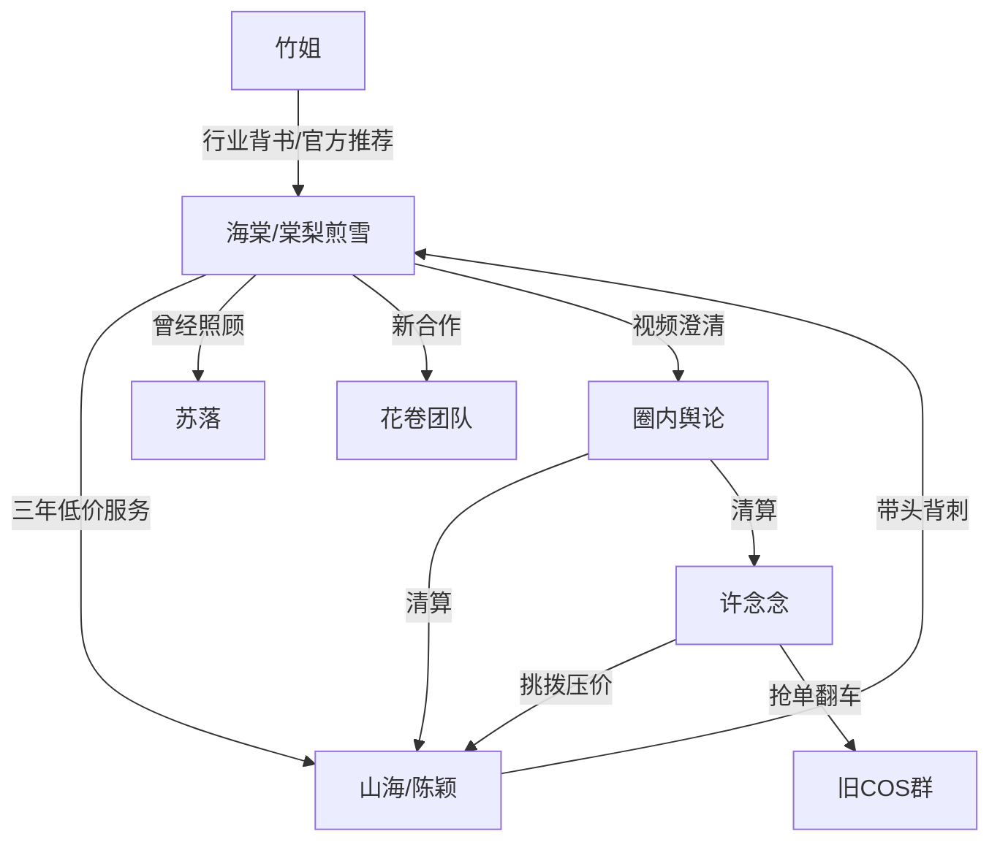

# 角色标签图谱

## 角色清单

### 海棠 / 棠梨煎雪 — 隐藏大佬型清醒手艺人
- 叙事功能: 受害者、反击者、价值坐标重建者。
- 核心标签: 克制、专业、隐藏大号。
- 弧光: 低价补贴朋友 → 被背刺退出 → 身份曝光 → 官方总监/工作室主理人。
- 台词风格: 极简、冷静、少解释。
- 关键行为: 拆掉旧物料、接花卷团队、发测评视频、拒绝山海和许念念。
- 读者情绪关系: 心疼前期付出，爽于后期价值回归。

### 许念念 — 低价搅局绿茶新人
- 叙事功能: 点燃冲突、制造低价规则、承担翻车报应。
- 核心标签: 装无辜、贪便宜、能力不足。
- 弧光: 抢单上位 → 廉价翻车 → 舆论崩盘 → 求学被拒。
- 台词风格: 撒娇、表情包、阴阳怪气。
- 关键行为: 群里质疑两百价格、采购廉价材料、外群抹黑、申请进工作室。
- 读者情绪关系: 激发厌恶和打脸期待。

### 山海 / 陈颖 — 白眼狼群主
- 叙事功能: 友情背刺核心、道德债最大债务人。
- 核心标签: 高高在上、虚伪友情、压价成性。
- 弧光: 带头弃用海棠 → 翻车求回头 → 圈内无人接单 → 友情彻底失去。
- 台词风格: 表面客气，实质命令和压价。
- 关键行为: 支持许念念、要求交物料、背后说海棠丑、深夜求单。
- 读者情绪关系: 比许念念更可恨，因为她背叛的是三年友情。

### 苏落 — 软弱但尚有良心的旧友
- 叙事功能: 旧团队内部视角、截图证据提供者、主角有限仁慈对象。
- 核心标签: 软弱、愧疚、敏感肌。
- 弧光: 私下关心但不敢公开站队 → 翻车求救 → 提供截图 → 保留最低限度关系。
- 台词风格: 小心、求助、带哭腔。
- 关键行为: 拉小群、现场求救、截图许念念抹黑。
- 读者情绪关系: 复杂心疼；她被救，但不能完全洗白。

### 花卷 — 新价值坐标的见证者
- 叙事功能: 对照组，证明外部市场认可海棠。
- 核心标签: 尊重专业、识货、直爽。
- 弧光: 求大佬接单 → 现场对比胜出 → 按市场价包单。
- 台词风格: 夸张真诚、网感强。
- 关键行为: 邀请海棠做妆造、展示山海背后聊天记录、付市场价。
- 读者情绪关系: 提供补偿性爽感。

### 竹姐 — 圈内专业背书者
- 叙事功能: 证明海棠价值，连接官方项目。
- 核心标签: 行业老人、资源、人脉。
- 弧光: 看穿旧团队白眼狼 → 推荐官方项目 → 见证海棠事业升级。
- 台词风格: 老练、直接、护短。
- 关键行为: 不给许念念优惠、推荐官方嘉年华、吐槽旧团队压价。
- 读者情绪关系: 提供“专业圈层站主角”的安全感。

## 关系网络

## 角色功能对照表（供改编参考）

| 原角色 | 极致标签 | 叙事功能 | 读者情绪功能 | 改编时必须保留的 |
|--------|---------|---------|-------------|---------------|
| 海棠 | 隐藏大佬手艺人 | 被低估者/反杀者 | 心疼、代入、爽 | 克制不解释、专业价值被市场证明 |
| 许念念 | 低价绿茶新人 | 触发低价规则 | 恨、等翻车 | 一边抢资源一边骂主角杀熟 |
| 山海 | 白眼狼群主 | 友情背刺源头 | 最强恨点 | 曾受益最多，却第一个压价背叛 |
| 苏落 | 软弱良心人 | 缓冲与证据来源 | 复杂心疼 | 私下关心但公开缺席 |
| 花卷 | 识货新客户 | 外部价值对照 | 补偿爽 | 尊重专业并愿付市场价 |
| 竹姐 | 行业背书者 | 资源升级 | 安全感 | 证明主角不是自夸，而是行业认可 |
