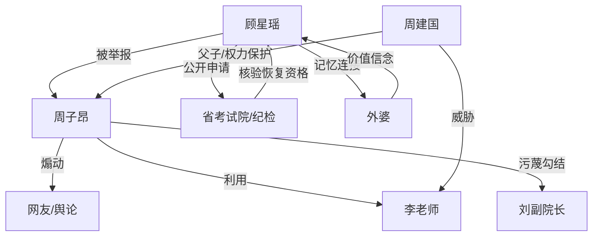

# 角色标签图谱

## 角色清单

### 顾星瑶 — 冷静反杀型省状元

- 叙事功能: 主角、被污名化者、证据链组织者、价值主题承载者。
- 核心标签: 省状元、俄语外语考生、清醒大女主。
- 弧光: 被全网定罪 → 公开反杀 → 自我选择被确认。
- 台词风格: 短句、反问、逻辑压迫，不做情绪化辩解。
- 关键行为: 主动申请直播；承认证据属实；出示俄语报名表；播放录音；多语直播补强能力。
- 读者情绪关系: 先心疼，再期待，最终爽和敬佩。

### 周子昂 — 伪寒门道德绑架者

- 叙事功能: 反派、舆论煽动者、伪公平代言人。
- 核心标签: 全省第二、伪寒门、利益投机者。
- 弧光: 道德高地控诉 → 误会脱罪失败 → 身份崩塌 → 成绩作废移交司法。
- 台词风格: 煽情、表演式谦卑、动辄代表寒门和公平。
- 关键行为: 发举报视频；展示英语成绩和监控；找老师作证；要求 B 卷自证；试图把恶意说成误会。
- 读者情绪关系: 从怀疑到厌恶，最终获得被打脸的痛快感。

### 李老师 — 被胁迫的证人

- 叙事功能: 前期压迫证据，后期反转证人。
- 核心标签: 英语老师、软弱、被威胁。
- 弧光: 作伪证 → 崩溃坦白 → 被从轻处理。
- 台词风格: 发紧、低头、断裂式坦白。
- 关键行为: 证明顾星瑶英语差；否认报告；最后承认周家威胁。
- 读者情绪关系: 先恨其背叛，后理解其困境。

### 周建国 — 权力幕后黑手

- 叙事功能: 暴露周子昂伪寒门身份，完成权力层清算。
- 核心标签: 教育局副局长、滥用职权、威胁证人。
- 弧光: 幕后操控 → 被点名调查 → 撤职移送。
- 台词风格: 无正面台词，通过他人供述和处分通知出现。
- 关键行为: 威胁李老师作证。
- 读者情绪关系: 愤怒，要求制度性惩罚。

### 刘副院长 — 被波及的公权力节点

- 叙事功能: 被反派用来制造“资本勾结考试院”的伪证链。
- 核心标签: 老战友、被污蔑者、程序监督者。
- 弧光: 被质疑 → 暂停职风险 → 事实澄清。
- 台词风格: 急切解释，后被程序约束。
- 关键行为: 解释三月聚餐；其存在放大了事件严重性。
- 读者情绪关系: 增加“不明真相时证据很像真的”的压迫感。

### 顾星瑶外婆 — 温情根源与主题锚点

- 叙事功能: 解释俄语能力的情感动机，提供结尾价值金句。
- 核心标签: 俄罗斯外婆、记忆、真相信念。
- 弧光: 回忆中的陪伴 → 语言动机 → 主题收束。
- 台词风格: 俄语短句，朴素坚定。
- 关键行为: 留下“真相永远会赢”的精神遗产。
- 读者情绪关系: 破防、温暖、补偿。

## 关系网络

## 角色功能对照表（供改编参考）

| 原角色 | 极致标签 | 叙事功能 | 读者情绪功能 | 改编时必须保留的 |
|--------|---------|---------|-------------|---------------|
| 顾星瑶 | 冷静省状元 | 被污名化后设局反杀 | 心疼、期待、爽 | 不急着解释，公开场合亮证据 |
| 周子昂 | 伪寒门全省第二 | 道德绑架反派 | 恨、恶心、爽点来源 | 代表公平的话术必须反噬 |
| 李老师 | 被胁迫老师 | 证词反转点 | 背叛感、复杂同情 | 先压迫后反水 |
| 周建国 | 权力黑手 | 权力层清算 | 制度性愤怒 | 滥权行为必须有处分 |
| 外婆 | 情感锚点 | 解释能力根源 | 破防、余味 | 语言选择必须有私人理由 |
