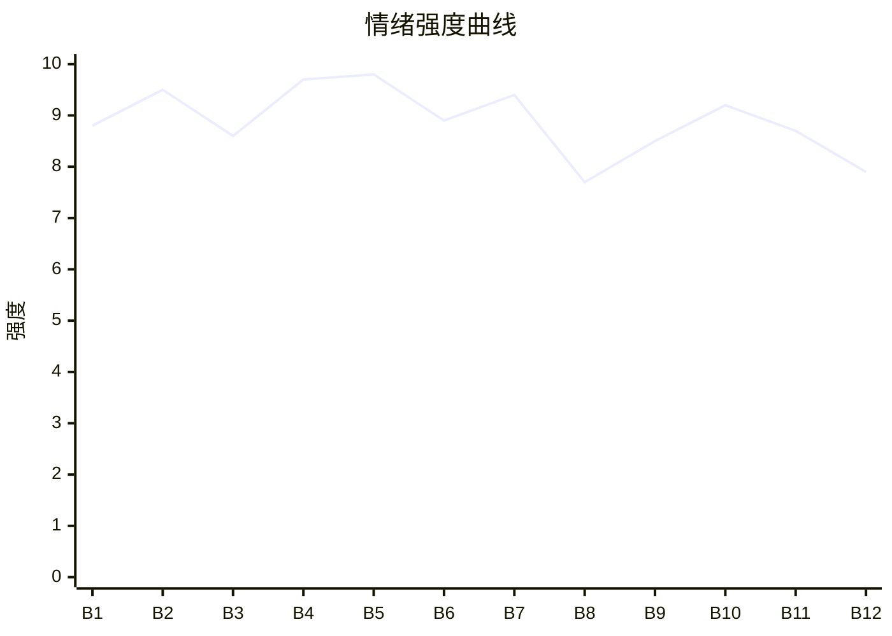

# Beat Sheet 节拍器

## 全文概况

- 总字数: 约 56500 字
- 节拍数: 12 幕
- 核心母题（Logline）: 被妻子和亲姐联手背叛的孟砚舟，为给被实验虐杀的孩子讨公道，在持续摧毁后逃离、假死、借新盟友资源反杀，最终让凶手接受法律与情感双重清算。
- 情绪模式: 极致打压 → 真相确认 → 求告失败 → 假死脱身 → 温柔补偿 → 被绑回国 → 反向设局 → 庭审清算 → 余生疗愈

## 节拍详表

### Beat 1: 藏獒笼开局与孩子失踪 [简介-第1章前段]
- **字数**: 约 4200 字（占比 7.4%）
- **核心事件**: 孟砚舟从藏獒笼重伤醒来，追问孩子，容寄月以“孩子没气了”和“你病了”压制他。
- **情绪标签**: 震惊、惊惧、憋屈
- **情绪强度**: 8.8/10
- **情绪方向**: ⚡突变
- **冲突类型**: 大转折
- **悬念钩子**: 孩子到底去哪了？程程三年前是否真死？
- **叙事速度**: 快
- **对话占比**: 35%
- **reversal_mechanism**: [M5]
- **hook_strength**: 8.6/10（极端度 2.7/3，信息密度 2.6/3，悬念 1.7/2，节奏 1.6/2）
- **关键句**: “妻子怀孕九月时，孟砚舟为她驱车千里买爱吃的水果，却被蒙面人关进藏獒笼中。”
- **原文摘录**: 妻子怀孕九月时，孟砚舟为她驱车千里买爱吃的水果，却被蒙面人关进藏獒笼中。烈犬的牙齿撕开他的皮肉，手术室的灯亮了三天三夜。妻子容寄月守了他一夜，他睁眼第一句话却是：“你的孩子呢？”容寄月抱紧他：“对不起，砚舟。你抢救的时候，我肚子里的孩子也出了意外……”孟砚舟说：“我知道你们把孩子取出来了，让我看一眼。”容寄月像看调皮孩子：“孩子已经没气了，砚舟乖，不要闹。”

### Beat 2: 程程真相与精神病院驯服 [第1章中后段]
- **字数**: 约 5000 字（占比 8.8%）
- **核心事件**: 程程逃出实验室，揭露容寄月和林经年用孩子做实验；孟砚舟被打晕送进精神病院。
- **情绪标签**: 恐怖、心痛、绝望
- **情绪强度**: 9.5/10
- **情绪方向**: ↓下降
- **冲突类型**: 大转折
- **悬念钩子**: 孟砚舟能否证明自己没有疯？
- **叙事速度**: 快
- **对话占比**: 32%
- **reversal_mechanism**: [M5, M6]
- **hook_strength**: null
- **关键句**: “妈妈一直拿我们做实验，为了研究出能救经年叔叔的女儿的药……”
- **原文摘录**: 程程瘦得惊人，全身骨头都被打断，爬到他身边，身后留下长长血痕。“妈妈还送来好多弟弟妹妹给经年叔叔做实验……快跑！爸爸，快跑！”容寄月出现在门口：“砚舟乖，到我这里来。”下一秒，怀中的孩子吐出一口血，没了呼吸。孟砚舟要告林经年，后颈却一痛。再醒来，便被关进精神病院。

### Beat 3: 回忆温柔与儿童画被毁 [第2章]
- **字数**: 约 4300 字（占比 7.6%）
- **核心事件**: 回忆容寄月、孟昕曾如何宠爱男主与程程；现实中林经年撕毁程程儿童画，容寄月打了孟砚舟。
- **情绪标签**: 怀旧、刺痛、愤怒
- **情绪强度**: 8.6/10
- **情绪方向**: ↓下降
- **冲突类型**: 微冲突升级为大转折
- **悬念钩子**: 离婚提出后容寄月会如何反应？
- **叙事速度**: 中
- **对话占比**: 45%
- **reversal_mechanism**: [M5]
- **hook_strength**: null
- **关键句**: “容寄月，我们离婚吧。”
- **原文摘录**: 儿童画是程程花了一个月画的生日礼物。林经年说“什么破烂玩意儿”，手中用力，儿童画被撕碎。容寄月抢过碎纸片扔进垃圾桶：“喜欢画就去拍卖会拍，捡垃圾做什么？”孟砚舟说：“看来你忘了，这是程程亲手画的。”容寄月巴掌落在他脸上。孟砚舟擦掉血迹：“容寄月，我们离婚吧。”

### Beat 4: 地下室、电击与照片证据 [第3-4章]
- **字数**: 约 5200 字（占比 9.2%）
- **核心事件**: 容寄月将男主关进地下室和电击椅；林经年拿程程被虐照片刺激他，诱他签离婚协议。
- **情绪标签**: 窒息、屈辱、恨意
- **情绪强度**: 9.7/10
- **情绪方向**: ↓下降
- **冲突类型**: 大转折
- **悬念钩子**: 照片能否成为翻案证据？
- **叙事速度**: 快
- **对话占比**: 38%
- **reversal_mechanism**: [M3, M5]
- **hook_strength**: null
- **关键句**: “浑身没一块好肉……就像你儿子一样。”
- **原文摘录**: 容寄月按下电击按钮：“记住，你病了，看到的都是幻觉。”孟砚舟只能重复：“他们是无辜的……是我疯了……”林经年随后进来，拿出程程照片：“抽血的时候，他哭得可厉害了……”照片上，小男孩手臂密密麻麻都是针孔。孟砚舟用血签下离婚协议，又死死抓住那些照片。

### Beat 5: 空坟、车祸与临死恨意 [第5章]
- **字数**: 约 4300 字（占比 7.6%）
- **核心事件**: 孟砚舟发现程程尸骨无存，携照片报警路上被林经年撞；抢救时容寄月和孟昕仍优先林经年。
- **情绪标签**: 崩溃、心死、恨
- **情绪强度**: 9.8/10
- **情绪方向**: ↓下降
- **冲突类型**: 大转折
- **悬念钩子**: 男主是否会死？容寄月是否终于看清？
- **叙事速度**: 快
- **对话占比**: 28%
- **reversal_mechanism**: [M5]
- **hook_strength**: null
- **关键句**: “容寄月，我真恨你啊。”
- **原文摘录**: 棺材打开，里面什么都没有。林经年说，大师说安葬会伤到宁宁，所以容寄月把程程扔给野狗吃掉。孟砚舟带证据走向警局，林经年开车撞来。医院里，医生问先救孟先生还是林先生，孟昕喊：“当然是先救经年！”容寄月僵住，半晌没有阻止。孟砚舟挤出几个字：“容寄月，我真恨你啊。”

### Beat 6: 伪补偿与法庭再败 [第6-8章]
- **字数**: 约 6200 字（占比 11.0%）
- **核心事件**: 容寄月短暂补偿，林经年回归诬陷；男主提诉讼却被精神病证明和容寄月证词击败。
- **情绪标签**: 冷漠、讽刺、二次绝望
- **情绪强度**: 8.9/10
- **情绪方向**: →平稳后骤降
- **冲突类型**: 大转折
- **悬念钩子**: 明天飞机起飞，男主能否离开？
- **叙事速度**: 中
- **对话占比**: 50%
- **reversal_mechanism**: [M5, M6]
- **hook_strength**: null
- **关键句**: “我不想要你了。也不想要孟昕了。”
- **原文摘录**: 容寄月亲自做饭洗衣，孟昕拎着糖果站在门外。可林经年一哭，她又让孟砚舟道歉。法庭上，孟昕递上精神病治疗证明，容寄月作证：“程程遇难刺激到了我的丈夫，让他精神失常。”全网直播倒戈。林经年笑：“对不起啊砚舟哥，又赢你一次。”孟砚舟想：明天，飞机就会起飞了。

### Beat 7: 精神病院火场与假死脱身 [第9-14章]
- **字数**: 约 7600 字（占比 13.5%）
- **核心事件**: 孟砚舟被再次送进精神病院，反击护工后放火逃离；容寄月、孟昕以为他死，真相由周夏揭开；第14章确认男主在海外活着。
- **情绪标签**: 濒死、痛快、反转
- **情绪强度**: 9.4/10
- **情绪方向**: ↑上升
- **冲突类型**: 大转折
- **悬念钩子**: 男主活着后会如何清算？
- **叙事速度**: 快
- **对话占比**: 35%
- **reversal_mechanism**: [M6, M3]
- **hook_strength**: null
- **关键句**: “砚舟没有死！砚舟还活着！”
- **原文摘录**: 护工挥鞭：“林先生吩咐了，希望您痛苦地死在这里。”孟砚舟砸晕他，确认院里没有其他人后放了一把火。容寄月和孟昕赶到火场，以为他被烧死。周夏供出林经年下药、虐待、设计实验的真相。第14章，孟昕在父亲视频里看见孟砚舟，疯癫地笑：“砚舟没有死！”

### Beat 8: 海外新生与艾拉救赎 [第15-19章]
- **字数**: 约 7200 字（占比 12.7%）
- **核心事件**: 孟砚舟在澳洲遇见艾拉，经历冷库危机后坦白过去，艾拉表达追求并提出帮他报仇。
- **情绪标签**: 松弛、心动、被珍视
- **情绪强度**: 7.7/10
- **情绪方向**: ↑上升
- **冲突类型**: 微冲突
- **悬念钩子**: 艾拉的资源将如何参与复仇？
- **叙事速度**: 中
- **对话占比**: 55%
- **reversal_mechanism**: [M2, M5]
- **hook_strength**: null
- **关键句**: “你之前没能成功，是因为他们凭借自己的钱权地位欺负你，并不是你哪里做得不够好。”
- **原文摘录**: 艾拉误入相亲场景，与孟砚舟结识。冷库里，孟砚舟因幽闭恐惧症崩溃，艾拉脱下外套罩住他。墓地前，他说：“我一点都不值得被喜欢。”艾拉说：“在你的故事里，我看到了一个很勇敢的孟砚舟。做错的是他们，应该让他们付出代价。如果你愿意，我可以帮你。”

### Beat 9: 追妻绑架与反向设局 [第19-21章]
- **字数**: 约 5600 字（占比 9.9%）
- **核心事件**: 容寄月和孟昕找到男主，强行绑他回国；男主通过艾拉的人确认支援，主动把绑架变成清算机会。
- **情绪标签**: 愤怒、冷静、期待
- **情绪强度**: 8.5/10
- **情绪方向**: ⚡突变
- **冲突类型**: 大转折
- **悬念钩子**: 男主为什么不逃？他准备怎么反杀？
- **叙事速度**: 快
- **对话占比**: 48%
- **reversal_mechanism**: [M2, M6]
- **hook_strength**: null
- **关键句**: “这是一个很好的机会。”
- **原文摘录**: 容寄月抱住他：“跟我回去好不好？”孟砚舟说：“我的女朋友在等我。”容寄月与孟昕变脸，击晕他带回国。酒店里，艾拉派来的金发女郎低声问是否离开，孟砚舟说：“不用。她说要帮我报仇，不是吗？这是一个很好的机会。”

### Beat 10: 墓前道歉与警察收网 [第21-23章前段]
- **字数**: 约 4800 字（占比 8.5%）
- **核心事件**: 孟砚舟稳住容寄月，见林经年，促成供述链；借程程忌日引容寄月到墓园，警察当场铐人。
- **情绪标签**: 压抑、冷静、痛快
- **情绪强度**: 9.2/10
- **情绪方向**: ↑上升
- **冲突类型**: 大转折
- **悬念钩子**: 法庭能否真正翻盘？
- **叙事速度**: 中
- **对话占比**: 42%
- **reversal_mechanism**: [M3, M6]
- **hook_strength**: null
- **关键句**: “知道错了就要付出代价，不是吗？”
- **原文摘录**: 容寄月说已把林经年折磨得十倍百倍，孟砚舟只问：“你想不想离开这里？”几天后，孟砚舟问容寄月：“你知道今天是程程的忌日吗？”墓碑前，她道歉。孟砚舟说：“知道错了就要付出代价，不是吗？”警察围上来，铐住容寄月。

### Beat 11: 法庭清算与容寄月挡伤 [第23-24章前段]
- **字数**: 约 4300 字（占比 7.6%）
- **核心事件**: DNA、照片、林经年供述坐实罪行；林经年袭击男主，容寄月替他挡下。
- **情绪标签**: 爽、余痛、告别
- **情绪强度**: 8.7/10
- **情绪方向**: ↑后回落
- **冲突类型**: 大转折
- **悬念钩子**: 容寄月是否能获得原谅？
- **叙事速度**: 快
- **对话占比**: 36%
- **reversal_mechanism**: [M3, M5]
- **hook_strength**: null
- **关键句**: “这个世界没有如果。”
- **原文摘录**: 法庭上，照片鉴定无伪造，实验室提取到程程 DNA。林经年供认：“容寄月也有份！”容寄月看见艾拉揽着孟砚舟的腰，明白他真的有了女朋友。庭外林经年扑来，容寄月挡在孟砚舟面前。醒来后她问：“如果我没逼死程程……”孟砚舟说：“这个世界没有如果。”

### Beat 12: 法律余波与幸福闭环 [第24章后段]
- **字数**: 约 3300 字（占比 5.8%）
- **核心事件**: 容寄月自杀，孟昕失去律师资格，孟砚舟拒绝见她，与艾拉走向婚姻，梦见程程祝福。
- **情绪标签**: 释然、补偿、余韵
- **情绪强度**: 7.9/10
- **情绪方向**: →平稳
- **冲突类型**: 收束
- **悬念钩子**: 无，完成闭环
- **叙事速度**: 慢
- **对话占比**: 50%
- **reversal_mechanism**: [M3, M5]
- **hook_strength**: null
- **关键句**: “我会幸福的。”
- **原文摘录**: 艾拉说容寄月在医院自杀，孟昕被吊销从业资格，想见他道歉。孟砚舟说：“不见。”艾拉问喜欢男孩还是女孩，他暂时不想要孩子，她便转向婚礼。梦里，程程牵着几个小婴儿：“爸爸，我们要去投胎了哦。希望你以后过得幸福！”孟砚舟笑出了眼泪：“会的。我会幸福的。”

## 情绪曲线可视化

## 节拍密度检测

- 平均每 4700 字一个节拍
- 微冲突密度: 每 1200-1800 字一次
- 大转折密度: 每 3500-5000 字一次
- 判定: 符合高频节拍器标准；前半部压迫密度极高，中段以假死和真相披露维持追读，后段以庭审与感情补偿收束。

## 反转机制清单(Reversal Mechanisms)

| 机制 ID | 机制名 | 承载 Beat | 关键段落/金句 | 等价改编提示 |
|--------|--------|-----------|--------------|-------------|
| M3 | 因果回旋反讽 | Beat 10-12 | “知道错了就要付出代价，不是吗？”；婚礼旧誓“对我不好你就坐牢去吧”最终成真 | 必须保留施害者曾经规则或誓言在结尾反身兑现，句式回旋度要高 |
| M5 | 温度反转曲线 | Beat 1-6, Beat 11-12 | 曾经宠爱、后来电击送院、最后失去男主后悔疯 | 必须显式写出“曾经爱过”的温度正峰，再写归零和负值悔恨 |
| M6 | 多层递进反转 | Beat 2, 7, 9, 10, 11 | 程程未正常死亡 → 男主假死 → 艾拉资源入场 → 墓园收网 → 法庭翻案 | 反转层数不能少，且每层量级递增：真相、脱身、权力、法律 |
| M2 | 身份反差爆发 | Beat 8-10 | 艾拉从误会相亲对象变成能调动跨国资源的强盟友 | 身份载体可换，但“温柔新角色其实拥有更高权力坐标”的反差必须保留 |
