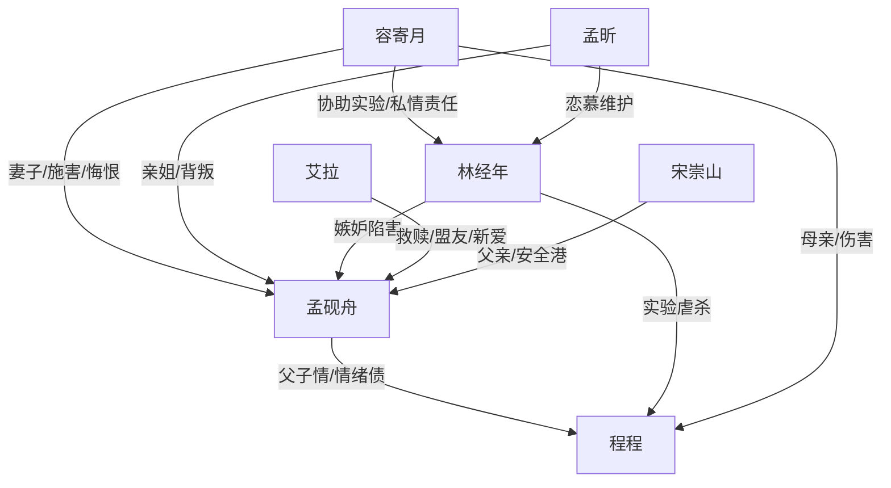

# 角色标签图谱

## 角色清单

### 孟砚舟 — 被虐后清醒复仇男主
- 叙事功能: 情绪承受体、真相追索者、最终清算发动者。
- 核心标签: 温柔父亲、创伤幸存者、冷静复仇。
- 弧光: 被爱包围的丈夫父亲 → 被摧毁的“精神病人” → 假死逃离者 → 法律清算者 → 被重新爱的人。
- 台词风格: 前期哀求，后期短句冷拒。
- 关键行为: 保护照片、报警、假死脱身、联系艾拉资源、墓园设局。
- 读者情绪关系: 心疼、代入、期待他被补偿。

### 容寄月 — 偏执冷血追妻火葬场女主
- 叙事功能: 最大伦理背叛者，M5 温度反转核心。
- 核心标签: 掌权人、逃避罪责、失去后悔疯。
- 弧光: 宠夫宠子 → 为宁宁与林经年牺牲程程 → 强控男主 → 真相后崩溃 → 坐牢/自杀。
- 台词风格: 温柔命令式，“砚舟乖”与威胁并存。
- 关键行为: 掩盖程程真相、电击男主、作伪证、绑男主回国、最后挡伤。
- 读者情绪关系: 恨、憋屈、想看她悔恨。

### 孟昕 — 恋爱脑亲姐/帮凶
- 叙事功能: 亲情背叛放大器，法庭压制工具。
- 核心标签: 天才律师、恋爱脑、亲情叛徒。
- 弧光: 护弟姐姐 → 为林经年伤弟 → 真相后崩溃 → 失去职业资格。
- 台词风格: 训斥、道德压制、后期悔恨。
- 关键行为: 把男主送回精神病院、为林经年辩护、绑回男主。
- 读者情绪关系: 恨其背叛，期待她失去所依仗的身份。

### 林经年 — 伪善医生/阶级嫉妒反派
- 叙事功能: 显性恶源，制造实验、陷害、虐打、车祸。
- 核心标签: 伪善、贪婪、嫉妒。
- 弧光: 被资助者 → 医疗新贵 → 真相败露 → 供咬容寄月。
- 台词风格: 装可怜与恶毒炫耀切换。
- 关键行为: 设计下药、虐杀程程、买通精神病院、袭击男主。
- 读者情绪关系: 纯恨，期待肉体和法律双惩罚。

### 程程 — 被牺牲的孩子/情绪债核心
- 叙事功能: 全文最大情绪债来源，所有清算的道德根基。
- 核心标签: 天真、受虐、尸骨无存。
- 弧光: 被宠小王子 → 实验牺牲品 → 梦中祝福父亲。
- 台词风格: 儿童化、疼痛化。
- 关键行为: 逃出实验室揭露真相，梦中告别。
- 读者情绪关系: 极致心疼，支撑复仇正当性。

### 艾拉 — 高资源救赎新女主
- 叙事功能: 新坐标、新爱、反杀资源提供者。
- 核心标签: 矜贵、温柔、强资源。
- 弧光: 误会相亲对象 → 冷库保护者 → 倾听创伤者 → 复仇盟友 → 未来伴侣。
- 台词风格: 真诚直白，带轻甜。
- 关键行为: 保护冷库中的孟砚舟、提出帮他、调动人手。
- 读者情绪关系: 安心、补偿、嗑糖。

### 宋崇山 — 清醒父亲/安全港
- 叙事功能: 提供逃离路径和亲情托底。
- 核心标签: 洒脱、护短、现实清醒。
- 弧光: 远方父亲 → 救援者 → 新生活推动者。
- 台词风格: 轻松调侃中带护短。
- 关键行为: 接男主出国、照顾康复、介绍新生活。
- 读者情绪关系: 安慰、松弛。

## 关系网络

## 角色功能对照表（供改编参考）

| 原角色 | 极致标签 | 叙事功能 | 读者情绪功能 | 改编时必须保留的 |
|--------|---------|---------|-------------|---------------|
| 孟砚舟 | 被虐清醒复仇者 | 承受与清算 | 心疼、爽 | 父亲身份、证据行动线、拒绝原谅 |
| 容寄月 | 悔疯掌权妻 | 主要背叛者 | 恨、看火葬场 | 曾经爱过、后来亲手摧毁 |
| 孟昕 | 恋爱脑亲姐 | 亲情背刺 | 憋屈、报应期待 | “最亲的人不信他” |
| 林经年 | 伪善医生 | 显性反派 | 纯恨 | 嫉妒、装可怜、直接虐害 |
| 程程 | 无辜孩子 | 情绪债核心 | 心疼 | 具体遗物、疼痛证据、梦中告别 |
| 艾拉 | 高位救赎者 | 补偿与资源 | 安心、甜 | 温柔但有权力资源 |
