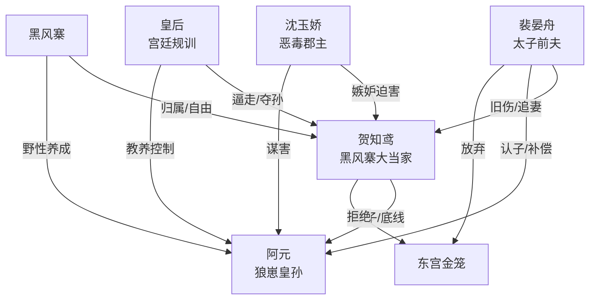

# 角色标签图谱

## 角色清单

### 贺知鸢 — 土匪大女主 / 护崽疯批 / 反内耗前妻
- 叙事功能: 主视角、爽点执行者、价值坐标中心。
- 核心标签: 大条、护崽、自由至上。
- 弧光: 被和离的太子妃 → 黑风寨大当家 → 拒绝金笼的规则制定者。
- 台词风格: 粗口短句、反问拆台、懒得解释。
- 关键行为: 砍太子救子、挡箭、砸皇后宫人、砍断郡主手臂、出逃回寨。
- 读者情绪关系: 爽、佩服、心疼但不怜悯。

### 裴晏舟 — 嘴硬太子前夫 / 追妻火葬场 / 降格赎罪者
- 叙事功能: 旧权力压迫源，也是最终甜宠兑现者。
- 核心标签: 高傲、执拗、悔红眼。
- 弧光: 强取豪夺的太子 → 认子悔恨的父亲 → 辞位入赘的压寨夫君。
- 台词风格: 前期“孤”式命令，后期小心翼翼求留。
- 关键行为: 用阿元逼女主回宫、认出胎记、清算定国公和皇后、辞去太子。
- 读者情绪关系: 前期恨和嫌弃，后期看他降格获得补偿爽。

### 阿元 — 狼崽皇孙 / 神助攻儿子 / 情绪债放大器
- 叙事功能: 亲子身份炸弹、护崽动机、喜剧补刀。
- 核心标签: 机灵、野性、嘴欠。
- 弧光: 被骂野种的土匪崽 → 被确认的皇孙 → 选择山寨自由的孩子。
- 台词风格: 童言无忌、土匪式豪横。
- 关键行为: 绑太子上山、踢太子、弹弓打郡主、要求回黑风寨。
- 读者情绪关系: 心疼、喜爱、想看他被保护。

### 沈玉娇 — 恶毒郡主 / 嫉妒型第三者 / 清算靶子
- 叙事功能: 外部恶意具象化，推动护崽暴怒与男主站队。
- 核心标签: 嫉妒、狠毒、失控。
- 弧光: 剿匪叫嚣者 → 谋害皇嗣者 → 被砍手后伏诛。
- 台词风格: 辱骂堆叠，“贱人”“野种”高频。
- 关键行为: 放箭射阿元、厢房用刑、勾结刺客夜袭。
- 读者情绪关系: 恨，期待她被重罚。

### 皇后 — 宫廷规训者 / 旧秩序母权 / 金笼化身
- 叙事功能: 把私人追妻升级为宫廷规则冲突。
- 核心标签: 傲慢、控制、体统。
- 弧光: 五年前逼走女主 → 五年后夺孙 → 幽禁深宫。
- 台词风格: 规矩、体统、配不上。
- 关键行为: 试图带走阿元教养，放出沈玉娇刺杀。
- 读者情绪关系: 厌恶，期待被权力反噬。

### 黑风寨众人 — 自由共同体 / 喜剧群众 / 女主归属地
- 叙事功能: 对照东宫金笼，证明女主真正的家在山寨。
- 核心标签: 热闹、粗粝、忠诚。
- 弧光: 误以为女主死了办丧事 → 庆祝女主归来 → 接纳太子入赘。
- 台词风格: 起哄、粗豪、直接。
- 关键行为: 绑人、护寨、办丧、杀猪庆祝。
- 读者情绪关系: 轻松、温暖、归属感。

## 关系网络

## 角色功能对照表（供改编参考）

| 原角色 | 极致标签 | 叙事功能 | 读者情绪功能 | 改编时必须保留的 |
|--------|---------|---------|-------------|---------------|
| 贺知鸢 | 土匪大女主 | 主视角与规则制定者 | 爽、清醒、心疼 | 护崽底线、拒绝金笼、口语拆台 |
| 裴晏舟 | 悔红眼太子 | 旧权力到降格赎罪 | 先恨后爽 | 必须从高位降为女主规则下的人 |
| 阿元 | 狼崽皇孙 | 身份炸弹与情绪债 | 心疼、可爱 | 不能乖，必须野、会补刀 |
| 沈玉娇 | 恶毒郡主 | 外部迫害 | 恨点集中 | 必须实际伤害孩子，报应才成立 |
| 皇后 | 宫廷规训者 | 价值冲突升级 | 厌恶压迫 | 必须代表规矩和金笼 |
| 黑风寨 | 自由共同体 | 主题落点 | 松弛、归属 | 必须比宫廷更像家 |
