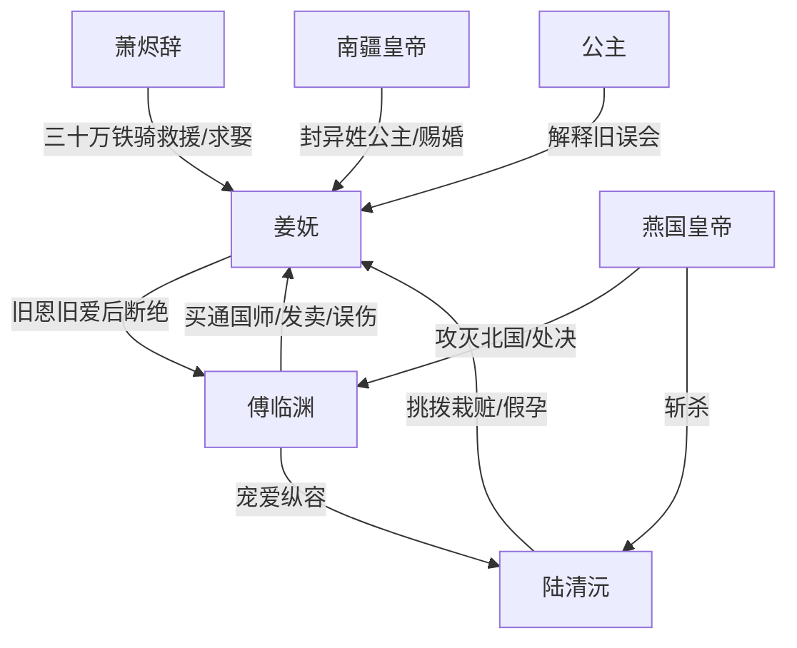

# 角色标签图谱

## 角色清单

### 姜妩 — 受辱清醒废后 / 被隆重补偿的大女主

- 叙事功能: 承受情绪债、完成断爱、承接补偿爽点。
- 核心标签: 废后、清醒、被珍视。
- 弧光: 感恩留北国 → 青楼三年忍辱 → 看清骗局 → 南疆新生。
- 台词风格: 冷静反讽，短句判决。
- 关键行为: 偷听真相后飞鸽传书；拒绝道歉；当众与傅临渊两清；再嫁萧烬辞。
- 读者情绪关系: 心疼、憋屈、替她爽。

### 傅临渊 — 薄情自恋帝王 / 追妻火葬场反派

- 叙事功能: 主要施害者，制造前半压迫与后半悔恨。
- 核心标签: 自私、虚伪、迟来深情。
- 弧光: 救命恩人 → 做戏废后 → 栽赃惩罚 → 悔恨亡国。
- 台词风格: 帝王命令式、占有欲强、自我开脱。
- 关键行为: 买通国师；发卖姜妩；纵容陆清沅；南疆抢婚；弃国追妻。
- 读者情绪关系: 恨、厌、等他悔死。

### 陆清沅 — 绿茶心上人 / 假孕夺位者

- 叙事功能: 次级施害者，推动误会、栽赃和皇帝道德崩塌。
- 核心标签: 绿茶、贪婪、偷梁换柱。
- 弧光: 落魄掌柜 → 宠妃准后 → 奸情败露 → 被斩。
- 台词风格: 姐姐式阴阳怪气，表面伏低，实则挑拨。
- 关键行为: 怂恿发卖；假摔流产；砸凤冠栽赃；苛待青楼。
- 读者情绪关系: 恨，期待被公开打脸。

### 萧烬辞 — 深情战神 / 制度级补偿者

- 叙事功能: 救援者、补偿者、女主新价值坐标。
- 核心标签: 战神、专一、护短。
- 弧光: 年少旧人 → 迟来救援 → 强势接回 → 夫君父亲。
- 台词风格: 直接护妻，带军权威压。
- 关键行为: 率三十万铁骑兵临城下；射伤傅临渊；揭穿陆清沅；迎娶姜妩。
- 读者情绪关系: 爽、安心、补偿满足。

### 南疆皇帝与公主 — 正义秩序 / 亲族补偿

- 叙事功能: 证明姜妩并非无依无靠，给她制度合法性。
- 核心标签: 仁厚、纠错、承认。
- 弧光: 旧误会源头 → 澄清者 → 赐婚者。
- 台词风格: 温和、长辈式。
- 关键行为: 封姜妩为异姓公主；按公主礼制操办婚礼。
- 读者情绪关系: 安慰、补偿。

### 燕国皇帝 — 终局清算工具人

- 叙事功能: 把傅临渊的私人薄情升级为国家报应。
- 核心标签: 外部强权、冷酷审判者。
- 弧光: 潜在威胁 → 亡国执行者。
- 台词风格: 冷嘲、一针见血。
- 关键行为: 攻占北国；斩陆清沅；刺伤下毒傅临渊。
- 读者情绪关系: 替天行道式爽感。

## 关系网络

## 角色功能对照表（供改编参考）

| 原角色 | 极致标签 | 叙事功能 | 读者情绪功能 | 改编时必须保留的 |
|--------|---------|---------|-------------|---------------|
| 姜妩 | 受辱清醒废后 | 承债与断爱 | 心疼、代入、爽 | 不道歉、不回头、结尾被珍视 |
| 傅临渊 | 薄情帝王 | 施害与悔恨 | 恨、等报应 | 曾经温柔、现在伤害、最后失国失爱 |
| 陆清沅 | 绿茶假孕女 | 栽赃与夺位 | 恨、等打脸 | 假孕/栽赃/反噬链 |
| 萧烬辞 | 深情战神 | 救场与补偿 | 爽、安心 | 更高权力救援与制度级宠爱 |
| 南疆皇帝 | 正义长辈 | 合法性背书 | 安慰 | 给女主身份与婚礼规格 |
| 燕国皇帝 | 外部清算者 | 终局报应 | 痛快 | 把私德败坏扩大成权力崩塌 |
