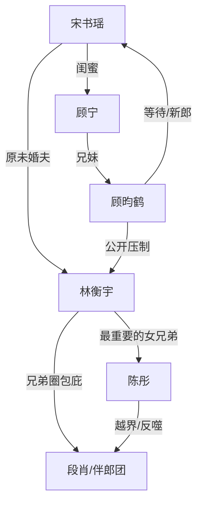

# 角色标签图谱

## 角色清单

### 宋书瑶 — 清醒止损新娘
- 叙事功能: 被轻视者、证据接收者、最终规则执行者
- 核心标签: 清醒、克制、及时止损
- 弧光: 期待婚礼 → 被反复刺痛 → 当场换新郎 → 安稳进入新关系
- 台词风格: 短句、冷静、带反讽
- 关键行为: 录像留证、转去对面酒店、当面对质、拒绝复合
- 读者情绪关系: 心疼转爽，读者希望她被珍视

### 林衡宇 — 迟钝傲慢前任
- 叙事功能: 主压迫者、情绪债制造者、悔恨承担者
- 核心标签: 偏心、欺瞒、自以为稳
- 弧光: 笃定掌控 → 慌乱追赶 → 当场失去 → 长期悔恨
- 台词风格: 道德绑架式安抚，“你懂事点”“给我面子”
- 关键行为: 让陈彤侵占婚礼流程、隐瞒四年、闯场求复合
- 读者情绪关系: 恨、厌、看他悔恨获得爽感

### 陈彤 — 无边界女兄弟
- 叙事功能: 触发冲突的外来者、兄弟圈瓦解源
- 核心标签: 大大咧咧伪装、越界、搅局
- 弧光: 被众星捧月 → 灰溜溜坐尾桌 → 被兄弟反噬
- 台词风格: 哥们口吻、装无辜、攻击女性
- 关键行为: 截接亲、拿手捧花、站婚礼誓词位、群里泼脏水
- 读者情绪关系: 强恨点，承担“女兄弟”标签厌恶

### 顾昀鹤 — 克制深情竹马新郎
- 叙事功能: 补偿者、身份反差牌、女主新归宿
- 核心标签: 妥帖、等待、尊重
- 弧光: 对面等待 → 救场成婚 → 小心追求 → 领证确定
- 台词风格: 温柔克制，不强迫
- 关键行为: 准备婚礼、接走女主、挡下林衡宇、处理旧礼物
- 读者情绪关系: 爽和甜，提供补偿性满足

### 顾宁 — 暴脾气闺蜜/证据助手
- 叙事功能: 情绪外化、取证推动、顾昀鹤连接点
- 核心标签: 护短、敏锐、行动派
- 弧光: 替女主憋屈 → 录像取证 → 为她开心
- 台词风格: 直接、吐槽、护短
- 关键行为: 开录像、提醒换车、协助转场
- 读者情绪关系: 替读者骂人、提供陪伴感

### 段肖与伴郎团 — 帮凶兄弟圈
- 叙事功能: 群体压迫、信息差暴露载体、后续反噬对象
- 核心标签: 起哄、包庇、双标
- 弧光: 帮林衡宇打掩护 → 恐慌 → 被陈彤反噬
- 台词风格: 劝人大度、兄弟情绑架
- 关键行为: 同步群聊、拦女主、闯场劝和
- 读者情绪关系: 厌恶，后续瓦解提供次级爽点

## 关系网络

## 角色功能对照表（供改编参考）

| 原角色 | 极致标签 | 叙事功能 | 读者情绪功能 | 改编时必须保留的 |
|--------|---------|---------|-------------|---------------|
| 宋书瑶 | 清醒止损新娘 | 执行离场与新选择 | 心疼、爽 | 不哭闹，证据在手，规则说到做到 |
| 林衡宇 | 迟钝傲慢前任 | 制造压迫和悔恨 | 恨、看报应 | “她不会走”的笃定必须保留 |
| 陈彤 | 无边界女兄弟 | 激化矛盾 | 厌恶 | 打着兄弟名义侵占亲密关系 |
| 顾昀鹤 | 克制深情新郎 | 补偿与反差 | 甜、安心 | 早已准备好但尊重女主选择 |
| 顾宁 | 护短闺蜜 | 辅助取证 | 代骂、陪伴 | 录像/证据辅助功能 |
| 伴郎团 | 帮凶群体 | 群体轻视 | 群体报应爽 | 聊天记录暴露与后续瓦解 |
