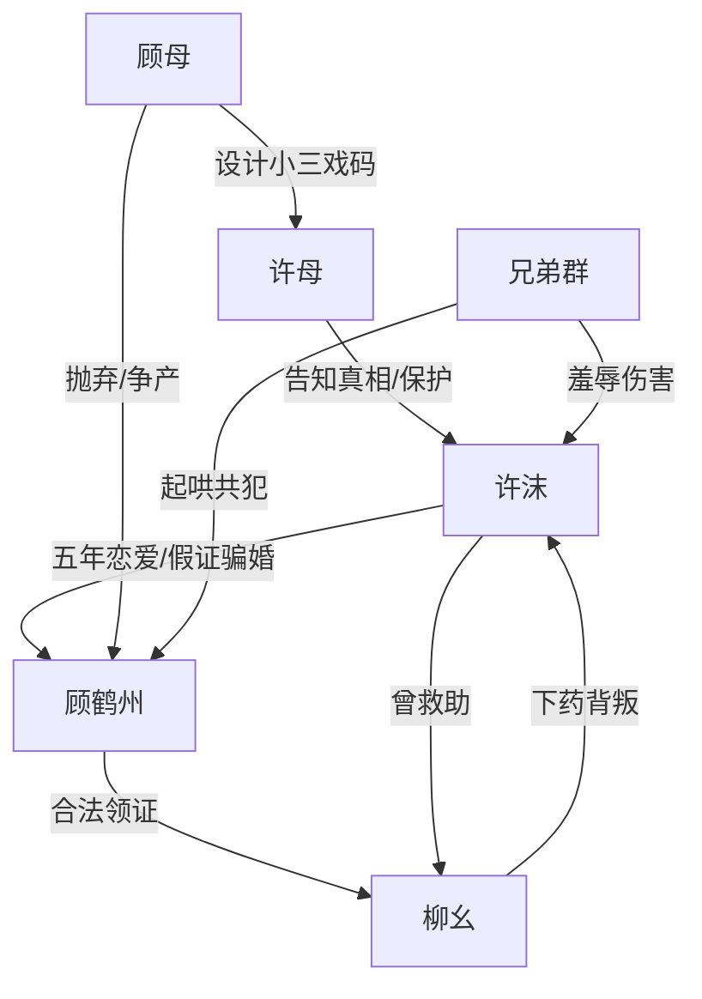

# 角色标签图谱

## 角色清单

### 许沫 — 清醒断爱受害女主
- 叙事功能: 承受压迫、保存真相、完成切割。
- 核心标签: 怀孕被弃、左耳残缺、不原谅。
- 弧光: 误信深情 → 濒死后醒悟 → 揭真相逃离 → 冷眼旁观报应。
- 台词风格: 前期颤抖追问，后期冷静砸脸。
- 关键行为: 给母亲打电话、婚礼揭真相、机场扔假证、海外拒绝复合。
- 读者情绪关系: 心疼、代入、为她拒绝原谅而爽。

### 顾鹤州 — 伪深情复仇型渣男
- 叙事功能: 核心施害者，制造全部情绪债。
- 核心标签: 五年演戏、假证骗婚、追悔火葬场。
- 弧光: 傲慢羞辱 → 真相信仰崩塌 → 失控追悔 → 家族反噬。
- 台词风格: 前期冷酷羞辱，后期歇斯底里求原谅。
- 关键行为: 递打胎卡、强制黑诊所、婚礼献祭、割耳求和、海外纠缠。
- 读者情绪关系: 恨、厌恶、期待报应。

### 柳幺 — 白眼狼小三/伪弱者
- 叙事功能: 夺位者、女主善意被背叛的证据。
- 核心标签: 被救出大山、下药爬床、怀孕反噬。
- 弧光: 被帮助者 → 上位妻子 → 机场撒泼 → 私照勒索。
- 台词风格: 娇滴滴、装无辜、关键时刻恶毒破防。
- 关键行为: 给女主下迷药、婚礼上位、机场跪地污蔑、后期勒索顾鹤州。
- 读者情绪关系: 恨与鄙夷。

### 许母 — 愧疚母亲/真相持有者
- 叙事功能: 母辈真相载体、女主逃离助推器。
- 核心标签: 被利用的小三、愧疚、保护女儿。
- 弧光: 被女儿误解 → 揭顾家真相 → 给钱送女儿逃离。
- 台词风格: 急切、悔恨、现实。
- 关键行为: 婚礼揭穿顾母，给护照和五百万。
- 读者情绪关系: 复杂，后期转为理解与心疼。

### 顾母 — 伪植物人/母辈骗局源头
- 叙事功能: 反转炸弹，摧毁顾鹤州道德坐标。
- 核心标签: 假植物人、国外情人、私生子。
- 弧光: 顾鹤州心中受害母亲 → 真正操盘者 → 争财产反噬儿子。
- 台词风格: 冷漠自私。
- 关键行为: 安排许母勾引顾父，装植物人，带私生子回国争产。
- 读者情绪关系: 厌恶，同时提供反噬爽点。

### 顾鹤州兄弟群 — 羞辱见证者/共犯
- 叙事功能: 证明五年骗局非单人冲动，而是群体霸凌。
- 核心标签: 赌局、起哄、性化羞辱。
- 弧光: 看戏起哄 → 被报警抓走。
- 台词风格: 群聊式下流、轻佻。
- 关键行为: 群聊揭露割耳赌局，婚礼试图带走女主。
- 读者情绪关系: 恨，期待法律清算。

## 关系网络

## 角色功能对照表（供改编参考）

| 原角色 | 极致标签 | 叙事功能 | 读者情绪功能 | 改编时必须保留的 |
|--------|---------|---------|-------------|---------------|
| 许沫 | 清醒断爱女主 | 承受与切割 | 心疼、爽 | 最终不原谅、不复合 |
| 顾鹤州 | 伪深情渣男 | 施害与追悔 | 恨、看报应 | 五年骗局与火葬场 |
| 柳幺 | 白眼狼小三 | 二次背叛 | 恨 | 被女主救过却反咬 |
| 许母 | 真相持有者 | 引爆反转 | 复杂心疼 | 母辈真相与送女主离开 |
| 顾母 | 伪受害操盘者 | 价值观反转 | 爽点反噬 | 让渣男“恨错人” |
| 兄弟群 | 共犯群像 | 加码羞辱 | 群体愤怒 | 群聊证据与婚礼共犯 |
