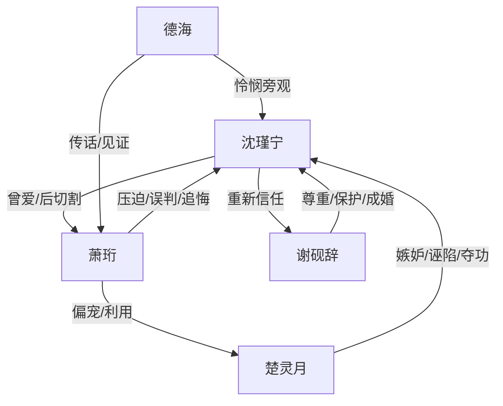

# 角色标签图谱

## 角色清单

### 沈瑾宁 — 清醒隐忍型才女

- 叙事功能: 受害者、布局者、情绪债中心、最终新生者。
- 核心标签: 才女、罪臣之女、清醒逃离
- 弧光: 忍辱求平反 → 偷偷布局 → 逃离东宫 → 江南安宁
- 台词风格: 前期低声恳求，后期平静切割。
- 关键行为: 写平戎策、偷奴籍、替嫁逃离、拒绝萧珩。
- 读者情绪关系: 心疼、敬佩、替她解脱。

### 萧珩 — 傲慢失明型追悔太子

- 叙事功能: 压迫源、误判者、火葬场承受者。
- 核心标签: 权力傲慢、替身羞辱、迟来悔恨
- 弧光: 掌控一切 → 失去控制 → 真相击穿 → 病逝悔恨
- 台词风格: 前期命令、轻慢；后期哀求、失控。
- 关键行为: 逼替嫁、夺功、鞭罚、追到苏城、承认错误。
- 读者情绪关系: 恨、痛快、冷眼看报应。

### 楚灵月 — 冒领功劳型白莲公主

- 叙事功能: 催化误会、制造压迫、承接因果反噬。
- 核心标签: 草包、冒领、装弱
- 弧光: 受宠公主 → 被圣旨反噬 → 被送和亲 → 死亡
- 台词风格: 娇弱、推责、哭诉。
- 关键行为: 毁平戎策、诬陷沈瑾宁、冒领救命恩与才华。
- 读者情绪关系: 厌恶、期待清算。

### 谢砚辞 — 江南救赎系公子

- 叙事功能: 正常爱的对照组，提供新身份与新生活。
- 核心标签: 温柔有边界、富商掌舵人、保护者
- 弧光: 好奇接近 → 尊重陪伴 → 公开保护 → 成为归处
- 台词风格: 温和、松弛、带一点玩笑。
- 关键行为: 买画修画、挡地痞、护沈瑾宁、与她成婚。
- 读者情绪关系: 安心、补偿、治愈。

### 德海 — 旁观见证者

- 叙事功能: 传话、见证太子变化、提供外部反应。
- 核心标签: 侍从、迟疑、见证
- 弧光: 执行命令 → 心生怜悯 → 见证萧珩病逝
- 台词风格: 谨慎、低声。
- 关键行为: 传话、查事、照料病重萧珩。
- 读者情绪关系: 中性偏怜悯。

## 关系网络

## 角色功能对照表（供改编参考）

| 原角色 | 极致标签 | 叙事功能 | 读者情绪功能 | 改编时必须保留的 |
|--------|---------|---------|-------------|---------------|
| 沈瑾宁 | 清醒才女 | 被压迫与布局逃离 | 心疼、爽、释然 | 才华被夺、身份枷锁、平静离开 |
| 萧珩 | 傲慢太子 | 施害与追悔 | 恨与火葬场爽感 | 权力误判、迟来真相、不可挽回 |
| 楚灵月 | 冒功白莲 | 外部刺激与反噬载体 | 厌恶、期待报应 | 毁成果、冒领身份、被规则反噬 |
| 谢砚辞 | 江南救赎 | 补偿正常爱 | 安心、治愈 | 不追问过去、实际保护、有边界 |
| 德海 | 见证侍从 | 转场和旁证 | 旁观感 | 见证男主前后反差 |
