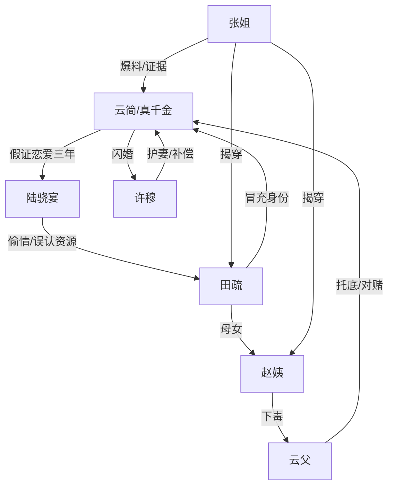

# 角色标签图谱

## 角色清单

### 云简 — 清醒撤退型真千金

- 叙事功能: 第一视角主角，承受背叛并撤回资源，完成身份反杀。
- 核心标签: 真千金、冷静、被低估的资源方
- 弧光: 恋爱脑隐忍妻子 → 取消对赌的女儿 → 合法许夫人 → 云家大小姐
- 台词风格: 克制、短句、关键时刻锋利
- 关键行为: 查假证、取消对赌、回家闪婚、当众揭穿田疏母女
- 读者情绪关系: 前半心疼，后半爽

### 陆骁宴 — 傲慢错认资源的前任

- 叙事功能: 背叛者和悔恨对象，负责制造婚姻债。
- 核心标签: 假深情、机会主义、傲慢
- 弧光: 笃定女主离不开他 → 发现假证失效 → 错过真千金 → 没底气喊老婆
- 台词风格: 哄骗式温柔，出事后强行解释
- 关键行为: 做假证、推迟婚礼、陪田疏旅游结婚、误认田疏资源
- 读者情绪关系: 恨、等他后悔

### 田疏 — 冒牌千金型绿茶闺蜜

- 叙事功能: 近身侵占者，负责抢男人、抢身份、抢家庭位置。
- 核心标签: 绿茶、寄生、冒牌大小姐
- 弧光: 被资助伴读 → 贴身秘书/小三 → 假新娘 → 被揭厨娘女儿
- 台词风格: 撒娇、装委屈、暗戳戳炫耀
- 关键行为: 占副驾驶、试婚纱、怀孕、骗云简留守、带陆骁宴回云家
- 读者情绪关系: 强恨点

### 许穆 — 钓系补偿型合法丈夫

- 叙事功能: 新婚姻坐标，负责证明女主值得被认真对待。
- 核心标签: 门当户对、钓系、克制护短
- 弧光: 被迫相亲对象 → 联姻搭子 → 合法丈夫 → 真心认真者
- 台词风格: 懒散、直白、带欲感
- 关键行为: 三分钟定婚、视频配合、回门护妻、送领带
- 读者情绪关系: 爽、甜、补偿

### 张姐 — 傻人真相雷达

- 叙事功能: 荒诞爆料器，负责把隐藏信息口语化抖出。
- 核心标签: 傻佣人、无意证人、关键证据持有人
- 弧光: 被当作说傻话 → 多次爆出真相 → 留存下毒证据
- 台词风格: 方言化、直白、童言无忌
- 关键行为: 点破偷情、点破假证、点破怀孕、拿出毒粉
- 读者情绪关系: 喜感、可靠、解气

### 云父 — 托底型严父

- 叙事功能: 家族资源和女主退路的具象化。
- 核心标签: 严厉、护短、资源掌控者
- 弧光: 反对婚事的父亲 → 实则放水托举 → 被下毒受害者
- 台词风格: 冷硬、直接
- 关键行为: 设置对赌、安排许穆相亲、接纳女主回家
- 读者情绪关系: 安心、心疼

### 赵姨 — 潜伏型恶仆

- 叙事功能: 将田疏母女侵占升级为刑事清算。
- 核心标签: 厨娘、下毒者、寄生者
- 弧光: 云家厨娘 → 冒牌千金母亲 → 下毒嫌疑人
- 台词风格: 惶恐狡辩
- 关键行为: 长期给云父炖汤撒粉
- 读者情绪关系: 厌恶、要求严惩

## 关系网络

## 角色功能对照表（供改编参考）

| 原角色 | 极致标签 | 叙事功能 | 读者情绪功能 | 改编时必须保留的 |
|--------|---------|---------|-------------|---------------|
| 云简 | 清醒真千金 | 撤回资源并清算 | 心疼转爽 | 主动回家、合法再婚、当众揭穿 |
| 陆骁宴 | 傲慢前任 | 制造背叛和悔恨 | 恨与打脸期待 | 假证、推迟婚礼、笃定她离不开 |
| 田疏 | 冒牌绿茶 | 近身侵占 | 强恨点 | 闺蜜身份、炫耀、假千金人设 |
| 许穆 | 钓系合法丈夫 | 情感补偿 | 甜爽 | 合法身份、护短、克制认真 |
| 张姐 | 傻人证人 | 爆料与证据 | 喜感爽点 | 三次以上关键爆料 |
| 云父 | 严父资源方 | 托底与身份坐标 | 安全感 | 对赌和回家退路 |
| 赵姨 | 恶仆 | 刑事升级 | 愤怒 | 长期侵害家族核心成员 |
