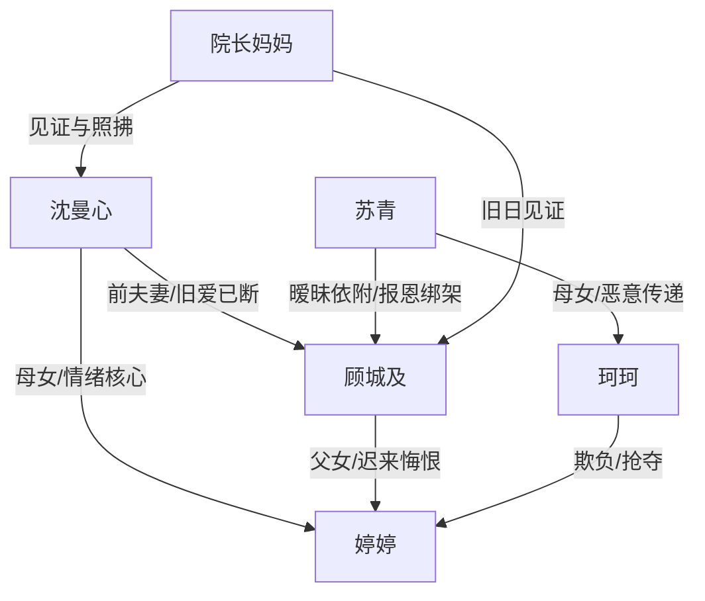

# 角色标签图谱

## 角色清单

### 沈曼心 — 克制丧女母亲/清醒前妻
- 叙事功能: 第一人称承伤者与清算者，负责揭露真相、拒绝复合、完成价值判断。
- 核心标签: 克制、清醒、丧女之痛
- 弧光: 被假死骗局拉回旧伤 → 领回女儿骨灰 → 说出真相 → 拒绝复合 → 面向新生活
- 台词风格: 短句、平静、带冷刺。
- 关键行为: 领骨灰、安葬女儿、电话告知真相、去别墅取玩偶、拒绝顾城及。
- 读者情绪关系: 心疼、代入、爽感站队对象。

### 顾城及 — 迟钝悔夫/报恩失衡者
- 叙事功能: 主要伦理罪人；既提供旧爱温度，也提供不可逆伤害。
- 核心标签: 念旧、迟钝、自以为是
- 弧光: 假死试探 → 不信女儿死讯 → 被真相击穿 → 驱逐苏青 → 跪求改正 → 长期补偿
- 台词风格: 前期解释辩解，后期重复道歉、语速失控。
- 关键行为: 假死骗女主回国、偏心苏青母女、错过女儿临终、修补玩偶、追到非洲补偿。
- 读者情绪关系: 恨、复杂、看他悔恨偿债。

### 苏青 — 绿茶寡妇/软刀子入侵者
- 叙事功能: 外部反派与婚姻入侵者，推动女主家庭破裂。
- 核心标签: 伪善、嫉妒、操控
- 弧光: 温柔示弱 → 炫耀同居 → 占用女儿房间 → 被戳破执念 → 被驱逐败落
- 台词风格: 软、委屈、夹枪带棒。
- 关键行为: 递药保温杯、羞辱骨灰盒、占用婷婷房间、教女儿恶语、向顾城及告白。
- 读者情绪关系: 厌恶、盼报应。

### 顾婷/婷婷 — 情绪债核心/逝去的月亮
- 叙事功能: 全文痛感核心和道德坐标；她的死让所有旧账不可逆。
- 核心标签: 乖、盼父爱、早逝
- 弧光: 被父亲忽视 → 车祸烧伤 → 临终仍懂事 → 以骨灰和玩偶持续影响活人
- 台词风格: 稚嫩、懂事、让人心碎。
- 关键行为: 等爸爸、穿粉裙、公交车挥手、临终请求爸爸来看她。
- 读者情绪关系: 极强心疼，是复仇合理性的根。

### 珂珂/陈珂珂 — 恶童镜像/残忍泄密者
- 叙事功能: 童言无忌揭穿苏青，放大“天真与残忍”的冲击。
- 核心标签: 被宠坏、恶意、抢夺
- 弧光: 欺负婷婷 → 占用房间 → 当众泄露母亲恶意
- 台词风格: 天真口吻说残忍话。
- 关键行为: 倒橙汁、抢父爱、说“她死了就挺好的”。
- 读者情绪关系: 愤怒、恶心，同时加速苏青崩塌。

### 院长妈妈 — 旧情见证者/价值旁白
- 叙事功能: 见证沈曼心和顾城及的过去，提供温度与判断。
- 核心标签: 慈爱、清醒、见证者
- 弧光: 安葬陪伴 → 回忆见证 → 劝女主接受补偿但不必原谅
- 台词风格: 温和、朴素、有判断力。
- 关键行为: 陪葬婷婷、讲述顾城及执拗、点明“理所当然”。
- 读者情绪关系: 安慰、稳定、补充道德判断。

## 关系网络

## 角色功能对照表（供改编参考）

| 原角色 | 极致标签 | 叙事功能 | 读者情绪功能 | 改编时必须保留的 |
|--------|---------|---------|-------------|---------------|
| 沈曼心 | 克制丧女母亲 | 承伤与清算 | 心疼、代入、爽 | 平静、不复合、不主动求报应 |
| 顾城及 | 迟钝悔夫 | 伦理罪人和悔恨容器 | 恨、复杂、看报应 | 曾深爱过，但伤害不可逆 |
| 苏青 | 绿茶入侵者 | 外部反派 | 厌恶、盼打脸 | 软刀子话术与“没转正”痛点 |
| 婷婷 | 逝去的月亮 | 情绪债核心 | 心碎、保护欲 | 临终懂事、父爱缺席、物件回收 |
| 珂珂 | 恶童泄密者 | 真相引爆器 | 愤怒 | 用童言暴露母亲恶意 |
| 院长妈妈 | 见证者 | 温度与旁白 | 安定、解释 | 点明“理所当然”的主题 |
