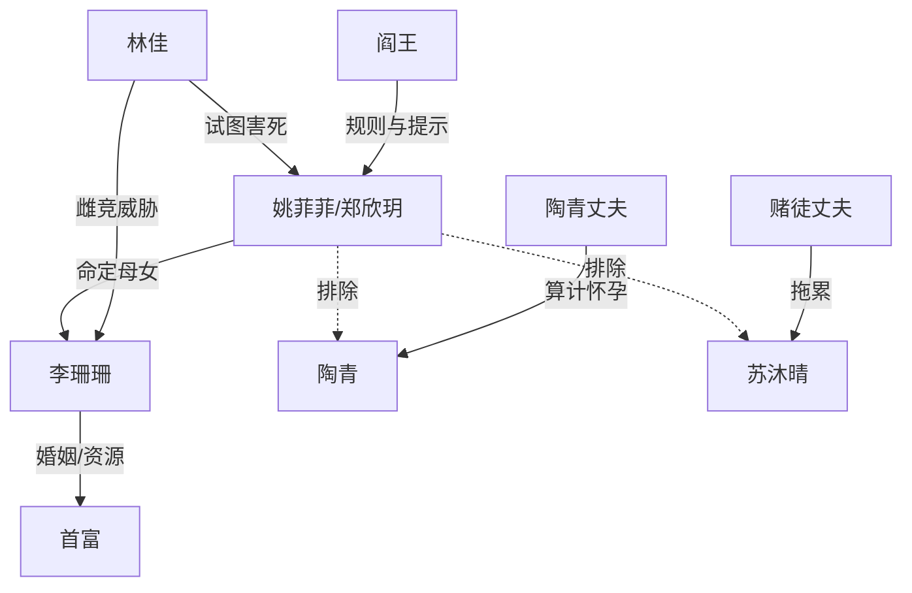

# 角色标签图谱

## 角色清单

### 姚菲菲/郑欣玥 — 清醒求生型胎儿主角

- 叙事功能: 视角核心、选择者、谜题破解者
- 核心标签: 投胎者、求生、会复盘
- 弧光: 恐惧逃避 → 三轮排除 → 反思自身策略 → 母女同心 → 顺利出生
- 台词风格: 直白、急促、设问多
- 关键行为: 争取一小时体验、排除三个选项、反选李珊珊、胎内配合自救
- 读者情绪关系: 心疼、代入、替她紧张，最终获得补偿爽感

### 李珊珊 — 雌竞型首富太太/危险但真爱孩子的命定母亲

- 叙事功能: 最大误导项、最终正确答案
- 核心标签: 首富老婆、雌竞、母爱强
- 弧光: 把胎儿当王牌 → 梦见前世 → 放弃苦肉计 → 拼命护胎
- 台词风格: 亲昵称呼多，情绪外放
- 关键行为: 备孕、保胎、险些苦肉计、翻身护肚
- 读者情绪关系: 前期警惕，后期转为认可和感动

### 陶青 — 丁克女企业家

- 叙事功能: 第二个误导项，代表事业优先
- 核心标签: 女强人、丁克、原则强
- 弧光: 坚持不生 → 被“继承事业”短暂动摇 → 仍拒绝被算计怀孕
- 台词风格: 强硬、理性、边界明确
- 关键行为: 明确说被算计怀孕就打掉孩子
- 读者情绪关系: 不恨但无法托付

### 苏沐晴 — 温柔恋爱脑母亲候选

- 叙事功能: 第三个误导项，代表爱孩子但无自保能力
- 核心标签: 温柔、贤妻、恋爱脑
- 弧光: 爱孩子 → 被丈夫骗钱 → 无法识别危险
- 台词风格: 温柔、顺从、信任丈夫
- 关键行为: 给丈夫嫁妆和存款，忽略胎儿提醒
- 读者情绪关系: 心疼又着急

### 林佳 — 金丝雀小三/外部死亡威胁

- 叙事功能: 终局外部危机制造者
- 核心标签: 嚣张、嫉妒、狠毒
- 弧光: 挑衅 → 诅咒 → 真正推人下楼
- 台词风格: 挑衅、恶毒、攻击性强
- 关键行为: 堵路、威胁、楼梯袭击
- 读者情绪关系: 恨，期待被清算

### 阎王 — 规则型引导者

- 叙事功能: 出题人、卡点制造者、规则解释者
- 核心标签: 严肃、高深、不能偏私
- 弧光: 逼迫选择 → 允许体验 → 反复追问 → 结尾解释
- 台词风格: 规则化、警告式、含暗示
- 关键行为: 给三个选项、提醒“你做错了一件事”
- 读者情绪关系: 既急又信任，他保证谜题公平

### 首富 — 资源兑现者

- 叙事功能: 爽感补偿与阶层资源来源
- 核心标签: 有钱、想要孩子、后期收心
- 弧光: 给钱奖励 → 因林佳事件愧疚 → 公证财产
- 台词风格: 直接砸资源
- 关键行为: 五千万奖励、基金、财产公证
- 读者情绪关系: 工具型爽点来源

## 关系网络

## 角色功能对照表（供改编参考）

| 原角色 | 极致标签 | 叙事功能 | 读者情绪功能 | 改编时必须保留的 |
|--------|---------|---------|-------------|---------------|
| 姚菲菲 | 求生胎儿 | 视角与选择 | 心疼、代入 | 三次失败后自我复盘 |
| 李珊珊 | 危险真母亲 | 正确答案 | 误判后反转感动 | 既危险又把孩子排第一 |
| 陶青 | 丁克女强人 | 错误答案一 | 理解但放弃 | 事业/自我原则优先 |
| 苏沐晴 | 恋爱脑好妈妈 | 错误答案二 | 心疼又焦急 | 爱孩子但护不住自己 |
| 林佳 | 恶毒小三 | 外部危机 | 恨与清算期待 | 真实袭击而非只挑衅 |
| 阎王 | 规则导师 | 悬念控制 | 追谜 | 反复提示“你做错了” |
