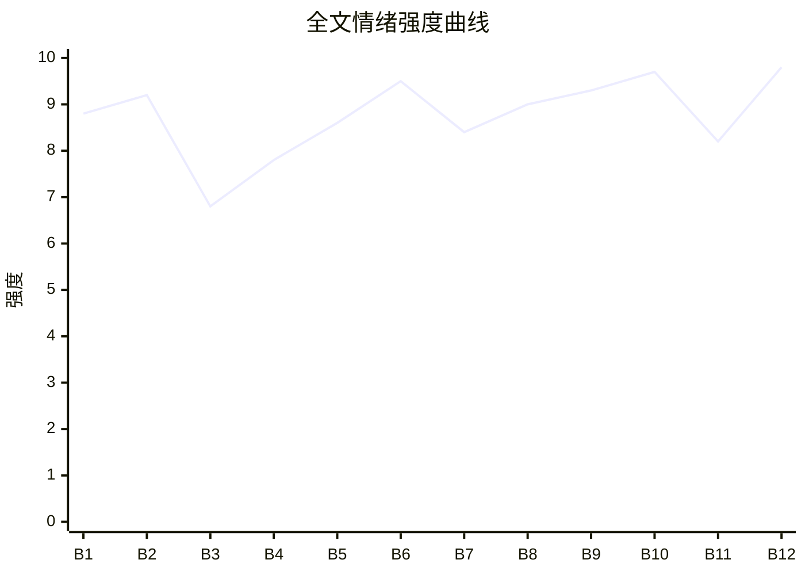

# Beat Sheet 节拍器

## 全文概况

- 总字数: 约 15000 字
- 节拍数: 12 幕
- 核心母题（Logline）: 女主被丈夫秘书污蔑挪用公款并限制财产，为夺回尊严与家族企业，逐层揭开丈夫软饭背叛、秘书越权侵占和商业窃密，最终让二人入狱并重掌人生。
- 情绪模式: 荒诞羞辱 → 生命威胁 → 背叛确认 → 当众压迫 → 身份反杀 → 法律清算 → 余党反扑 → 终局碾压

## 节拍详表

### Beat 1: 奶茶引爆挪用公款 [开篇-1 前]

- **字数**: 约 620 字（占比 4.1%）
- **核心事件**: 女主买蜜雪冰城刷亲密付，被秘书报警称挪用公款，并被限制每月 500 元额度。
- **情绪标签**: 荒诞、羞辱、冷笑、期待反杀
- **情绪强度**: 8.8/10
- **情绪方向**: ⚡突变
- **冲突类型**: 大转折
- **悬念钩子**: 女主真实身份是公司所有者，秘书凭什么管她的钱？
- **叙事速度**: 快
- **对话占比**: 45%
- **reversal_mechanism**: [M2, M3]
- **hook_strength**: 9.0/10
- **关键句**: “公司是我的，老公的银行账户里每一笔钱都是我的，连她的工资，也是我发的。”
- **原文摘录**: “逛街买蜜雪冰城,我不小心刷了老公的亲密付，还没等走出店，我就被制服叔叔摁在地上，说我涉嫌挪用公款。……‘还有，你每个月的消费额度只有500块，今天你已经花了499了，这个月你不许再花钱了！’……可她不知道。公司是我的，老公的银行账户里每一笔钱都是我的，连她的工资，也是我发的。而她口中的‘沈先生’，不过是入赘到我家的。她凭什么，替他管我家的钱？”

### Beat 2: 医院缴费失败与账户冻结 [1 初段]

- **字数**: 约 1250 字（占比 8.3%）
- **核心事件**: 女主临产住院，个人银行卡被清空/冻结，许岁岁要求她发 OA 申请。
- **情绪标签**: 愤怒、惊恐、生命危机
- **情绪强度**: 9.2/10
- **情绪方向**: ↑上升
- **冲突类型**: 大转折
- **悬念钩子**: 一个秘书为什么能控制女主所有账户？
- **叙事速度**: 快
- **对话占比**: 50%
- **reversal_mechanism**: [M3]
- **hook_strength**: null
- **关键句**: “对了，你这个月只剩下一块钱的额度了，你别申请超额了！”
- **原文摘录**: “到了医院，登记信息，需要缴费。……‘林女士，你的卡里没钱了。’……我现在在医院，需要用钱，把我的钱还给我！……‘需要用钱就给我发OA申请，我同意了自然会给你打钱！对了，你这个月只剩下一块钱的额度了，你别申请超额了！’……‘我已经把你名下所有的账户都冻结了，也打过招呼了谁都不许借给你钱。等到你什么时候给我道歉……我再开通您的账户吧。’看到这条信息，我气血翻涌，终于晕死了过去。”

### Beat 3: 爱情回忆与沈封人设反转预埋 [回忆段]

- **字数**: 约 1650 字（占比 11.0%）
- **核心事件**: 女主回忆隐瞒身份进公司、爱上贫穷但正直的沈封，并让他入赘掌管公司。
- **情绪标签**: 怀念、心痛、反差
- **情绪强度**: 6.8/10
- **情绪方向**: ↓下降
- **冲突类型**: 微冲突
- **悬念钩子**: 曾经护她的人为什么会纵容秘书伤害她？
- **叙事速度**: 中
- **对话占比**: 25%
- **reversal_mechanism**: [M5, M2]
- **hook_strength**: null
- **关键句**: “彼时马上就要升职的沈封，竟然直接拍桌而起，直接挡在我面前。”
- **原文摘录**: “我家千亿资产，这一代却只有我一个女儿。……我选择隐瞒身份，以一个小职员的身份进入公司……他每天来得最早，走得最晚。……‘太晚回去不安全，我帮你完成工作，你下班吧。’……女同事偷了我的项目……沈封竟然直接拍桌而起……‘我要跟她一起走！’……结婚后……公司就交给了沈封跟我的律师一起打理。”

### Beat 4: 许岁岁绿茶越界与沈封初次包庇 [许岁岁入职-彻夜不归]

- **字数**: 约 1700 字（占比 11.3%）
- **核心事件**: 许岁岁被女主资助升职，却改婚房密码、带醉酒沈封彻夜不归，并用母亲手术卖惨留下。
- **情绪标签**: 憋屈、恶心、疑云
- **情绪强度**: 7.8/10
- **情绪方向**: ↑上升
- **冲突类型**: 微冲突
- **悬念钩子**: 沈封的维护是真心惩罚，还是表演？
- **叙事速度**: 中
- **对话占比**: 45%
- **reversal_mechanism**: [M5]
- **hook_strength**: null
- **关键句**: “要说这背后没有沈封的撑腰……是不可能的。”
- **原文摘录**: “许岁岁就是其中一个，进入了公司，不到十天就一路晋升到了总裁秘书的岗位。……我很欣赏这样有前途的女孩子，不仅帮她全部还了助学贷款。……一开始，是她经常借着要时常替沈封取文件为由，直接把我婚房的密码改成了她的生日。……她穿着我的睡衣，正在给沈封做早餐。……沈封那个时候，还黏糊糊的抱着我说道：‘老婆，你怎么那么善良啊！’……可是许岁岁一而再，再而三的挑衅我。”

### Beat 5: 背叛证据与珠宝被控 [医院醒来-回家被封]

- **字数**: 约 1550 字（占比 10.3%）
- **核心事件**: 律师查出沈封与许岁岁旅游、资助、暧昧朋友圈；女主回家发现嫁妆珠宝被转由许岁岁管理。
- **情绪标签**: 心碎、屈辱、怒火
- **情绪强度**: 8.6/10
- **情绪方向**: ↑上升
- **冲突类型**: 大转折
- **悬念钩子**: 文件夹里到底是什么更大的证据？
- **叙事速度**: 快
- **对话占比**: 35%
- **reversal_mechanism**: [M2, M5]
- **hook_strength**: null
- **关键句**: “我打开文件夹，只一眼就双腿一软，险些摔倒。”
- **原文摘录**: “我醒来的时候，沈封还没出现。……‘沈总带着秘书出去开会了，说是明天才能回来。’……朋友圈截图……‘我一句想看埃菲尔铁塔，他就陪我连夜飞过来了。’……‘资助人就是沈先生。’……我打开文件夹，只一眼就双腿一软……可等到我回家的时候，才发现我家竟然被封了起来。……‘以后您的珠宝，首饰，包包，礼服都归许小姐管理……写一篇5000字的申请书发到了OA流程上。’”

### Beat 6: 母亲病房被夺，女主杀心落地 [母亲被赶-去公司]

- **字数**: 约 1300 字（占比 8.7%）
- **核心事件**: 许岁岁将女主母亲赶出 VIP 病房给自己母亲住，女主确认生命底线被踩，命令律师反击。
- **情绪标签**: 暴怒、护亲、清醒
- **情绪强度**: 9.5/10
- **情绪方向**: ⚡突变
- **冲突类型**: 大转折
- **悬念钩子**: 女主去公司后会如何亲手清算白眼狼？
- **叙事速度**: 快
- **对话占比**: 40%
- **reversal_mechanism**: [M3]
- **hook_strength**: null
- **关键句**: “既然我的身边已经出现了白眼狼，那我便要亲手除掉他们。”
- **原文摘录**: “‘你妈都病了那么多年了……我直接让人把你妈请出去了。’……‘我母亲不能离开吸氧仓的！你这样做是杀人！’……许岁岁竟然把我妈妈的VIP病房拿去给她妈妈住了。……我直接跟身边的律师下令：‘把许岁岁的母亲给我丢到大马路上！’……‘还有！我要起诉许岁岁！杀人未遂！’……‘送我去公司。’”

### Beat 7: 公司门口受辱与公开离婚宣言 [到公司-沈封回来]

- **字数**: 约 1450 字（占比 9.7%）
- **核心事件**: 女主到公司被小乔羞辱，被许岁岁势力嘲讽“老女人”，女主当众宣称来离婚且净身出户的是沈封。
- **情绪标签**: 爽前压迫、轻蔑、期待
- **情绪强度**: 8.4/10
- **情绪方向**: ↑上升
- **冲突类型**: 微冲突
- **悬念钩子**: 沈封会如何面对公开离婚？
- **叙事速度**: 快
- **对话占比**: 55%
- **reversal_mechanism**: [M2]
- **hook_strength**: null
- **关键句**: “该净身出户的，不是我，而是他。”
- **原文摘录**: “到了公司……‘沈夫人怎么来公司了啊？’……小乔……‘你就是沈总的老婆啊？这么大岁数了，难怪沈总嫌弃你了。’……我冷笑一声，直接让保镖给她摁住，抬手一个耳光打在她脸上。……‘我今天还就是来跟沈封离婚的，只不过，该净身出户的，不是我，而是他。’……沈封带着许岁岁急匆匆的赶了回来。”

### Beat 8: 怀孕小三与沈封摊牌夺产 [公司对峙-沈封宣称共同财产]

- **字数**: 约 1550 字（占比 10.3%）
- **核心事件**: 许岁岁倒打一耙，女主甩出孕检单；沈封承认出轨并试图以共同财产、公司控制权威胁女主。
- **情绪标签**: 恶心、愤怒、期待打脸
- **情绪强度**: 9.0/10
- **情绪方向**: ↑上升
- **冲突类型**: 大转折
- **悬念钩子**: 女主如何证明公司真正归属？
- **叙事速度**: 快
- **对话占比**: 60%
- **reversal_mechanism**: [M2, M6]
- **hook_strength**: null
- **关键句**: “你好像忘了，我们不是结婚，而是你入赘啊！”
- **原文摘录**: “许岁岁抱着被扇红脸的小乔，突然哭了起来……‘您怎么能让人把我妈妈丢出医院呢！’……我从包里拿出一张孕检单，砸在他脸上：‘许岁岁怀孕了！怀的是你的孩子！’……沈封……‘既然你已经知道了，那我也不瞒你了。’……‘就算是上了法庭，这个公司跟所有的资产，都有我的一半。’……我笑了起来：‘你好像忘了，我们不是结婚，而是你入赘啊！’”

### Beat 9: 员工站队与律师执法入场 [身份压制-执法进场]

- **字数**: 约 1500 字（占比 10.0%）
- **核心事件**: 沈封煽动员工站队，许岁岁让保安赶女主；女主电话叫来律师和执法人员，准备公开清算。
- **情绪标签**: 窒息、反转前夕、爽感蓄势
- **情绪强度**: 9.3/10
- **情绪方向**: ⚡突变
- **冲突类型**: 大转折
- **悬念钩子**: 律师将公布哪些证据？
- **叙事速度**: 快
- **对话占比**: 55%
- **reversal_mechanism**: [M1, M2, M6]
- **hook_strength**: null
- **关键句**: “顺便把制服同志们也一起带过来吧，关于侵占财务的事情，我也该好好跟我的前夫清算一下了。”
- **原文摘录**: “沈封……‘这里的人，都是我一手提拔的！’……许岁岁……‘保安呢？还不把人请出去？’……周围员工的态度彻底变了。……我一一看过去。记住了这些人的面孔。……拨通了一个电话。‘可以进来了。顺便把制服同志们也一起带过来吧，关于侵占财务的事情，我也该好好跟我的前夫清算一下了。’……为首的是我的律师。而在他身后是好几名穿着制服的执法人员。”

### Beat 10: 股权信托与资金流死环 [律师宣读-离婚签字]

- **字数**: 约 1900 字（占比 12.7%）
- **核心事件**: 律师公开证明公司、账户、珠宝均属林家信托，沈封无共同财产只有共同债务，且涉嫌挪用资金；沈封签字离婚。
- **情绪标签**: 痛快、碾压、塌房
- **情绪强度**: 9.7/10
- **情绪方向**: ↑上升
- **冲突类型**: 大转折
- **悬念钩子**: 沈封会不会就此彻底倒下？
- **叙事速度**: 中快
- **对话占比**: 50%
- **reversal_mechanism**: [M1, M2, M3]
- **hook_strength**: null
- **关键句**: “只有共同债务没有共同财产！”
- **原文摘录**: “律师上前一步……‘第一，这家公司，从注册之初到现在……全部隶属于林家名下信托。’……‘与沈封先生，没有任何实际所有权关系。’……‘并非使用婚内财产，而是向家族账户进行的内部借贷，也就是说，您二位现在都欠着林家家族账户的钱呢！只有共同债务没有共同财产！’……‘沈封先生，用公司账户向个人账户转移资金……这是挪用公款了。’……我从包里抽出一份文件。‘离婚协议。签字吧。’……他手抖着签了字。”

### Beat 11: 公司换血与前夫反扑 [一个月后-招标会前]

- **字数**: 约 1050 字（占比 7.0%）
- **核心事件**: 女主清洗公司，沈封另起炉灶拉客户、抢新品并带许岁岁以“沈太太”身份公开挑衅。
- **情绪标签**: 未尽、压迫回潮、终局期待
- **情绪强度**: 8.2/10
- **情绪方向**: →平稳后上升
- **冲突类型**: 微冲突
- **悬念钩子**: “好戏还没开始”暗示女主已布终局。
- **叙事速度**: 中
- **对话占比**: 30%
- **reversal_mechanism**: [M6]
- **hook_strength**: null
- **关键句**: “急什么。好戏还没开始。”
- **原文摘录**: “那一天起。整个公司，开始大换血。……一个一个。全部开除。……可却在一夜之间，客户突然爽约，市场被挤占。市值蒸发了将近百分之十。……‘沈封……另起炉灶了。’……许岁岁也彻底不装了。她挺着肚子，挽着沈封的手。以‘沈太太’的身份……我只是笑了笑。‘急什么。好戏还没开始。’”

### Beat 12: 招标会终清算与新生结尾 [招标会-结尾]

- **字数**: 约 2480 字（占比 16.5%）
- **核心事件**: 招标会上执法人员带走沈封和许岁岁，商业窃密、职务侵占、杀人未遂全部落地；女主生女并声明只后悔心软。
- **情绪标签**: 终极爽、报应、重生
- **情绪强度**: 9.8/10
- **情绪方向**: ↑上升后→收束
- **冲突类型**: 大转折
- **悬念钩子**: 已收束，无后续悬念，留下大女主人生开启。
- **叙事速度**: 快转慢
- **对话占比**: 45%
- **reversal_mechanism**: [M1, M3, M6]
- **hook_strength**: null
- **关键句**: “我只后悔，当初心软过。”
- **原文摘录**: “业内最大的招标会。……许岁岁……‘林小姐可真可怜。男人留不住。现在连公司也守不住了。’……沈封……‘如果你现在后悔。我也不是不能考虑跟你复婚。’……会场大门，被猛地推开。……‘沈封。涉嫌职务侵占、挪用资金、商业窃密。请跟我们走一趟。’……‘许岁岁。你涉嫌非法干预医疗资源分配……现以杀人未遂嫌疑，依法带走调查。’……‘盛世集团的每一个项目，从立项，到数据，到代码，全部归林氏所有。’……‘晚了。’……判决下来。沈封……入狱。许岁岁……同样入刑。……我的孩子平安出生。是个女孩。……‘我从不后悔。’‘我只后悔’‘当初心软过。’”

## 情绪曲线可视化

## 节拍密度检测

- 平均每 1250 字一个节拍
- 微冲突密度: 每 1800 字一次
- 大转折密度: 每 1500 字一次
- 判定: 符合高频节拍器标准

## 反转机制清单(Reversal Mechanisms)

从 prompts/patterns/reversal-mechanisms.md 的 8 大机制中命中以下机制:

| 机制 ID | 机制名 | 承载 Beat | 关键段落/金句 | 等价改编提示 |
|--------|--------|-----------|--------------|-------------|
| M1 | 死环反杀 | Beat 9-10, Beat 12 | “只有共同债务没有共同财产！”；“涉嫌职务侵占、挪用资金、商业窃密” | 固化载体可换为信托文件、权限日志、资金流水，但必须保留“你以为是你的，证据证明全是我的/你侵占”的闭环 |
| M2 | 身份反差爆发 | Beat 1, Beat 8-10 | “公司是我的”；“我们不是结婚，而是你入赘啊” | 身份层级不能压缩，至少保留“表层弱者 → 家族继承人 → 公司掌权人”三层 |
| M3 | 因果回旋反讽 | Beat 2, Beat 6, Beat 10, Beat 12 | “挪用公款”从女主罪名回旋到沈封真罪；“限制消费/财产安全”回旋成许岁岁非法侵占 | 必须让施害者使用的规则反身打回自己，结尾用同类罪名/同类话术清算 |
| M6 | 多层递进反转 | Beat 8-12 | 怀孕证据 → 入赘身份 → 信托股权 → 商业窃密入狱 | 反转层数不能少，层级需从私人婚姻升到公司权力再升到刑事清算 |
