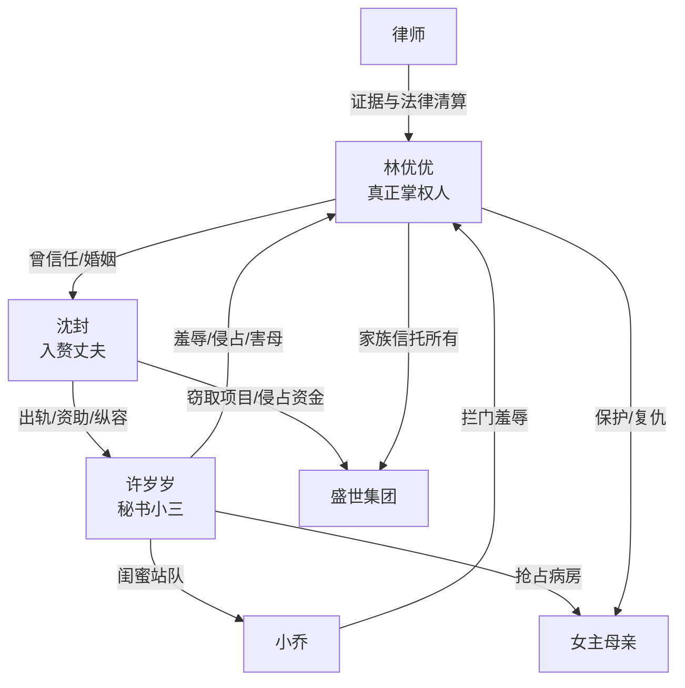

# 角色标签图谱

## 角色清单

### 林优优 — 隐忍资本大女主

- 叙事功能: 第一人称主角、受辱者、设局者、最终清算者
- 核心标签: 千亿继承人、孕期被背叛、冷静反杀
- 弧光: 信任丈夫退居幕后 → 被羞辱伤害 → 夺回公司与人生
- 台词风格: 短句、冷笑、宣判式
- 关键行为: 暂停沈封职位、起诉许岁岁、带律师执法进公司、招标会终局清算
- 读者情绪关系: 心疼、代入、爽

### 沈封 — 软饭背刺男/伪掌权者

- 叙事功能: 亲密关系背叛源、权力侵占者、终极清算对象
- 核心标签: 入赘女婿、出轨总裁、商业窃密犯
- 弧光: 温柔穷小子 → 伪装成功人士 → 负债罪犯
- 台词风格: 先威胁，后哀求，立场快速崩塌
- 关键行为: 纵容秘书、出轨怀孕、试图夺公司、另起炉灶偷项目
- 读者情绪关系: 恨、鄙夷、期待他崩溃

### 许岁岁 — 绿茶越权秘书/小三

- 叙事功能: 高频羞辱输出、情绪债制造机、女主反杀触发器
- 核心标签: 贫困生秘书、白眼狼、小三孕妇
- 弧光: 被女主资助提拔 → 越权夺财害人 → 入刑崩塌
- 台词风格: 装可怜与道德绑架切换，爱用“为了沈总/公司”
- 关键行为: 报假警、冻结账户、转移珠宝、抢母亲病房、公开挑衅
- 读者情绪关系: 强烈厌恶，承担主要“打脸需求”

### 小乔 — 走狗型炮灰

- 叙事功能: 展示许岁岁势力扩张和公司站队腐化
- 核心标签: 闺蜜走狗、嘴贱炮灰、职场站队者
- 弧光: 拦门羞辱 → 被掌掴 → 被开除
- 台词风格: 粗暴、轻蔑、狐假虎威
- 关键行为: 公司门口拦女主，骂女主老女人
- 读者情绪关系: 小爽点承载者

### 律师 — 证据宣判者

- 叙事功能: 女主权力代理人、法律信息输出口
- 核心标签: 冷静、专业、证据链
- 弧光: 医院守候 → 调查证据 → 当众宣读 → 立案执行
- 台词风格: 文件化、条理化、宣判式
- 关键行为: 调查朋友圈、股权信托、资金流、商业窃密证据
- 读者情绪关系: 安全感、爽点兑现

### 女主母亲 — 底线触发者

- 叙事功能: 生命伦理底线，推动女主从忍耐转向杀伐
- 核心标签: 病危母亲、被侵害弱者、亲情底线
- 弧光: 住院治疗 → 病房被夺 → 稳定恢复
- 台词风格: 基本无台词
- 关键行为: 被许岁岁赶出病房，触发杀人未遂清算
- 读者情绪关系: 心疼、愤怒、正义合法化

## 关系网络

## 角色功能对照表（供改编参考）

| 原角色 | 极致标签 | 叙事功能 | 读者情绪功能 | 改编时必须保留的 |
|--------|---------|---------|-------------|---------------|
| 林优优 | 隐忍资本大女主 | 受辱后清算 | 代入与爽 | 真实掌权身份、冷静姿态、法律反杀 |
| 沈封 | 软饭背刺男 | 亲密背叛与夺权 | 恨与鄙夷 | 入赘/靠女主起家、出轨、侵占权力 |
| 许岁岁 | 绿茶越权秘书 | 高频羞辱 | 强恨点 | 越权管钱、装可怜、伤害女主家人 |
| 小乔 | 炮灰走狗 | 扩大站队压迫 | 小打脸 | 狐假虎威、当众羞辱、快速清算 |
| 律师 | 证据宣判者 | 信息揭示 | 安全感 | 文件/资金/法律证据链 |
| 女主母亲 | 亲情底线 | 触发女主反击 | 心疼与愤怒 | 被反派伤害到生命安全 |
