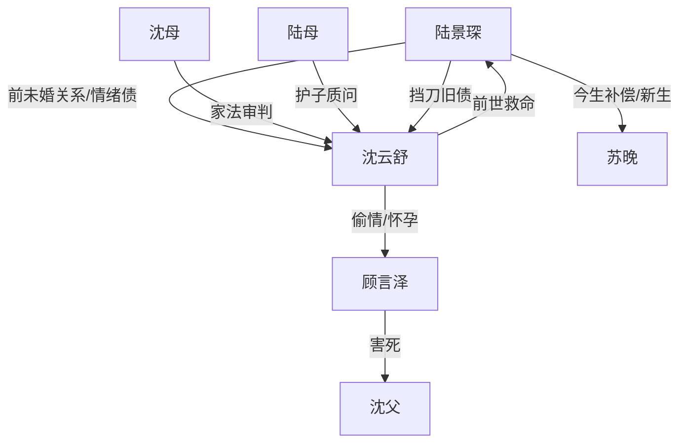

# 角色标签图谱

## 角色清单

### 陆景琛 — 清醒重生男主/情绪债清算者
- 叙事功能: 受害者、证据收集者、公开审判执行者。
- 核心标签: 重生、冷静、两清。
- 弧光: 愧疚补偿 → 信任崩塌 → 主动设局 → 情感解绑。
- 台词风格: 短句、反问、证据砸脸。
- 关键行为: 查孕检、邀请顾言泽、带长辈抓奸、公开视频、拒绝复合。
- 读者情绪关系: 心疼前期被欺骗，爽于后期清醒反杀。

### 沈云舒 — 伪深情女总裁/追妻火葬场反派
- 叙事功能: 情绪债来源、双面反讽载体、悔恨线承担者。
- 核心标签: 伪装深情、控制欲、藏污。
- 弧光: 豪门深情人设 → 婚礼社死 → 家族除名 → 冰川赎罪。
- 台词风格: 前期温柔周全，后期急促邀功。
- 关键行为: 藏顾言泽、错戴戒指、婚礼偷情、狡辩下药、求复合。
- 读者情绪关系: 让读者恨、恶心，后期提供悔恨爽点。

### 顾言泽 — 疯批情人/杀父仇人/羞辱放大器
- 叙事功能: 引爆沈云舒底线崩坏，提供道德重罪。
- 核心标签: 恶毒、勾引、无耻。
- 弧光: 杀父凶手 → 被藏情人 → 婚礼衣柜丑闻 → 被沈云舒处理。
- 台词风格: 装可怜、哭腔、恶意补刀。
- 关键行为: 换哮喘药、生日宴闯入、婚礼递纸条、衣柜里承认孩子。
- 读者情绪关系: 纯恨点，越惨越偿债。

### 苏晚 — 温暖白月光/边界感新伴侣
- 叙事功能: 与沈云舒形成冷热对照，提供男主余生补偿。
- 核心标签: 温暖、稳定、保护。
- 弧光: 前世陪伴者 → 今生重逢 → 当场护住男主。
- 台词风格: 平静、简短、不纠缠。
- 关键行为: 买栗子、暖手、护在男主身前、围围巾。
- 读者情绪关系: 安心、补偿、治愈。

### 沈母 — 家族道德审判者
- 叙事功能: 前期为沈云舒背书，后期亲手切割，放大社死。
- 核心标签: 守旧、强硬、家法。
- 弧光: 相信女儿专一 → 亲眼见证背叛 → 断绝关系。
- 台词风格: 沉稳、有家族规训感。
- 关键行为: 婚礼保证、拐杖砸膝、宣布断女。
- 读者情绪关系: 替读者执行家族层面的惩罚。

### 陆母/陆家亲友 — 舆论见证团
- 叙事功能: 从“深情背书”转为“受害者家属愤怒”，让清算公开化。
- 核心标签: 信任、震惊、护子。
- 弧光: 放心托付 → 当场崩溃 → 质问沈家。
- 台词风格: 家常祝福转为愤怒控诉。
- 关键行为: 婚礼祝福、跟上楼、踹沈云舒。
- 读者情绪关系: 提供集体见证的爽感。

## 关系网络

## 角色功能对照表（供改编参考）

| 原角色 | 极致标签 | 叙事功能 | 读者情绪功能 | 改编时必须保留的 |
|--------|---------|---------|-------------|---------------|
| 陆景琛 | 清醒重生男主 | 设局清算 | 心疼→爽 | 冷静、证据链、两清逻辑 |
| 沈云舒 | 伪深情女总裁 | 情绪债源头 | 恨→看悔恨 | 表层深情与内心背叛并置 |
| 顾言泽 | 疯批情人 | 道德重罪触发器 | 厌恶 | 必须有不可原谅旧罪 |
| 苏晚 | 温暖白月光 | 情绪补偿 | 安心 | 热意象、边界感、保护姿态 |
| 沈母 | 家族审判者 | 公共惩罚 | 爽 | 先背书后断亲 |
