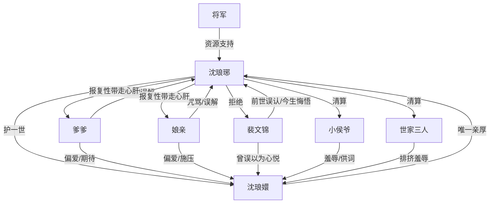

# 角色标签图谱

## 角色清单

### 沈琅琊 — 清醒护妹复仇长姐
- 叙事功能: 第一人称主角，承担重生、救妹、查真相、复仇和出走兑现。
- 核心标签: 护短、清醒、行动力强
- 弧光: 前世自责赎罪 → 今生避让救妹 → 发现妹妹自戕 → 清算外界与家庭 → 带妹自由
- 台词风格: 短句砸脸，情绪高点用连续质问
- 关键行为: 放弃抛绣球、试毒、取解药、审侯爷、设宴复仇、拒绝裴文锦、带妹妹出走
- 读者情绪关系: 心疼、爽、认同

### 沈琅嬛 — 被期待压垮的至宝妹妹
- 叙事功能: 情绪核心与救赎对象，推动女主从争夫叙事转向护妹叙事。
- 核心标签: 温柔、脆弱、被规训
- 弧光: 表面受宠 → 内里绝望 → 自戕求死 → 被姐姐护住 → 重获自由
- 台词风格: 柔软、轻声、带自我否定
- 关键行为: 分享布料、询问姐姐是否自在、吃毒求死、吐露绝望、随姐姐远走
- 读者情绪关系: 心疼、保护欲、怜惜

### 爹爹 — 功利偏心的迟悟父亲
- 叙事功能: 家庭压迫代表之一，后期提供复仇资源。
- 核心标签: 偏心、体面焦虑、迟来补偿
- 弧光: 前世逼死女主 → 今生继续警告女主 → 知道真相后跪求宗族 → 被女儿带走心肝宝贝惩罚
- 台词风格: 命令式、责备式，后期含愧
- 关键行为: 警告女主不准抢、责骂女主、跪遍贵人、同意取消婚事
- 读者情绪关系: 恨、复杂、有限缓和

### 娘亲 — 以爱为名施压的母亲
- 叙事功能: 直接制造姐妹两人的心理债务。
- 核心标签: 情绪勒索、偏爱、悔悟
- 弧光: 前世咒女主去死 → 今生继续偏心 → 打琅嬛逼问 → 得知真相后交秘宝
- 台词风格: 哭喊、指责、道德绑架
- 关键行为: 打女主、打琅嬛、哭诉自己不想活、交出传家秘宝
- 读者情绪关系: 恨、窒息、部分缓解

### 裴文锦 — 迟来深情的误认者
- 叙事功能: 前世婚恋误会源头，今生悔恨线负责情绪补偿。
- 核心标签: 误认、悔悟、无资格
- 弧光: 前世怨恨女主 → 今生抢女主绣球 → 承认真相 → 被女主拒绝
- 台词风格: 解释型、懊悔型、低姿态
- 关键行为: 抢绣球、挡母亲、求原谅、守沈家门口
- 读者情绪关系: 不原谅的爽、迟来悔恨的补偿

### 小侯爷 — 轻浮羞辱者与真相入口
- 叙事功能: 外部羞辱链的引爆点和供词来源。
- 核心标签: 破落贵族、嘴贱、懦弱
- 弧光: 当众羞辱琅嬛 → 被女主暴打 → 被审供出真相 → 磕头认错
- 台词风格: 刻薄下流，受刑后求饶
- 关键行为: 抢琅嬛绣球、羞辱退选、供出世家排挤
- 读者情绪关系: 恨、爽点靶子

### 柳小姐/王小姐/顾少爷 — 世家霸凌群像
- 叙事功能: 具体化“盛京评价系统”的恶意。
- 核心标签: 阴狠、虚荣、嘴碎
- 弧光: 私下羞辱琅嬛 → 设宴被清算 → 名声身体前程皆毁
- 台词风格: 前期假体面，后期哭求
- 关键行为: 排挤琅嬛、宴上被迫下跪、被卖走、家族被抄
- 读者情绪关系: 恨、痛快

### 将军 — 女主行动力背书
- 叙事功能: 提供军营资源，使女主“粗鄙骑马”转化为强势能力。
- 核心标签: 豪爽、护短、权力支援
- 弧光: 旧交资源 → 审讯支持 → 强化女主行动可信度
- 台词风格: 粗直、强硬
- 关键行为: 给烙铁、替女主扛事
- 读者情绪关系: 安全感、爽

## 关系网络

## 角色功能对照表（供改编参考）

| 原角色 | 极致标签 | 叙事功能 | 读者情绪功能 | 改编时必须保留的 |
|--------|---------|---------|-------------|---------------|
| 沈琅琊 | 清醒护妹复仇长姐 | 主视角、反击执行者 | 心疼转爽 | 被贬低能力后期变强势工具 |
| 沈琅嬛 | 被期待压垮的至宝妹妹 | 情绪核心 | 心疼与保护欲 | 自戕动机必须具体可信 |
| 爹娘 | 爱与压迫并存的父母 | 家庭债务源 | 窒息、愤怒、迟来补偿 | 偏心和体面焦虑不能删 |
| 裴文锦 | 迟来深情误认者 | 悔恨线 | 拒绝即爽 | 求原谅但无资格复合 |
| 小侯爷 | 嘴贱真相入口 | 外部冲突引爆 | 恨与拷问爽 | 羞辱句必须刺痛 |
| 世家三人 | 霸凌群像 | 社会规训具象化 | 清算爽 | 每人最在意之物被反向毁掉 |
| 将军 | 权力支援者 | 行动可信度 | 安全感 | 支撑女主暴力反击的资源来源 |
