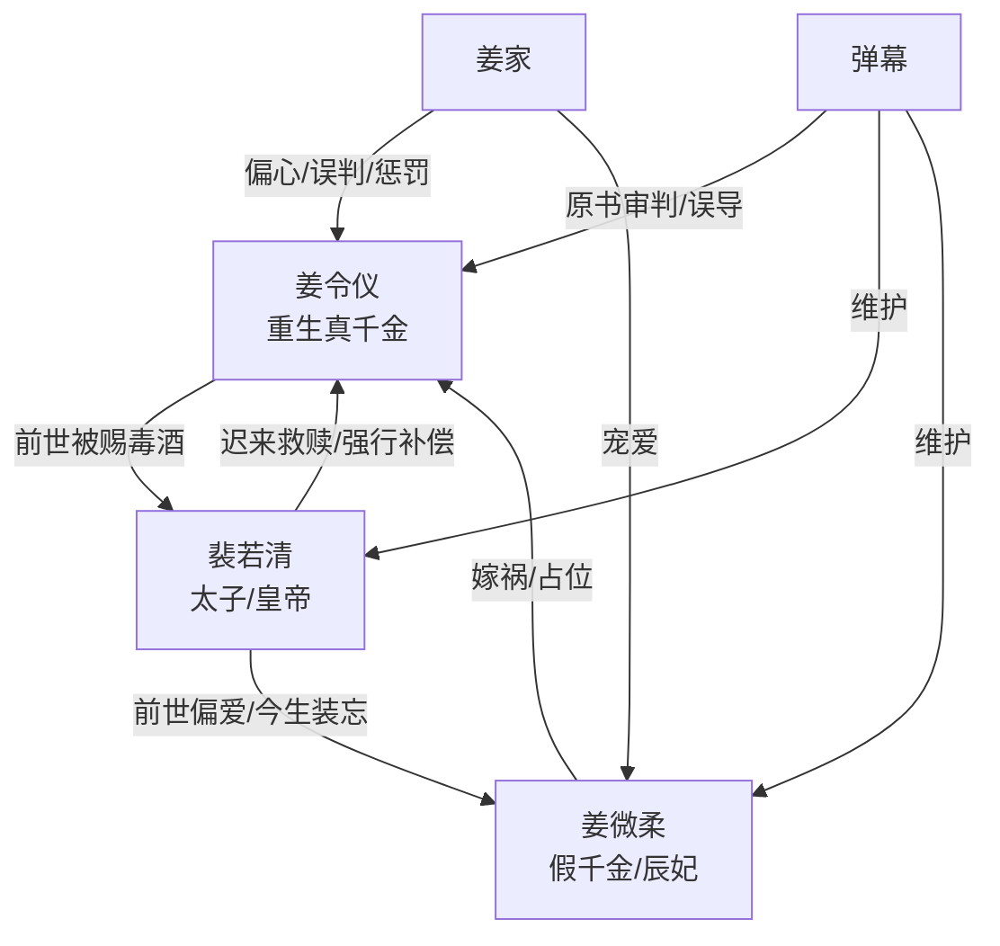

# 角色标签图谱

## 角色清单

### 姜令仪 — 冷心重生真千金
- 叙事功能: 第一人称承债者与清算者，负责承载读者的心疼与最终爽感。
- 核心标签: 清醒、冷淡、被替代者
- 弧光: 毒酒赐死的皇后 → 不再争爱的重生女 → 揭穿救赎骗局后走向新生
- 台词风格: 短句、反讽、少解释，高潮处一字一顿审判
- 关键行为: 冷拒救人、拒婚、离京假死、封后大典揭穿男主重生、接受道歉但不回头
- 读者情绪关系: 心疼、替她憋屈、期待她彻底拒绝所有迟来补偿

### 裴若清 — 自我感动式追妻火葬场男主
- 叙事功能: 前世施害者，今生迟来补偿者，也是最终情绪债清算对象。
- 核心标签: 迟来深情、傲慢救赎、执念深
- 弧光: 赐毒酒的皇帝 → 自以为能重走正确路线的太子 → 被揭穿后自服毒药
- 台词风格: 前期温和劝导，中期质问误判，后期崩溃追问
- 关键行为: 用一百两换救命、教女主识字做饭、误会女主、送回偏爱、强行带回、服毒偿债
- 读者情绪关系: 前期恨其迟钝，中期厌其自以为是，后期获得部分报应快感

### 姜微柔 — 白莲假千金/原书女主
- 叙事功能: 女主被替代命运的具象载体，推动误会与重生信息差。
- 核心标签: 柔弱、伪善、占位者
- 弧光: 被所有人偏爱的假千金 → 重生后继续夺位 → 封后大典败露被驱逐
- 台词风格: 柔声柔气、装无辜、关键处露恶意
- 关键行为: 自跳水嫁祸、威胁让男主记起前世、冲入封后大典揭穿前世
- 读者情绪关系: 恨、厌烦、期待被当众拆穿

### 姜家父母兄长 — 偏心原生家庭
- 叙事功能: 累积女主“没人爱”的原生债，衬托她离京的合理性。
- 核心标签: 偏心、迟来愧疚、软弱
- 弧光: 认定女主恶毒 → 略有愧疚 → 仍背弃承诺暴露她行踪
- 台词风格: 冷淡训诫、含糊示好、关键处沉默
- 关键行为: 赶女主去庄子、假证害她、祠堂罚跪、泄露她未死
- 读者情绪关系: 憋屈、厌恶、期待女主脱离

### 弹幕 — 读者误导型合唱
- 叙事功能: 代表原书站位与外部审判，随剧情崩塌改变读者认知。
- 核心标签: 偏见、吵闹、反转见证者
- 弧光: 骂女配恶毒 → 怀疑真相 → 惊慌发现男主重生
- 台词风格: 网感强、情绪化、吐槽式
- 关键行为: 提供原剧情信息、误导读者、在关键反转处破防
- 读者情绪关系: 前期惹怒读者，后期增强爽感

## 关系网络

## 角色功能对照表（供改编参考）

| 原角色 | 极致标签 | 叙事功能 | 读者情绪功能 | 改编时必须保留的 |
|--------|---------|---------|-------------|---------------|
| 姜令仪 | 冷心重生真千金 | 承债与清算 | 心疼、爽、释然 | 不再争爱；拒绝救赎；最后往前看 |
| 裴若清 | 迟来深情施害者 | 主要情绪债对象 | 恨、厌、报应快感 | 前世亲手伤害；今生自以为补偿；最后同等偿债 |
| 姜微柔 | 白莲占位者 | 误会发动机 | 恨与拆穿爽 | 柔弱表象下主动嫁祸 |
| 姜家 | 偏心家人 | 原生压迫 | 憋屈、脱离爽 | 偏心假千金，迟来愧疚但不可靠 |
| 弹幕 | 原剧情偏见 | 信息差工具 | 激怒、反转快感 | 前期站错队，后期破防 |
