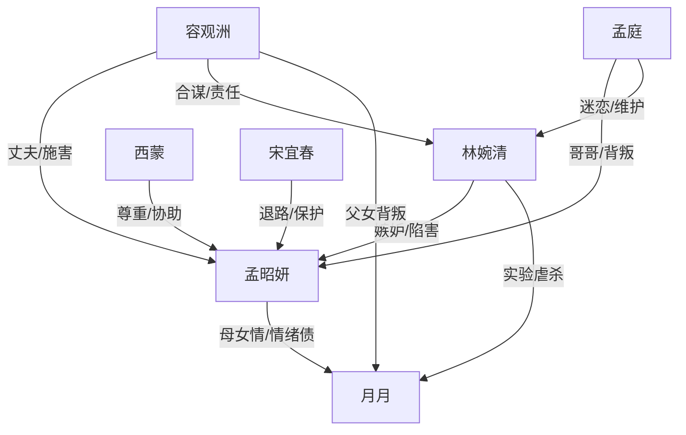

# 角色标签图谱

## 角色清单

### 孟昭妍 — 创伤清醒型复仇女主
- 叙事功能: 承受压迫、保存证据、完成逃离与法律清算
- 核心标签: 失女母亲、被污名者、清醒复仇
- 弧光: 被精神控制的妻子 → 假死逃离的幸存者 → 主动设局的清算者 → 获得新生的自由人
- 台词风格: 前期哀求和质问，后期冷静短句
- 关键行为: 留照片、联系母亲、火场假死、回国设局、墓园报警
- 读者情绪关系: 心疼、憋屈、期待她复仇、为她释然

### 容观洲 — 伪深情掌权丈夫
- 叙事功能: 最大亲密背叛源，制造虐点与火葬场
- 核心标签: 自私父亲、伪深情、权势施害者
- 弧光: 宠妻丈夫 → 合谋施害者 → 迟来悔恨者 → 失去一切的囚徒/自毁者
- 台词风格: 温柔命令、父权式安抚、后期哀求
- 关键行为: 夺子实验、关精神病院、电击女主、作伪证、绑架回国
- 读者情绪关系: 恨、恶心、期待他悔疯

### 孟庭 — 恋爱脑亲哥/帮凶律师
- 叙事功能: 第二重亲情背叛，负责“家人也不信她”的绝望
- 核心标签: 天才律师、盲目护短、迟来愧疚
- 弧光: 宠妹哥哥 → 林婉清帮凶 → 真相击垮 → 失去职业资格
- 台词风格: 训斥、道德绑架、后期慌乱
- 关键行为: 藏獒笼、法庭辩护、精神病院提议、发现女主未死
- 读者情绪关系: 恨其糊涂，期待他被真相反噬

### 林婉清 — 医学野心绿茶反派
- 叙事功能: 直接施害者，推动实验、诬陷和私刑
- 核心标签: 伪弱者、毒医者、阶层嫉妒
- 弧光: 被保护的无辜者 → 真凶暴露 → 被私刑折磨 → 法庭互咬
- 台词风格: 人前楚楚可怜，人后恶毒炫耀
- 关键行为: 撕画、炫耀照片、撞车、买通护工、供出容观洲
- 读者情绪关系: 极致恨点，期待惨烈报应

### 西蒙 — 异国秩序补偿型男主
- 叙事功能: 提供尊重、倾听、资源与新生活可能
- 核心标签: 绅士贵公子、边界感、法律资源
- 弧光: 乌龙相识 → 创伤见证者 → 追求者 → 复仇协助者 → 未来伴侣
- 台词风格: 温和、直白、尊重选择
- 关键行为: 冷库护她、倾听过去、派人接应、陪同法庭
- 读者情绪关系: 补偿爽、安心、替女主松口气

### 宋宜春 — 清醒母亲/自由样本
- 叙事功能: 女主退路与价值观参照
- 核心标签: 果断离婚、强大自由、护女
- 弧光: 远方退路 → 救援者 → 新生活引导者
- 台词风格: 直爽、轻松、反爹味
- 关键行为: 接纳女主、安排新社交、维护她
- 读者情绪关系: 安慰、补偿、羡慕

### 月月 — 情绪债核心
- 叙事功能: 所有复仇合法性的中心
- 核心标签: 被虐杀的女儿、无辜孩子、旧爱见证
- 弧光: 被宠爱的小公主 → 实验牺牲品 → 梦中祝福者
- 台词风格: 稚嫩、痛苦、求救
- 关键行为: 逃出实验室告知真相、在梦中完成告别
- 读者情绪关系: 极致心疼、驱动复仇期待

## 关系网络

## 角色功能对照表（供改编参考）

| 原角色 | 极致标签 | 叙事功能 | 读者情绪功能 | 改编时必须保留的 |
|--------|---------|---------|-------------|---------------|
| 孟昭妍 | 创伤清醒女主 | 承债与清算 | 心疼、爽 | 不原谅、不回头、用证据清算 |
| 容观洲 | 伪深情丈夫 | 最大施害者 | 恨、看他悔疯 | 曾经深爱 + 后来亲手害女儿 |
| 孟庭 | 恋爱脑哥哥 | 亲情背叛 | 二重憋屈 | 宠妹旧情与帮凶现状 |
| 林婉清 | 毒绿茶医者 | 直接恶源 | 期待报应 | 人前弱、人后毒、阶层嫉妒 |
| 西蒙 | 秩序补偿男主 | 救赎与资源 | 安心、甜 | 尊重边界，不替女主做主 |
| 月月 | 无辜牺牲品 | 情绪债核心 | 心疼、复仇驱动 | 具体可爱的旧日细节 |
