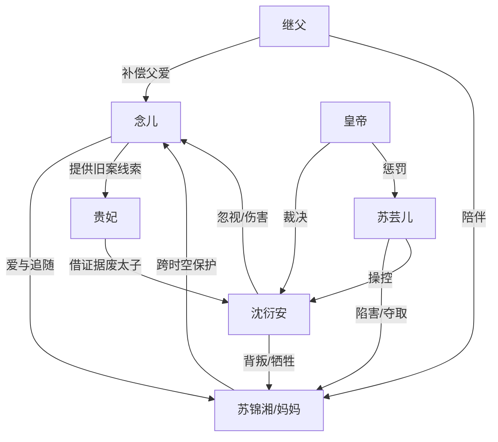

# 角色标签图谱

## 角色清单

### 念儿 — 清醒幼女/见证者复仇
- 叙事功能: 第一人称镜头、情绪放大器、关键证人、现代反击执行者
- 核心标签: 天真、心疼母亲、决绝
- 弧光: 盼父爱的小女儿 → 拒父审判者 → 新世界被爱之人
- 台词风格: 童稚直白，关键处短句砸脸
- 关键行为: 当众说出红花真相；向贵妃揭露苏家旧案；现代报警拒父
- 读者情绪关系: 心疼、代入、爽

### 苏锦湘/妈妈 — 隐忍宿主/跨时空母亲
- 叙事功能: 被压迫核心、情绪债承载者、脱离世界机制启动者
- 核心标签: 隐忍、清醒、母爱极致
- 弧光: 为爱停留 → 被爱背叛 → 用受虐值带女儿脱离
- 台词风格: 轻、冷、少解释
- 关键行为: 要回信物；承受红花与死亡；带念儿去现代
- 读者情绪关系: 心疼、敬重、补偿期待

### 沈衍安/父亲 — 负心太子/迟来追悔者
- 叙事功能: 主要施害者，温度反转对象，火葬场承受者
- 核心标签: 自欺、偏宠、软弱残忍
- 弧光: 深情丈夫 → 纵容宠妾害妻 → 废太子孤魂
- 台词风格: “最后一次”“我会补偿”式空头承诺
- 关键行为: 贬妻、让妻替罪、坐实苏家通敌、灌红花、死后求原谅
- 读者情绪关系: 恨、厌恶、看他崩溃的爽

### 苏芸儿/芸娘娘 — 绿茶婢女/夺位施害者
- 叙事功能: 直接压迫源，制造误会与伤害升级
- 核心标签: 卖惨、嫉妒、恶毒
- 弧光: 婢女上位太子妃 → 反复陷害 → 入牢受刑
- 台词风格: 哭诉、示弱、自贬式操控
- 关键行为: 诬陷苏家、害娘亲小产、下红花、巫蛊嫁祸
- 读者情绪关系: 强恨点、报应期待

### 贵妃 — 权谋借刀者
- 叙事功能: 清算工具人，利用念儿证据推动废太子
- 核心标签: 野心、冷硬、机会主义
- 弧光: 找太子错处 → 借念儿证词达成目标
- 台词风格: 强势、宫廷审判腔
- 关键行为: 查巫蛊、联络内应、推动旧案爆发
- 读者情绪关系: 警惕但认可其工具价值

### 皇帝/皇爷爷 — 皇家秩序维护者
- 叙事功能: 公权裁决者，清算合法性来源
- 核心标签: 威严、顾皇家颜面、有限公正
- 弧光: 震怒查案 → 轻罚太子 → 旧案后废太子
- 台词风格: 命令式、审判式
- 关键行为: 验尸、处置芸娘娘、废太子、平反苏家
- 读者情绪关系: 既爽又不满，因其保全皇家颜面

### 继父叔叔 — 现代补偿型父亲
- 叙事功能: 修复“父亲”概念，证明幸福可重建
- 核心标签: 稳定、尊重、保护
- 弧光: 妈妈新伴侣 → 念儿真正的父亲角色
- 台词风格: 原文少写，以行为呈现
- 关键行为: 征询念儿意见、考察男友、送嫁落泪
- 读者情绪关系: 安慰、治愈

## 关系网络

## 角色功能对照表（供改编参考）

| 原角色 | 极致标签 | 叙事功能 | 读者情绪功能 | 改编时必须保留的 |
|--------|---------|---------|-------------|---------------|
| 念儿 | 清醒幼女 | 见证+证词+现代反杀 | 心疼与爽 | 幼女视角、拒父台词、报警式反击 |
| 苏锦湘 | 隐忍宿主母亲 | 情绪债核心 | 虐心与补偿 | 为带孩子承受伤害 |
| 沈衍安 | 负心太子 | 主施害者 | 恨与追悔爽 | “最后一次”空承诺 |
| 苏芸儿 | 绿茶婢女 | 直接作恶 | 强恨点 | 卖惨操控与自导自演 |
| 贵妃 | 借刀权谋者 | 清算推进 | 爽点工具 | 利益一致但不纯善 |
| 皇帝 | 公权裁决者 | 合法清算 | 公道与不满 | 皇家颜面导致父亲未立刻死 |
| 继父 | 补偿型父亲 | 治愈收束 | 安定 | 尊重母女、行动型爱 |
