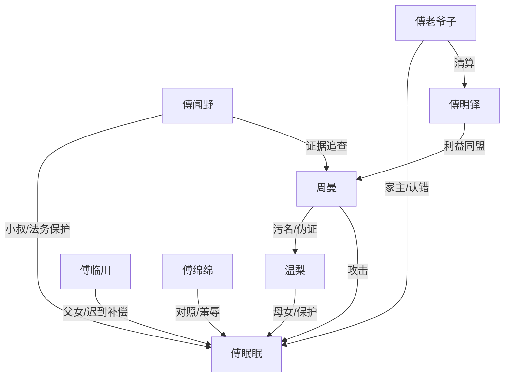

# 角色标签图谱

## 角色清单

### 傅眠眠 — 受屈小奶团/真相钥匙
- 叙事功能: 情绪核心、证据携带者、傅家破冰触发器
- 核心标签: 饿怕了、懂事过头、童言反杀
- 弧光: 不敢弄脏别人家 → 确认这里就是家 → 敢问“可以不乖吗”
- 台词风格: 短句、提问多、生活化误解
- 关键行为: 带缴费单上门、保住兔子录音笔、识别贴纸习惯、反复确认能否回家
- 读者情绪关系: 极强心疼、保护欲、治愈爽

### 傅临川 — 冷血合同人/迟到父亲
- 叙事功能: 从章程逻辑转向亲情责任，执行身份承认
- 核心标签: 冷、笨拙、护短
- 弧光: “按章程” → 买奶粉和儿童拖鞋 → 公开说“她是我女儿”
- 台词风格: 极短、命令式、少解释
- 关键行为: 接缴费单、留下眠眠、发布会正名、承认自己错
- 读者情绪关系: 前期疏离，后期补偿爽

### 傅闻野 — 铁面法务小叔/证据引擎
- 叙事功能: 负责所有证据链闭合，是 M1 反杀执行者
- 核心标签: 冷脸、专业、讲道理
- 弧光: 不会哄孩子 → 为孩子查监控、接幼儿园、穿“大灰狼”
- 台词风格: 法务式短句，冷幽默
- 关键行为: 封存录音笔、查内网、查流水、拆穿声明
- 读者情绪关系: 安全感、智性爽

### 傅老爷子 — 冷硬家主/迟来认错者
- 叙事功能: 家族权力判决者，代表傅家的制度性亏欠
- 核心标签: 章程、权威、愧疚
- 弧光: 当年不查温梨 → 亲自翻访客簿 → 弯腰对孩子道歉
- 台词风格: 简短威严
- 关键行为: 关门查宴会、暂停二房权限、承认自己有责任
- 读者情绪关系: 先怨后释然

### 温梨 — 缺席母亲/证据布置者
- 叙事功能: 全文隐形主角，所有证据与价值观来源
- 核心标签: 清白、坚韧、保护
- 弧光: 生前被污名 → 死后通过证据翻案
- 台词风格: 录音和回忆中温柔克制
- 关键行为: 缝录音笔、贴兔子贴纸、保留清单和玉扣
- 读者情绪关系: 心疼、敬意、遗憾

### 周曼 — 恶毒二房/伪证操盘手
- 叙事功能: 主反派，制造污名、伪证和舆论伤害
- 核心标签: 伪善、贪婪、控局
- 弧光: 体面质疑者 → 被证据锁死 → 被警方带走
- 台词风格: “为傅家着想”式伪善
- 关键行为: 伪造转账、删除求助、操控投屏、拿出伪造声明
- 读者情绪关系: 恨、等报应

### 傅明铎 — 二房利益共同体
- 叙事功能: 周曼同谋和二房利益代表
- 核心标签: 贪、护短、甩锅
- 弧光: 催基金名单 → 被流水打脸 → 基金权限暂停
- 台词风格: 圆滑、压迫式
- 关键行为: 推傅绵绵进名单、挡周曼、质疑证据
- 读者情绪关系: 厌恶、清算期待

### 傅绵绵 — 被教坏的对照组孩子
- 叙事功能: 眠眠的儿童对照，显示大人恶意如何传给下一代
- 核心标签: 甜面、被纵容、工具化
- 弧光: 轻声羞辱眠眠 → 母亲被带走后崩溃
- 台词风格: 软声刺人
- 关键行为: 宴会上刺激眠眠、幼儿园舆论源头关联
- 读者情绪关系: 轻恨，后期复杂

## 关系网络

## 角色功能对照表（供改编参考）

| 原角色 | 极致标签 | 叙事功能 | 读者情绪功能 | 改编时必须保留的 |
|--------|---------|---------|-------------|---------------|
| 傅眠眠 | 受屈小奶团 | 情绪核心/证据钥匙 | 心疼与治愈 | 童言、饥饿感、怕被丢下 |
| 傅临川 | 冷血父亲 | 身份承认者 | 补偿爽 | 冷到暖的笨拙动作 |
| 傅闻野 | 铁面法务 | 反杀执行者 | 智性爽 | 证据链闭合能力 |
| 傅老爷子 | 冷硬家主 | 制度认错者 | 权威低头爽 | 亲自承认错 |
| 温梨 | 缺席母亲 | 真相源头 | 心疼与敬意 | 生前布证、死后翻案 |
| 周曼 | 伪善二房 | 主反派 | 恨点 | 伪证、污名、怕回归 |
| 傅绵绵 | 被教坏对照组 | 儿童对照 | 二级恨点 | 甜声伤人 |
