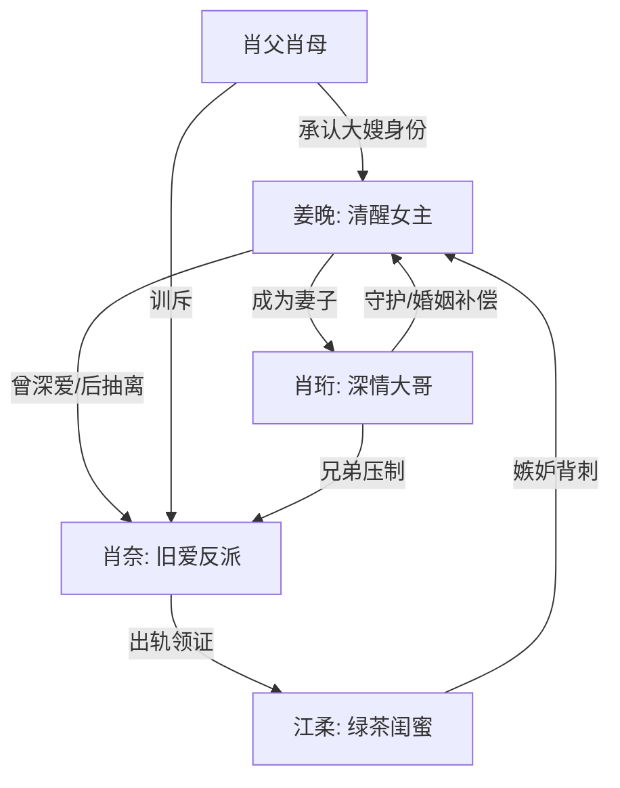

# 角色标签图谱

## 角色清单

### 姜晚 — 清醒反击型千金女主
- 叙事功能: 承受背叛、完成抽离、承接读者站队。
- 核心标签: 情深旧爱、体面清醒、被珍惜后不回头。
- 弧光: 倒贴付出 → 当场清醒 → 成为大嫂 → 平静释怀。
- 台词风格: 短句、反问、冷静拒绝。
- 关键行为: 婚登处拉肖珩领证；婚礼不赴肖奈局；家宴公开真相；结尾拒绝来生。
- 读者情绪关系: 心疼、代入、爽。

### 肖奈 — 傲慢旧爱 / 追妻火葬场男
- 叙事功能: 制造压迫、贡献悔恨、承接报应。
- 核心标签: 自恋、迟钝、权力感错位。
- 弧光: 以为姜晚离不开他 → 家宴崩溃 → 失去孩子与婚姻 → 破产低头。
- 台词风格: 说教、赏赐、命令式。
- 关键行为: 与江柔先领证；伪造假证；婚礼羞辱；家宴失控；破产后认大嫂。
- 读者情绪关系: 恨、看笑话、后期获得有限惩罚满足。

### 肖珩 — 深情补偿型男主
- 叙事功能: 对照肖奈，兑现“女主值得被珍惜”。
- 核心标签: 克制、稳、行动派。
- 弧光: 暗中守护 → 正式求婚 → 家宴护妻 → 替姜晚讨债。
- 台词风格: 平静、短、承诺明确。
- 关键行为: 解释“太仓促”；准备婚纱；带姜晚进肖家；清算肖奈公司债务。
- 读者情绪关系: 安全感、补偿感、甜爽。

### 江柔 — 绿茶闺蜜 / 嫉妒型背刺者
- 叙事功能: 引爆背叛，推动肖奈自毁。
- 核心标签: 装弱、嫉妒、反噬。
- 弧光: 被姜晚照顾 → 抢男人抢名分 → 流产难孕 → 社交坠落。
- 台词风格: 委屈、撒娇、挑拨。
- 关键行为: 与肖奈领证；发亲密视频；抢婚纱；用孩子压制肖奈；后期自白嫉妒。
- 读者情绪关系: 厌恶、报应爽。

### 肖父肖母 — 家族秩序审判者
- 叙事功能: 把私人背叛升级为家族公开审判。
- 核心标签: 门第、体面、权威。
- 弧光: 不知情 → 接纳姜晚为大嫂 → 训斥肖奈。
- 台词风格: 家长式、权威式。
- 关键行为: 让肖奈叫大嫂；追问江柔身份；承认姜晚位置。
- 读者情绪关系: 提供公开打脸的权力背书。

## 关系网络

## 角色功能对照表（供改编参考）

| 原角色 | 极致标签 | 叙事功能 | 读者情绪功能 | 改编时必须保留的 |
|--------|---------|---------|-------------|---------------|
| 姜晚 | 清醒千金 | 承压与反击 | 心疼、代入、爽 | 公开场合冷静回击，不回头 |
| 肖奈 | 追妻火葬场男 | 压迫与悔恨 | 恨、看报应 | 傲慢要足，悔悟要迟 |
| 肖珩 | 补偿型男主 | 价值确认 | 安全感 | 行动补偿，不油腻抢戏 |
| 江柔 | 绿茶闺蜜 | 背刺与反噬 | 厌恶 | 嫉妒动机和孩子筹码 |
| 肖家父母 | 家族审判 | 权力背书 | 打脸爽 | 家宴公开叫“大嫂” |
