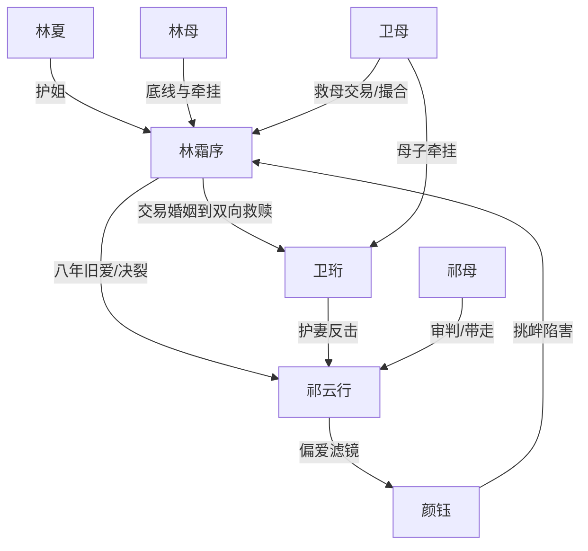

# 角色标签图谱

## 角色清单

### 林霜序 — 清醒断舍离大女主
- 叙事功能: 承受压迫、完成抽离、开启新关系
- 核心标签: 顶级助理、八年付出、清醒决绝
- 弧光: 以为被爱 → 发现替补真相 → 换新郎 → 被尊重治愈
- 台词风格: 平静、精准、带冷讽
- 关键行为: 接受救母交易、辞职搬家、闪婚卫珩、拒绝祁云行
- 读者情绪关系: 心疼、代入、爽

### 祁云行 — 失格旧爱/迟来悔悟霸总
- 叙事功能: 施害者、对照组、火葬场承担者
- 核心标签: 记忆缺陷、白月光滤镜、高位傲慢
- 弧光: 理所当然拥有 → 当众失去 → 真相反噬 → 断腿孤立
- 台词风格: 命令式、冷淡、事后解释
- 关键行为: 忘记救母、降职女主、抢救护车、取消婚礼、追悔求复合
- 读者情绪关系: 恨、憋屈、后期看报应

### 卫珩 — 残疾钓系新夫/尊重型救赎者
- 叙事功能: 新爱补偿、尊严镜像、反杀嘴替
- 核心标签: 残疾、毒舌、克制深情
- 弧光: 自毁阴郁 → 被尊重唤醒 → 主动康复 → 为爱站起
- 台词风格: 戏谑、锋利、真诚时简短
- 关键行为: 婚礼护妻、亮结婚证、支持女主、救低血糖女主
- 读者情绪关系: 爽、安心、甜、心疼

### 颜钰 — 作精白月光/利益型搅局者
- 叙事功能: 催化旧爱失格、制造误会与情绪债
- 核心标签: 白月光、装晕、贪婪
- 弧光: 被偏爱 → 露馅 → 被收回资源 → 家族破产
- 台词风格: 甜腻、装无辜、暗示挑衅
- 关键行为: 索要裙子、装晕血、制造热搜误会、借祁云行资源
- 读者情绪关系: 厌恶、想看打脸

### 林夏 — 妹妹/读者嘴替
- 叙事功能: 外化女主伤害，替读者控诉
- 核心标签: 护姐、直白、真情
- 弧光: 依赖姐姐 → 看清祁云行 → 支持姐姐新生
- 台词风格: 直接、哭腔、愤怒
- 关键行为: 婚礼现场推开祁云行，控诉他不心疼姐姐
- 读者情绪关系: 共情、解气

### 林母 — 创伤根源/救母动机
- 叙事功能: 女主底线与情绪债核心
- 核心标签: 病危、旧创伤、有证无名
- 弧光: 濒危 → 稳定 → 接纳卫珩
- 台词风格: 温和、看破不说破
- 关键行为: 病危推动交易，后期认可卫珩
- 读者情绪关系: 心疼、希望她得到安稳

### 祁母 — 体面家族审判者
- 叙事功能: 从旧阵营内部否定祁云行
- 核心标签: 体面、清醒、家族利益
- 弧光: 劝儿子远离颜钰 → 婚礼当众受辱 → 扇醒儿子
- 台词风格: 冷、直、带阶层体面感
- 关键行为: 婚礼扇祁云行，承认林霜序不能忍是合理的
- 读者情绪关系: 部分解气

## 关系网络

## 角色功能对照表（供改编参考）

| 原角色 | 极致标签 | 叙事功能 | 读者情绪功能 | 改编时必须保留的 |
|--------|---------|---------|-------------|---------------|
| 林霜序 | 清醒大女主 | 承压与抽离 | 心疼+爽 | 不哭求、不回头、能独立谋生 |
| 祁云行 | 失格旧爱 | 制造情绪债 | 恨+看火葬场 | 忘女主、记白月光的对照 |
| 卫珩 | 尊重型新夫 | 补偿与救赎 | 甜+安心 | 尊重边界，行动大于嘴甜 |
| 颜钰 | 作精白月光 | 催化冲突 | 厌恶+打脸期待 | 装弱、抢资源、被清算 |
| 林夏 | 护姐嘴替 | 外部控诉 | 解气 | 直白指出女主受伤 |
