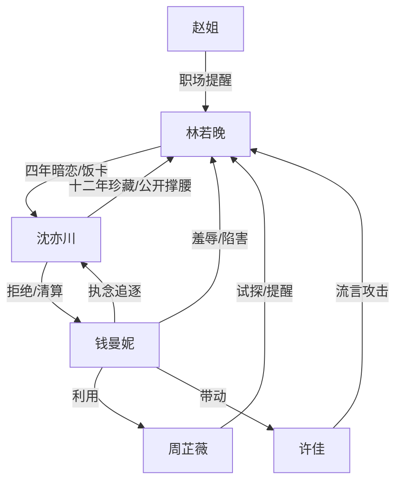

# 角色标签图谱

## 角色清单

### 林若晚 — 自卑真诚型逆袭女主
- 叙事功能: 情绪债承载者、旧物证据链制造者、职场价值重建者。
- 核心标签: 真诚、不求回报、低谷逆袭
- 弧光: “配不上”的暗恋者 → 被珍视的品牌总监 → 能独立站稳的副总裁
- 台词风格: 前期退缩短句，后期冷静反击；承认事实但拒绝羞辱。
- 关键行为: 四年充饭卡、写笔记本后逃离、重逢入职、用方案和证据反击。
- 读者情绪关系: 心疼、代入、替她憋屈，后期因她被承认而爽。

### 沈亦川 — 克制深情型商业掌门人
- 叙事功能: 情感补偿兑现者、价值认证者、最终安全感来源。
- 核心标签: 克制、深情、强者
- 弧光: 贫穷孤僻学生 → 两千亿集团掌门人 → 用一生回收女主真心的人
- 台词风格: 短句、低温、决定感强。
- 关键行为: 保存笔记本十二年、留充值凭条、拒九亿撤资、公开撑腰、求婚。
- 读者情绪关系: 期待、心动、安心；满足“他其实一直懂”的补偿幻想。

### 钱曼妮 — 索取式白富美反派
- 叙事功能: 阶层羞辱者、女主真心的反照物、回旋反讽承载者。
- 核心标签: 优越感、执念、控制欲
- 弧光: 亮闪闪的富家女 → 行业资源操盘者 → 社交性失势者
- 台词风格: 表面温和，实则包装羞辱；善用“关心”语气刺人。
- 关键行为: 大学警告女主、职场施压、晚宴扒底、峰会公开私事、伪造邮件。
- 读者情绪关系: 恨、厌、期待她翻车；后期有少量复杂余味。

### 周芷薇 — 利益理性型职场中间人
- 叙事功能: 职场试炼制造者、关键情报转交者、反派阵营裂口。
- 核心标签: 精明、现实、有底线
- 弧光: 试探女主的直属上级 → 不愿被钱曼妮当工具 → 冷静旁观者
- 台词风格: 直接、职业、少废话。
- 关键行为: 交问题方案、提醒水深、告知峰会局、拒绝替钱曼妮传话。
- 读者情绪关系: 初期警惕，后期认可。

### 赵姐 — 职场见证型辅助角色
- 叙事功能: 提供职场现实感，见证女主能力被认可。
- 核心标签: 老练、冷眼、善意
- 弧光: 沉默观察 → 适时提醒 → 稳定支持
- 台词风格: 简短提醒式。
- 关键行为: 提醒“小心钱曼妮”、递咖啡、传递后续信息。
- 读者情绪关系: 稳定、可信。

### 许佳 — 跟风型小反派
- 叙事功能: 钱曼妮影响力的执行端，承载办公室流言。
- 核心标签: 跟风、势利、怯弱
- 弧光: 背后议论者 → 被震慑 → 离职留便签道歉
- 台词风格: 茶水间碎嘴式。
- 关键行为: 质疑数据、传播流言、离职道歉。
- 读者情绪关系: 轻度厌恶，作为小债务被轻偿还。

## 关系网络

## 角色功能对照表（供改编参考）

| 原角色 | 极致标签 | 叙事功能 | 读者情绪功能 | 改编时必须保留的 |
|--------|---------|---------|-------------|---------------|
| 林若晚 | 自卑真诚逆袭女主 | 承债与偿债主体 | 心疼、代入、爽 | 不求回报的长期付出 + 后期能力自证 |
| 沈亦川 | 克制深情霸总 | 情感补偿与保护 | 心动、安心 | 他早知道、一直保存证据、最终公开承认 |
| 钱曼妮 | 索取式白富美 | 反派压迫与反照 | 恨、爽 | 她把真心污名化，最后被“索取”逻辑反噬 |
| 周芷薇 | 职场中间人 | 试炼与情报 | 紧张、转信任 | 不能过早洗白，要保留利益理性 |
| 赵姐 | 老员工见证者 | 现实支撑 | 稳定 | 少量关键提醒 |
| 许佳 | 跟风小反派 | 流言具象化 | 厌烦 | 轻清算即可 |
