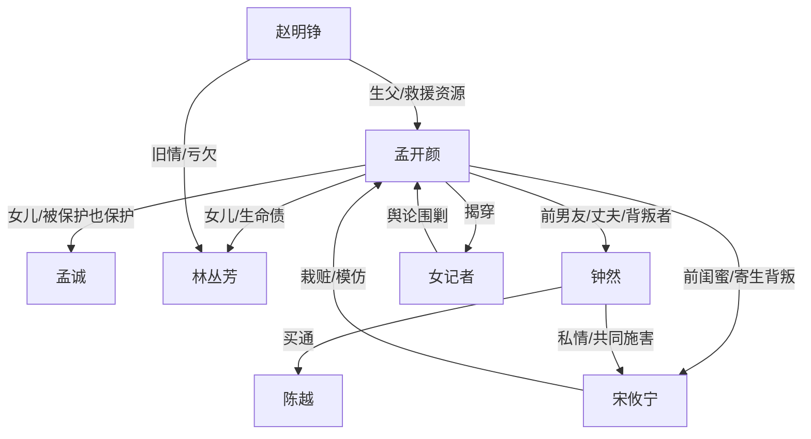

# 角色标签图谱

## 角色清单

### 孟开颜 — 清醒重生大女主

- 叙事功能: 第一视角承载者，重生改命与情绪清算执行人。
- 核心标签: 清醒、护亲、边界感
- 弧光: 被蒙骗半生的妻子 → 重生切断关系的女儿 → 拿回人生的独立女性
- 台词风格: 短句、冷嘲、边界清晰
- 关键行为: 保护志愿表、拒绝道歉绑架、揭穿女记者、求助赵明铮、报警处理宋攸宁、拒绝钟然。
- 读者情绪关系: 心疼、站队、爽感投射。

### 钟然 — 负心天之骄子/迟来悔罪者

- 叙事功能: 亲密关系背叛者，前半压迫源，后半悔恨余波载体。
- 核心标签: 自私、偏袒、负罪
- 弧光: 理科状元与男友 → 诬告共犯 → 囚犯 → 悔罪打饭师傅 → 救人死亡
- 台词风格: 前期强硬甩锅，后期低声忏悔。
- 关键行为: 改志愿、维护宋攸宁、买通陈越、作伪证、恢复记忆后道歉、救同名女孩。
- 读者情绪关系: 前期恨，后期冷眼看悔恨，不要求原谅。

### 宋攸宁 — 寄生型绿茶闺蜜

- 叙事功能: 友情背叛源，女主被篡改人生的直接受益者。
- 核心标签: 装弱、寄生、模仿
- 弧光: 假装无辜的闺蜜 → 自杀栽赃者 → 跟踪模仿者 → 报应承受者
- 台词风格: 前期委屈求全，私下挑衅露骨，后期精神崩溃。
- 关键行为: 与钟然发生关系、配合改志愿、装自杀、诬告女主、A 大纠缠模仿、复读失败跳楼。
- 读者情绪关系: 厌恶、恨、对报应有期待。

### 孟诚 — 护女父亲

- 叙事功能: 女主第二世最重要的保护对象之一，亲情补偿核心。
- 核心标签: 担当、护短、温暖
- 弧光: 上一世早亡遗憾 → 第二世及时获救 → 与女儿共享新人生
- 台词风格: 直接护女，“滚”“我女儿没有作弊”。
- 关键行为: 亲手交志愿表、踹开钟然、挡记者、抢救脱险。
- 读者情绪关系: 心疼、安心、补偿感。

### 林丛芳 — 坚韧母亲

- 叙事功能: 女主亲情债与出生真相承载者。
- 核心标签: 冒险生女、护女、隐忍
- 弧光: 上一世心脏病离世 → 第二世手术成功 → 坦白往事
- 台词风格: 温柔安抚与果断护女并存。
- 关键行为: 安抚高烧女儿、医院护女、手术脱险、饭桌坦白。
- 读者情绪关系: 心疼、温暖、家庭价值锚点。

### 赵明铮 — 迟到的生父/资源救援者

- 叙事功能: 权力资源入场，帮助女主打破社会性围剿。
- 核心标签: 愧疚、克制、补偿
- 弧光: 上一世葬礼迟到者 → 第二世救援者 → 家庭边界外的叔叔
- 台词风格: 克制、长辈式安抚。
- 关键行为: 安排医院救治、推动作弊调查、饭桌接受“赵叔叔”位置。
- 读者情绪关系: 复杂但认可其补偿功能。

### 陈越 — 被收买的工具人

- 叙事功能: 志愿篡改与作弊诬告的执行工具，推动社会性危机。
- 核心标签: 懦弱、贪钱、替罪
- 弧光: 上一世假认改志愿 → 第二世收钱诬告 → 被查反口
- 台词风格: 畏缩、编造。
- 关键行为: 指证作弊、藏钱、反口。
- 读者情绪关系: 厌恶，作为钟然罪证链的一环。

### 女记者 — 舆论暴力化身

- 叙事功能: 将校园诬告扩大为公共羞辱，提供女主反杀对象。
- 核心标签: 伪公正、情妇、双标
- 弧光: 咄咄逼人的审判者 → 被女主一句话揭穿
- 台词风格: 官方腔、逼问式。
- 关键行为: 围堵女主、攻击父亲名誉、被揭与钟父关系。
- 读者情绪关系: 憋屈后爽感释放。

## 关系网络

## 角色功能对照表（供改编参考）

| 原角色 | 极致标签 | 叙事功能 | 读者情绪功能 | 改编时必须保留的 |
|--------|---------|---------|-------------|---------------|
| 孟开颜 | 清醒重生大女主 | 改命执行人 | 心疼+爽感投射 | 优先救父母，不恋爱脑复合 |
| 钟然 | 负心天之骄子 | 亲密背叛与悔恨载体 | 前恨后冷 | 参与毁人生，后悔但不被原谅 |
| 宋攸宁 | 寄生绿茶闺蜜 | 友情背叛与栽赃源 | 强恨点 | 装弱+私下挑衅+后期模仿纠缠 |
| 父母 | 被命运夺走的亲情 | 情绪债核心 | 心疼+补偿 | 上一世丧亲，第二世保住 |
| 赵明铮 | 迟到资源父亲 | 权力反转工具 | 安心+复杂 | 帮忙但不取代养父 |
| 陈越 | 被收买工具人 | 证据链突破口 | 厌恶 | 被钱收买且可查 |
| 女记者 | 舆论暴力 | 公开羞辱放大器 | 憋屈后爽 | 自诩公正却有污点 |
