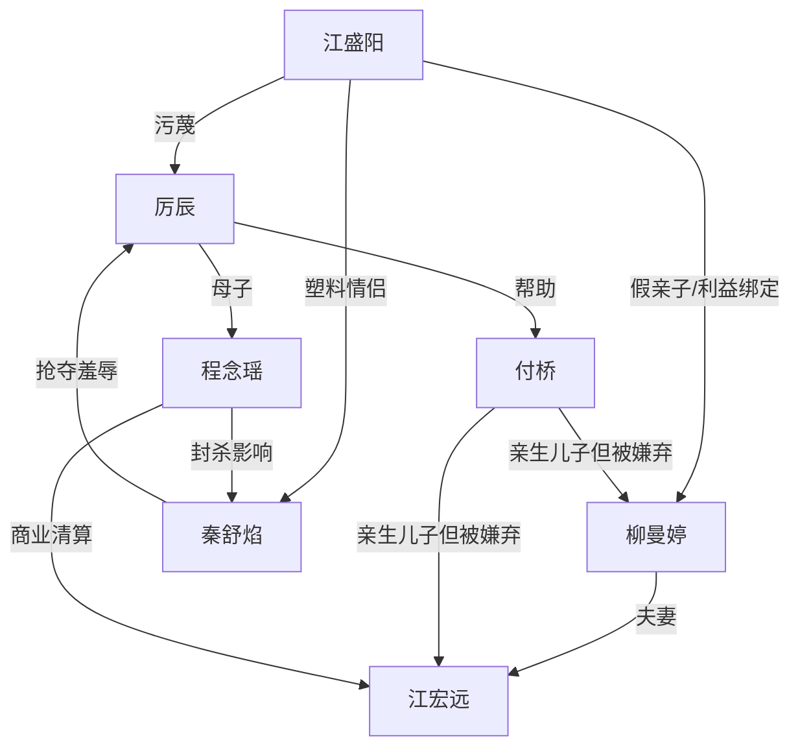

# 角色标签图谱

## 角色清单

### 厉辰 — 微服首富少爷/冷吐槽大男主

- 叙事功能: 被误认的受害者、真相锚点、后期补偿弱者的人。
- 核心标签: 低调、冷静、善良
- 弧光: 蹭饭旁观者 → 被群体欺凌者 → 身份揭露中心 → 价值判断者
- 台词风格: 反问多，短句多，带轻微吐槽。
- 关键行为: 否认认亲、护住背包、尝试打电话、帮助付桥。
- 读者情绪关系: 前半心疼和憋屈，后半爽和认可。

### 程念瑶 — 护短首富妈/降维执行者

- 叙事功能: 身份揭露者、权力清算者、情绪债偿还者。
- 核心标签: 强势、护短、杀伐果断
- 弧光: 楼上谈合作的缺席者 → 怒火救场 → 清算全场
- 台词风格: 冷、短、带商业审判感。
- 关键行为: 公开认子、揭腕表、封杀江秦两家、安置付桥。
- 读者情绪关系: 爽、安心、崇拜。

### 江盛阳 — 白莲假少爷/利益寄生者

- 叙事功能: 第一施害者，负责制造偷表污蔑和身份误导。
- 核心标签: 装可怜、嫉妒、恶毒
- 弧光: 众星捧月 → 装委屈控诉 → 惊恐求饶 → 一无所有
- 台词风格: 哭腔、哥哥称呼、甩锅卖惨。
- 关键行为: 搜包、认哥、碰瓷、求厉辰放过。
- 读者情绪关系: 恨、厌恶、看他崩塌的爽。

### 秦舒焰 — 势利未婚妻/墙头草女主

- 叙事功能: 强化主角被羞辱和被抢夺的压迫。
- 核心标签: 傲慢、势利、翻脸快
- 弧光: 居高临下审判 → 拍飞手机 → 下跪甩锅 → 无耻示爱
- 台词风格: 命令式、羞辱式、崩溃式。
- 关键行为: 抢表、抓手、叫保安、抱腿求爱。
- 读者情绪关系: 恨、恶心、期待报应。

### 柳曼婷 — 阶层歧视母亲/伪豪门夫人

- 叙事功能: 把身份误认升级为阶层羞辱和家庭价值观揭露。
- 核心标签: 刻薄、势利、虚荣
- 弧光: 高高在上羞辱 → 旧事被揭 → 亲子厌弃暴露
- 台词风格: 尖酸、鄙夷、身份压制。
- 关键行为: 羞辱主角“穷酸”，命秦舒焰抢包，嫌弃付桥。
- 读者情绪关系: 恨、鄙夷。

### 江宏远 — 忘恩负义商人/伪白手起家

- 叙事功能: 承接商业清算，揭示江家财富根基虚伪。
- 核心标签: 谄媚、忘恩、贪婪
- 弧光: 谈合作得意 → 赔笑 → 跪地崩溃
- 台词风格: 谄媚求饶。
- 关键行为: 下楼赔罪，被揭司机旧账。
- 读者情绪关系: 看穿、痛快。

### 付桥 — 真少爷/被遗弃弱者

- 叙事功能: 价值观补偿对象，证明江家不配谈亲情。
- 核心标签: 自卑、善良、努力
- 弧光: 角落服务生 → 真少爷现身 → 拒绝江家 → 获得机会
- 台词风格: 怯弱但真诚。
- 关键行为: 承认不想回江家，入职厉氏。
- 读者情绪关系: 心疼、希望他被补偿。

## 关系网络

## 角色功能对照表（供改编参考）

| 原角色 | 极致标签 | 叙事功能 | 读者情绪功能 | 改编时必须保留的 |
|--------|---------|---------|-------------|---------------|
| 厉辰 | 微服首富少爷 | 被误认中心 | 憋屈后补爽 | 隐瞒身份、冷静吐槽、帮助弱者 |
| 程念瑶 | 护短权力者 | 降维清算 | 爽和安全感 | 公开认子、物证打脸、商业清算 |
| 江盛阳 | 白莲假少爷 | 施害引擎 | 恨点 | 装委屈、栽赃、崩塌求饶 |
| 秦舒焰 | 势利未婚妻 | 肢体压迫 | 厌恶 | 抢夺、拍飞手机、下跪变脸 |
| 柳曼婷 | 伪豪门夫人 | 阶层羞辱 | 愤怒 | 出身羞辱、嫌弃真亲子 |
| 付桥 | 真弱者 | 道德补偿 | 心疼 | 被遗忘、拒绝亲生父母、获得机会 |
