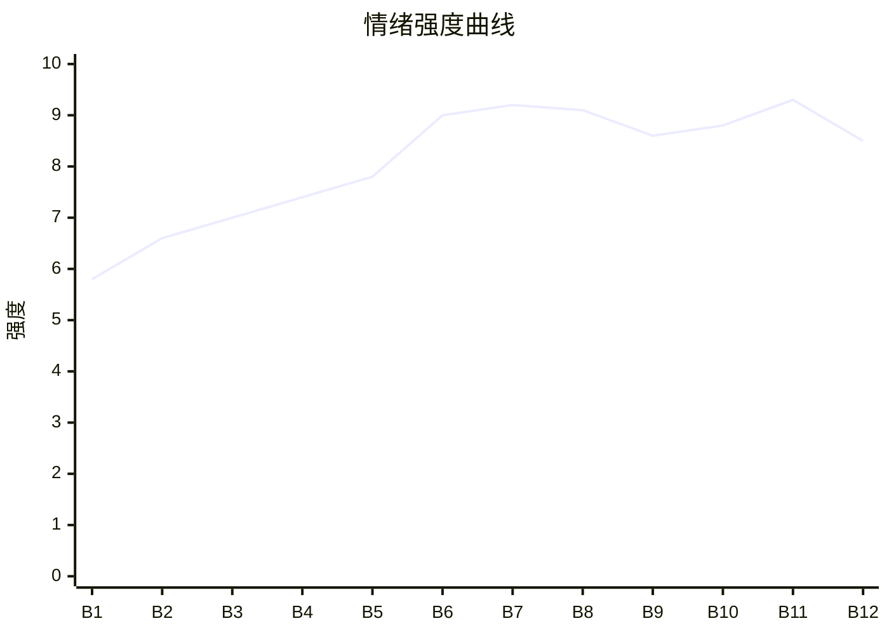

# Beat Sheet 节拍器

## 全文概况

- 总字数: 约 10800 字
- 节拍数: 12 幕
- 核心母题（Logline）: 年轻女雇主因吃榴莲被越界保姆记恨，在丈夫出差时遭保姆母女造谣、霸占和盗窃，最终依靠监控证据与法律清算将其赶出家门并行业封杀。
- 情绪模式: 日常冒犯 → 越界压迫 → 群体围攻 → 证据反杀 → 二次清算 → 甜爽收束

## 节拍详表

### Beat 1: 榴莲引爆越界 [开篇-1 前]
- **字数**: 约 600 字（占比 5.6%）
- **核心事件**: 女主买榴莲回家，保姆王翠拒吃后又指责女主不留给长辈和老公。
- **情绪标签**: 荒唐、憋屈、警觉
- **情绪强度**: 5.8/10
- **情绪方向**: ⚡突变
- **冲突类型**: 微冲突
- **悬念钩子**: 一个保姆为何敢把自己当婆婆训雇主？
- **叙事速度**: 快
- **对话占比**: 45%
- **reversal_mechanism**: [M3]
- **hook_strength**: 8.2/10
- **关键句**: “她一个保姆，不过比我早进门一年，还真把自己当我婆婆了。”
- **原文摘录**: 散步回来买了个榴莲，刚准备吃，保姆就直勾勾的盯着我。「王姨，来一块。」我把最大最肥的那块递过去，王翠没接，还狠狠剜了我一眼。「我可没你那么馋。」她不吃，我就只好自己享用了。等我把最后一块榴莲放进嘴里时，王翠突然大叫一声。「我的妈呀！这么贵的水果你自己全吃啦！都不知道给家里长辈和自己老公留一些，真是没规矩！」「把你馋死得了！」我愣住了。我老公根本不吃榴莲，再者葛天父母早逝，家里哪来的长辈。她一个保姆，不过比我早进门一年，还真把自己当我婆婆了。

### Beat 2: 饭桌告状失败 [1]
- **字数**: 约 900 字（占比 8.3%）
- **核心事件**: 王翠向葛天告状，反被葛天宠妻态度打脸，女主第一次正面划边界。
- **情绪标签**: 解气、挑衅、轻爽
- **情绪强度**: 6.6/10
- **情绪方向**: ↑上升
- **冲突类型**: 微冲突
- **悬念钩子**: 王翠被怼后会不会收敛？
- **叙事速度**: 快
- **对话占比**: 60%
- **reversal_mechanism**: [M3]
- **hook_strength**: null
- **关键句**: “王姨，我老婆本来就是小公主啊。”
- **原文摘录**: 王翠在饭桌上说女主一个人吃光榴莲，葛天却问女主还吃不吃，说明天买两个。王翠指责女主懒、馋、不做家务，“她是来当媳妇的，又不是来当公主的！”葛天笑着回应：“王姨，我老婆本来就是小公主啊。”女主顺势反击：“我有老公养，我就是命好，你羡慕吧。”王翠气急说“小天早晚休了你”。

### Beat 3: 丈夫出差，保姆夺权 [2 前半]
- **字数**: 约 950 字（占比 8.8%）
- **核心事件**: 葛天出差后，王翠五点放红歌扰民，宣称要教女主规矩，让女主承担家务。
- **情绪标签**: 愤怒、荒诞、压迫
- **情绪强度**: 7.0/10
- **情绪方向**: ↑上升
- **冲突类型**: 大转折
- **悬念钩子**: 女主开除她是否有效？
- **叙事速度**: 快
- **对话占比**: 55%
- **reversal_mechanism**: [M3]
- **hook_strength**: null
- **关键句**: “我负责专门照顾小天啊，我年纪大了，这些脏活累活都应该你来干。”
- **原文摘录**: 葛天第二天天没亮就走了。客厅里放起红歌，才五点。王翠拖地说：“我都起来做家务了，你还好意思继续睡吗。”“正好趁小天不在家，我好好教教你规矩。”她自称算葛天半个妈，要教女主做饭打扫卫生。女主反问：“饭我做，卫生我来打扫，那我请问我花钱雇你干什么？”王翠答：“我负责专门照顾小天啊。”

### Beat 4: 王琴闯入，保姆母女霸占家 [2 后半-3 前]
- **字数**: 约 900 字（占比 8.3%）
- **核心事件**: 王翠带女儿王琴进门，王琴要住主卧，王翠拒绝离开，声称自己已脱离家政公司。
- **情绪标签**: 震惊、失控、入侵感
- **情绪强度**: 7.4/10
- **情绪方向**: ↑上升
- **冲突类型**: 大转折
- **悬念钩子**: 投诉渠道失效，女主如何赶走她们？
- **叙事速度**: 快
- **对话占比**: 50%
- **reversal_mechanism**: [M6]
- **hook_strength**: null
- **关键句**: “不好意思沈女士，王翠现在已经从我们公司离职了。”
- **原文摘录**: 女主睡着后被王琴闯入惊醒。王琴说“妈我要住这间！”王翠解释“这是我女儿，以后她就住这！”女主打电话给金牌家政要求王翠下户，却得知王翠已离职。王翠得意地说：“我早就脱离公司自己单干了，你想投诉我，没门！”

### Beat 5: 抢电话摔手机，贼喊捉贼 [3 中段]
- **字数**: 约 950 字（占比 8.8%）
- **核心事件**: 王翠抢女主电话向葛天哭诉，并故意摔坏手机反咬女主。
- **情绪标签**: 愤怒、无助、紧张
- **情绪强度**: 7.8/10
- **情绪方向**: ↑上升
- **冲突类型**: 微冲突
- **悬念钩子**: 女主手机坏了，怎么报警？
- **叙事速度**: 快
- **对话占比**: 65%
- **reversal_mechanism**: [M1, M3]
- **hook_strength**: null
- **关键句**: “嘴里还叫着：‘哎呀，你怎么把手机摔了！’”
- **原文摘录**: 女主给葛天打电话，王翠一把抢过去哭诉：“你媳妇要赶我走！”她说自己只是想让小琴借住，女主却又摔又砸，还要开除她。葛天让她把电话给暖暖，王翠假装递手机，又用力摔到地上，嘴里叫：“哎呀，你怎么把手机摔了！”她得意地说葛天不会开除她，还让王琴随便住。

### Beat 6: 小区围攻，谣言成刑场 [3 后半-4]
- **字数**: 约 1500 字（占比 13.9%）
- **核心事件**: 王翠母女跪地卖惨，联合老太太造谣女主是小三、殴打勒索，女主被围观拍摄。
- **情绪标签**: 窒息、羞辱、愤怒
- **情绪强度**: 9.0/10
- **情绪方向**: ↑上升
- **冲突类型**: 大转折
- **悬念钩子**: 群体证人都站王翠，女主如何自证？
- **叙事速度**: 中
- **对话占比**: 60%
- **reversal_mechanism**: [M6]
- **hook_strength**: null
- **关键句**: “我直接被这群恶邻气哭了。”
- **原文摘录**: 女主出门去巡捕房报警，王翠母女追到楼下，当众跪下大喊“你非要逼死我们母女你才甘心吗！”老太太们围上来，听王翠说女主抢走王琴男朋友、辱骂殴打、讹十万。王琴掏手机拍摄，其他人也拿手机怼到女主脸上。巡捕到场后，王翠露出抓痕要求验伤，说女主骂她和女儿，还讹十万。老太太们纷纷作证，女主又气又急，无助发抖。

### Beat 7: 葛天回归，监控第一杀 [4 末-5]
- **字数**: 约 1100 字（占比 10.2%）
- **核心事件**: 葛天出现，宣布家中有监控，调出视频证明女主没有辱骂殴打，手机是王翠摔的。
- **情绪标签**: 反转、痛快、松一口气
- **情绪强度**: 9.2/10
- **情绪方向**: ⚡突变
- **冲突类型**: 大转折
- **悬念钩子**: 监控还能揭出什么？
- **叙事速度**: 快
- **对话占比**: 55%
- **reversal_mechanism**: [M1, M6]
- **hook_strength**: null
- **关键句**: “咱家里新装的监控，等一会儿我回去把监控调出来，就知道谁在撒谎了。”
- **原文摘录**: 女主被逼到气哭时，葛天扶住她肩膀。王翠想告状，葛天制止：“刚才你说的我都听见了。咱家里新装的监控，等一会儿我回去把监控调出来，就知道谁在撒谎了。”王翠脸白，试图以隐私、心梗阻止。葛天调出监控，众人看见女主没骂人也没动手，手机分明是王翠故意摔碎的。

### Beat 8: 自抓伤口与小三谣言崩塌 [5 末-6]
- **字数**: 约 1100 字（占比 10.2%）
- **核心事件**: 葛天继续拉监控，证明王翠抓痕是自抓，并公开澄清自己和王琴毫无恋爱关系。
- **情绪标签**: 打脸、嘲讽、围观反噬
- **情绪强度**: 9.1/10
- **情绪方向**: ↑上升
- **冲突类型**: 大转折
- **悬念钩子**: 王翠为何执念女儿嫁葛天？
- **叙事速度**: 快
- **对话占比**: 65%
- **reversal_mechanism**: [M1, M3, M6]
- **hook_strength**: null
- **关键句**: “你脖子上这伤明明是自己抓的，监控都拍到了，为什么要赖在我老婆身上！”
- **原文摘录**: 王翠辩称监控片面，又拿脖子伤说事。葛天把进度条往后拉：“你脖子上这伤明明是自己抓的。”众人哗然。葛天澄清：“我和我老婆是自由恋爱，从来不存在什么第三者插足。”邻居倒戈，指责王翠凭空污蔑人家。王翠仍大叫葛天本来喜欢王琴。

### Beat 9: 妄想拆穿，保姆身份归位 [6 末-7 前]
- **字数**: 约 1000 字（占比 9.3%）
- **核心事件**: 葛天逐条解释借住、被褥、询问住多久只是客气，揭穿王翠母女的桃花癫和越界母亲幻觉。
- **情绪标签**: 荒诞、讽刺、痛快
- **情绪强度**: 8.6/10
- **情绪方向**: →平稳高位
- **冲突类型**: 微冲突
- **悬念钩子**: 女主是否会真正起诉？
- **叙事速度**: 中
- **对话占比**: 70%
- **reversal_mechanism**: [M3]
- **hook_strength**: null
- **关键句**: “你只是我花钱雇来的保姆，怎么就成我娘了？”
- **原文摘录**: 王翠说葛天若不喜欢王琴，为什么同意借住、准备被褥、问住多久。葛天解释那只是客人待遇，是礼貌，不是喜欢，并说自己连王琴联系方式都没有。王翠又哭“有了媳妇忘了娘”，葛天回击：“你只是我花钱雇来的保姆，怎么就成我娘了？我父母早就去世了，你又没生我养我，算什么娘！”

### Beat 10: 法律清算，公开道歉赔三万 [7-8 前]
- **字数**: 约 1100 字（占比 10.2%）
- **核心事件**: 女主坚持起诉，王翠母女在巡捕局服软，女主要求赔偿三万并公开澄清。
- **情绪标签**: 清算、冷静、掌控
- **情绪强度**: 8.8/10
- **情绪方向**: ↓略降但爽感稳定
- **冲突类型**: 大转折
- **悬念钩子**: 王翠母女能否顺利搬走？
- **叙事速度**: 中
- **对话占比**: 60%
- **reversal_mechanism**: [M1, M3]
- **hook_strength**: null
- **关键句**: “差一点，你就等着接法院传票吧！”
- **原文摘录**: 王翠在巡捕局哭喊“嚼两句舌根怎么就成造谣诽谤了”，得知要负法律责任后向女主道歉。女主保存了王琴上传的视频和辱骂留言，要求母女公开道歉、赔手机和精神损失共三万。“这些都做到，我可以不起诉你。差一点，你就等着接法院传票吧！”

### Beat 11: 搬家翻出盗窃，赔偿翻倍 [8 后-10 前]
- **字数**: 约 1300 字（占比 12.0%）
- **核心事件**: 王翠母女收拾东西时，女主发现王琴偷裙子、王翠藏首饰，进一步查出多年盗窃，赔偿升至六万。
- **情绪标签**: 震惊、二次暴击、彻底清算
- **情绪强度**: 9.3/10
- **情绪方向**: ↑上升
- **冲突类型**: 大转折
- **悬念钩子**: 她们是否还会狡辩逃责？
- **叙事速度**: 快
- **对话占比**: 50%
- **reversal_mechanism**: [M1, M6]
- **hook_strength**: null
- **关键句**: “这都是我的首饰！王翠，你竟然敢偷盗！”
- **原文摘录**: 王翠母女回家慢吞吞收拾。女主发现王琴行李里有自己新买的裙子，指出领口补线独一无二。又发现王翠护着的盒子，抢开后发现里面全是自己的首饰。女主检查后发现许多护肤品、裙子、日用品多年丢失，列清单总计三万元。加上原先三万，赔偿变为六万。

### Beat 12: 六万到账，行业拉黑，甜爽收尾 [10 后]
- **字数**: 约 1000 字（占比 9.3%）
- **核心事件**: 王翠母女转账六万、录道歉视频，网友补充其惯犯恶行，王翠被行业拉黑回老家。
- **情绪标签**: 终局痛快、安心、补偿
- **情绪强度**: 8.5/10
- **情绪方向**: ↓收束
- **冲突类型**: 大转折
- **悬念钩子**: 无，完成闭环。
- **叙事速度**: 中
- **对话占比**: 45%
- **reversal_mechanism**: [M3]
- **hook_strength**: null
- **关键句**: “在此之后没有一家家政公司愿意雇佣她。”
- **原文摘录**: 王翠不情愿转来六万，并与王琴录制道歉视频，承认不该造谣宋暖是小三、污蔑她殴打辱骂。视频发出后，网友留言称王翠在别家也爱造谣、手脚不干净。她被网上公开处刑，没有家政公司愿意雇佣，私活也接不到，只好带王琴回老家种地。结尾葛天解释自己因飞机延误、看到监控赶回，并说早因王翠不安分才装监控。新阿姨到来，生活恢复秩序。

## 情绪曲线可视化

## 节拍密度检测

- 平均每 900 字一个节拍
- 微冲突密度: 每 1350 字一次
- 大转折密度: 每 1000 字一次
- 判定: 符合高频节拍器标准

## 反转机制清单(Reversal Mechanisms)

从 prompts/patterns/reversal-mechanisms.md 的 8 大机制中命中以下机制:

| 机制 ID | 机制名 | 承载 Beat | 关键段落/金句 | 等价改编提示 |
|--------|--------|-----------|--------------|-------------|
| M1 | 死环反杀 | Beat 5, 7, 8, 10, 11 | “咱家里新装的监控……就知道谁在撒谎了。” | 固化载体可换成监控、录音、聊天记录、物业登记，但必须让反派自己的行为反证其谎言。 |
| M3 | 因果回旋反讽 | Beat 1, 2, 8, 10, 12 | 王翠用“没规矩/小三/讹钱”污蔑女主，最终被公开道歉、赔偿、行业拉黑。 | 施害者的规则和话术必须反身打回去，结尾要有公开澄清或同句式回敬。 |
| M6 | 多层递进反转 | Beat 4, 6, 7, 8, 11 | 投诉失效 → 群体围攻 → 监控反杀 → 恋爱谣言崩 → 盗窃曝光 | 层数不能少，必须从家务越界升维到名誉、法律、财产、行业信用。 |
