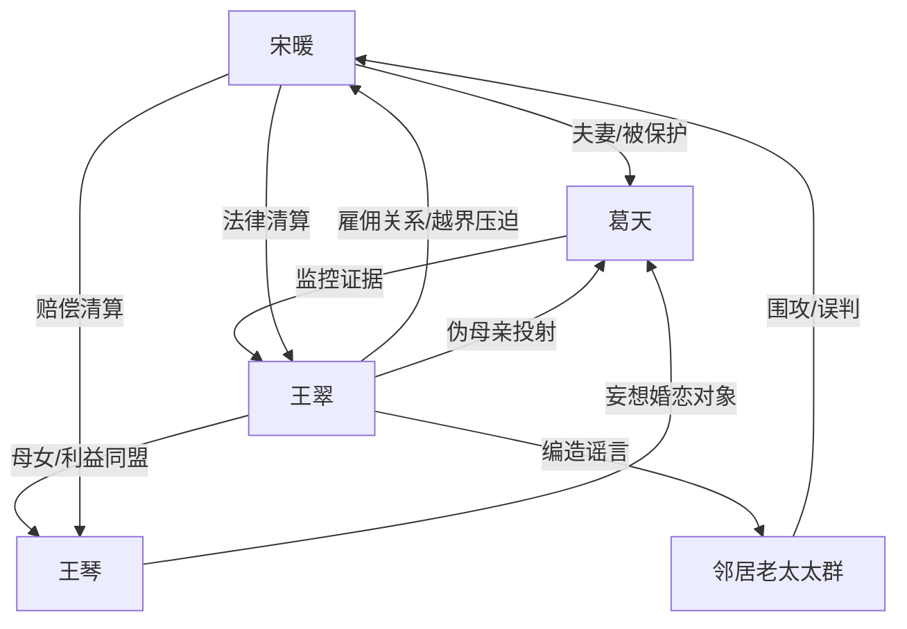

# 角色标签图谱

## 角色清单

### 宋暖 — 清醒雇主型爽文女主
- 叙事功能: 被压迫者、证据清算执行者、读者代入位。
- 核心标签: 清醒、嘴硬、边界感强。
- 弧光: 忍让求省事 → 被逼反击 → 法律与证据清算。
- 台词风格: 直接反问，少废话，关键处冷硬。
- 关键行为: 吃榴莲触发冲突；要求辞退；报警；坚持看监控；索赔并要求公开道歉。
- 读者情绪关系: 前半心疼，后半爽。

### 王翠 — 越界保姆/伪婆婆反派
- 叙事功能: 压迫源、谣言制造者、所有情绪债的债务人。
- 核心标签: 越界、造谣、贪婪。
- 弧光: 阴阳怪气 → 霸占雇主家 → 群体污蔑 → 证据崩塌 → 行业封杀。
- 台词风格: 伪长辈训话、卖惨、撒谎不眨眼。
- 关键行为: 拒吃榴莲后骂人；五点放红歌；带女儿入住；摔手机；自抓造伤；偷首饰。
- 读者情绪关系: 强恨点。

### 葛天 — 护妻证据位丈夫
- 叙事功能: 提供证据载体、公开站队、澄清谣言。
- 核心标签: 护妻、理性、留心眼。
- 弧光: 前期温和宠妻 → 出差离场 → 带监控回归反杀。
- 台词风格: 温和但有边界，打脸时逻辑清楚。
- 关键行为: 支持女主吃榴莲；装监控；调监控；澄清与王琴关系；支持起诉。
- 读者情绪关系: 安全感与补偿。

### 王琴 — 妄想插足/失信女儿
- 叙事功能: 放大王翠动机，制造婚恋谣言和二次恶感。
- 核心标签: 妄想、失信、偷拿。
- 弧光: 闯入主卧 → 拍视频造谣 → 被揭失信人 → 偷裙子败露。
- 台词风格: 撒泼、推责、弱者绑架。
- 关键行为: 要住主卧；拍视频网暴；偷女主裙子；拒绝承担责任。
- 读者情绪关系: 厌恶、鄙夷。

### 邻居老太太群 — 乌合围观者
- 叙事功能: 舆论压力放大器，制造女主无处自证的窒息感。
- 核心标签: 轻信、助恶、围攻。
- 弧光: 听信王翠 → 围攻女主 → 看监控后倒戈。
- 台词风格: 七嘴八舌，道德审判。
- 关键行为: 围住女主、作假证、辱骂女主父母，后又指责王翠。
- 读者情绪关系: 憋屈来源，反转后提供围观打脸。

## 关系网络

## 角色功能对照表（供改编参考）

| 原角色 | 极致标签 | 叙事功能 | 读者情绪功能 | 改编时必须保留的 |
|--------|---------|---------|-------------|---------------|
| 宋暖 | 清醒雇主女主 | 代入与反击 | 心疼转爽 | 边界感、证据意识、拒绝和稀泥 |
| 王翠 | 越界保姆 | 施压与造谣 | 强恨点 | 伪长辈姿态、卖惨、贼喊捉贼 |
| 葛天 | 护妻丈夫 | 证据位 | 补偿与安全感 | 公开站队、拿出关键证据 |
| 王琴 | 妄想女儿 | 放大动机 | 厌恶 | 入侵主卧、网暴、偷拿财物 |
| 邻居群 | 舆论合唱团 | 群体压迫 | 憋屈与反噬爽 | 先围攻后倒戈 |
