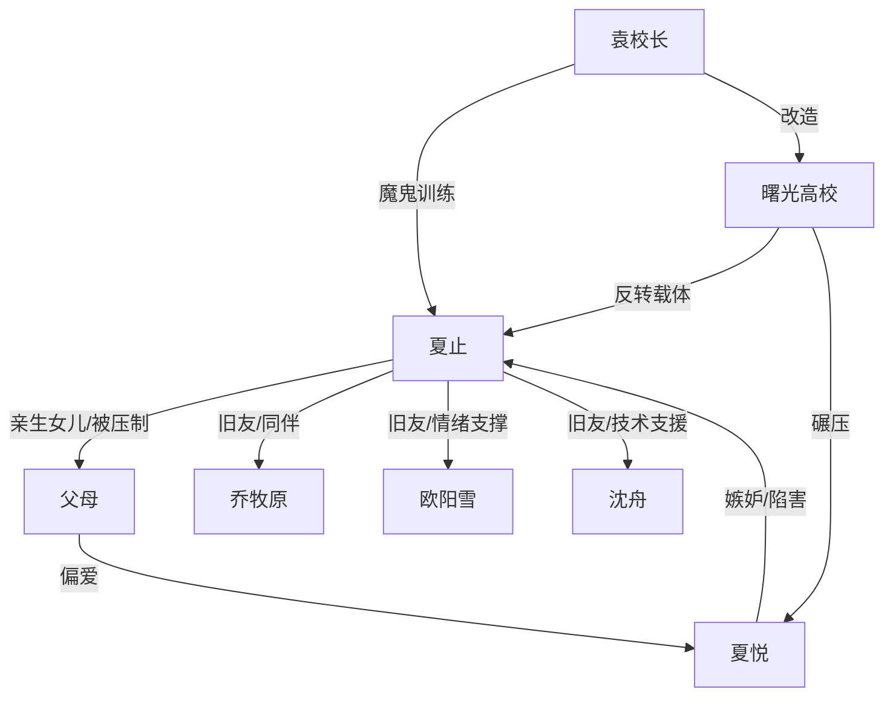

# 角色标签图谱

## 角色清单

### 夏止 — 摆烂型天才大女主
- 叙事功能: 第一视角主角，承担被偏心压制与最终打脸的情绪主线。
- 核心标签: 被拐归来、天才、清醒摆烂
- 弧光: 期待父母认可 → 接受偏心现实 → 为自己站起来 → 省状元离开
- 台词风格: 冷静吐槽、短句、偶尔直球
- 关键行为: 连续拿第一、提出重赛、欢迎夏悦进曙光、以成绩证明一切
- 读者情绪关系: 心疼、爽、认同

### 夏悦 — 绿茶型脆弱对照组
- 叙事功能: 施压者和自毁者，推动父母偏心与后期因果回旋。
- 核心标签: 嫉妒、装病、输不起
- 弧光: 被宠优等生 → 嘲讽曙光 → 主动入局 → 精神崩溃
- 台词风格: 表面委屈，实则攻击；常用压力和自我否定绑架父母
- 关键行为: 装吞安眠药、质疑作弊、要求转学、成绩崩盘
- 读者情绪关系: 恨、期待报应

### 父母 — 偏心型亲情压迫者
- 叙事功能: 家庭伦理压迫源，确认女主无法从原生家庭获得公正。
- 核心标签: 偏心、控制、双标
- 弧光: 接回亲女儿 → 因成绩压姐姐而打压 → 要求她做废人 → 含泪照顾崩溃姐姐
- 台词风格: 打着关心名义控制，偏爱包装成“为姐姐好”
- 关键行为: 转学、误读憔悴、打巴掌、支持夏悦入曙光
- 读者情绪关系: 愤怒、寒心

### 袁校长/院长 — 魔鬼教育家
- 叙事功能: 反转载体，将“废校”变成“天才训练营”。
- 核心标签: 斯巴达、教育狂、隐藏资源
- 弧光: 童年阴影 → 曙光改造者 → 高考胜利背后推手 → A大余味钩子
- 台词风格: 笑呵呵但压迫感强
- 关键行为: 接手曙光、整改校风、放任夏悦撞墙、送别时继续安排
- 读者情绪关系: 又怕又爽，喜剧压迫

### 乔牧原 — 理科天才队友
- 叙事功能: 证明曙光学生实力，提供竞赛爽点和保护感。
- 核心标签: 理科怪物、直球、压迫感
- 弧光: 旧友重逢 → 竞赛秒答 → 曙光翻身
- 台词风格: 直白怼人
- 关键行为: 抢答、怼质疑者、带动队伍气势
- 读者情绪关系: 爽、可靠

### 欧阳雪 — 语言天才朋友
- 叙事功能: 女主情绪托举者，帮助她摆脱原生家庭评价。
- 核心标签: 贴贴、语言天才、情绪支撑
- 弧光: 重逢亲近 → 安慰女主 → 并肩升学
- 台词风格: 活泼、亲密
- 关键行为: 解释曙光真相、安慰女主、陪她逛街
- 读者情绪关系: 温暖、治愈

### 沈舟 — 黑客天才
- 叙事功能: 处理外部黑热搜，展现曙光“卧虎藏龙”。
- 核心标签: 寡言、黑客、技术降噪
- 弧光: 低调旧友 → 秒删热搜 → A大同行
- 台词风格: 简短
- 关键行为: 协助破案背景、清除黑热搜
- 读者情绪关系: 爽、安心

## 关系网络

## 角色功能对照表（供改编参考）

| 原角色 | 极致标签 | 叙事功能 | 读者情绪功能 | 改编时必须保留的 |
|--------|---------|---------|-------------|---------------|
| 夏止 | 摆烂天才 | 被压制主角与打脸执行者 | 心疼、爽 | 表层不想卷，实力无法隐藏 |
| 夏悦 | 绿茶优等生 | 亲情竞争与自毁反派 | 恨、看报应 | 用“压力”绑架，后期被压力反噬 |
| 父母 | 偏心控制者 | 道德压迫来源 | 愤怒 | 明确要求女主让位/做废人 |
| 袁校长 | 魔鬼导师 | 废校反转载体 | 喜剧压迫 | 废校背后的强者资源 |
| 天才同学团 | 卧虎藏龙团队 | 群体打脸放大器 | 爽、归属感 | 至少 3 个标签化天才同伴 |
