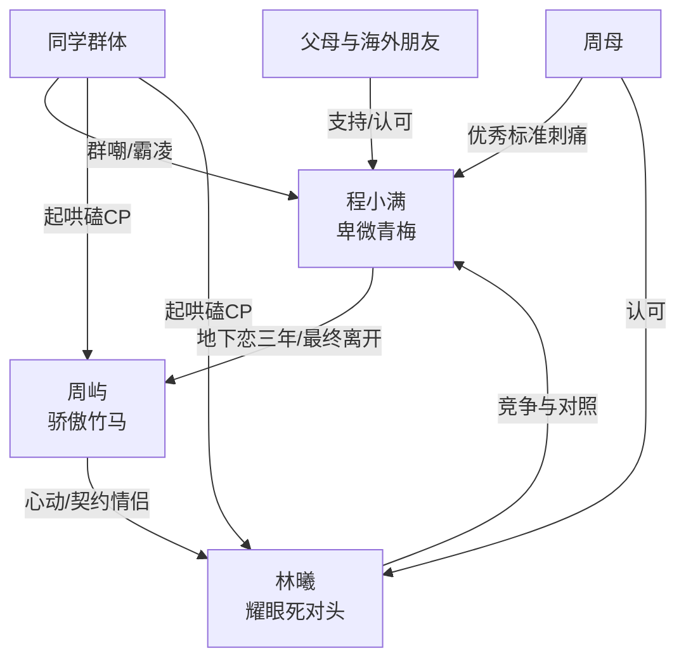

# 角色标签图谱

## 角色清单

### 程小满 — 卑微青梅到清醒自救者
- 叙事功能: 第一视角承压者与最终价值完成者。
- 核心标签: 青梅、被低估、清醒离开
- 弧光: 地下恋忍耐者 → 雨夜决裂者 → 海外成长者 → 平静拒绝者
- 台词风格: 前期少说、忍；爆发时连续质问；后期简短克制。
- 关键行为: 回“好”、决定留学、扇周屿、拉黑、拒绝复合、拒绝等待。
- 读者情绪关系: 前半心疼，后半爽和释然。

### 周屿 — 骄傲竹马/迟来追妻男主
- 叙事功能: 主要情绪债制造者，也是后半悔恨补偿载体。
- 核心标签: 天之骄子、虚荣怯懦、迟来醒悟
- 弧光: 享受偏爱 → 人前否认 → 擅自掌控 → 失去后崩塌 → 长期等待
- 台词风格: 前期高高在上、命令式；后期道歉、卑微、重复告白。
- 关键行为: 心率挑战否认、抢伞、官宣林曦、改志愿、毕业典礼再否认、生日会承认喜欢、追到国外、公开补官宣。
- 读者情绪关系: 前半恨，后半看他悔恨获得补偿，但不希望复合。

### 林曦 — 耀眼死对头/误入三角的女神
- 叙事功能: 周屿真实心动的镜子，放大女主的“配不上”创伤。
- 核心标签: 优秀、高傲、直球
- 弧光: 被磕 CP 的死对头 → 契约女友 → 真心告白失败者
- 台词风格: 骄傲、直接、带竞争感。
- 关键行为: 不心动挑战心率爆表、接受契约、生日会告白、骂周屿混蛋。
- 读者情绪关系: 前期轻微讨厌/嫉妒，后期转为同情；她不是终极反派。

### 同学群体 — 群体霸凌与舆论压力
- 叙事功能: 将女主的自卑外化为持续羞辱环境。
- 核心标签: 起哄、刻薄、慕强
- 弧光: 群嘲女主 → 磕周林 → 被周屿迟来官宣打脸
- 台词风格: 弹幕化、嘲讽、网感强。
- 关键行为: 嘲笑心率、刷丑照、毕业典礼写脏字、群里传播周屿官宣。
- 读者情绪关系: 恨点放大器。

### 周母 — 世俗优秀标准代言人
- 叙事功能: 用“优秀女孩”标准二次刺痛女主。
- 核心标签: 热情、势利而不自知、后悔
- 弧光: 夸林曦天生一对 → 四年后解释当年不知情
- 台词风格: 家长式热情，伤人而不自知。
- 关键行为: 饭桌夸林曦，给钱让周屿约会，四年后提周屿未放下。
- 读者情绪关系: 轻微压迫，不是主要反派。

### 程小满父母/海外朋友 — 正向价值镜像
- 叙事功能: 后半修复女主自我认知。
- 核心标签: 支持、接纳、认可
- 弧光: 接纳留学决定 → 支持深造 → 见证重生
- 台词风格: 温和、肯定。
- 关键行为: 安排留学，办 party，朋友说“你值得最好的一切”。
- 读者情绪关系: 安慰、补偿、温暖。

## 关系网络

## 角色功能对照表（供改编参考）

| 原角色 | 极致标签 | 叙事功能 | 读者情绪功能 | 改编时必须保留的 |
|--------|---------|---------|-------------|---------------|
| 程小满 | 被低估的清醒青梅 | 承压与自救 | 心疼→爽→释然 | 她不是靠新欢赢，而是靠自我价值赢 |
| 周屿 | 迟来醒悟的骄傲竹马 | 施害与追悔 | 恨→看火葬场 | 人前否认、人后安抚、迟来公开 |
| 林曦 | 耀眼竞争者 | 三角催化 | 嫉妒/同情 | 她必须优秀，才能刺痛“配不上” |
| 同学群体 | 群体霸凌者 | 舆论压迫 | 愤怒 | 群嘲必须具体且持续 |
| 正向支持者 | 价值修复者 | 后半补偿 | 温暖 | 必须有人明确告诉女主“你很优秀” |
