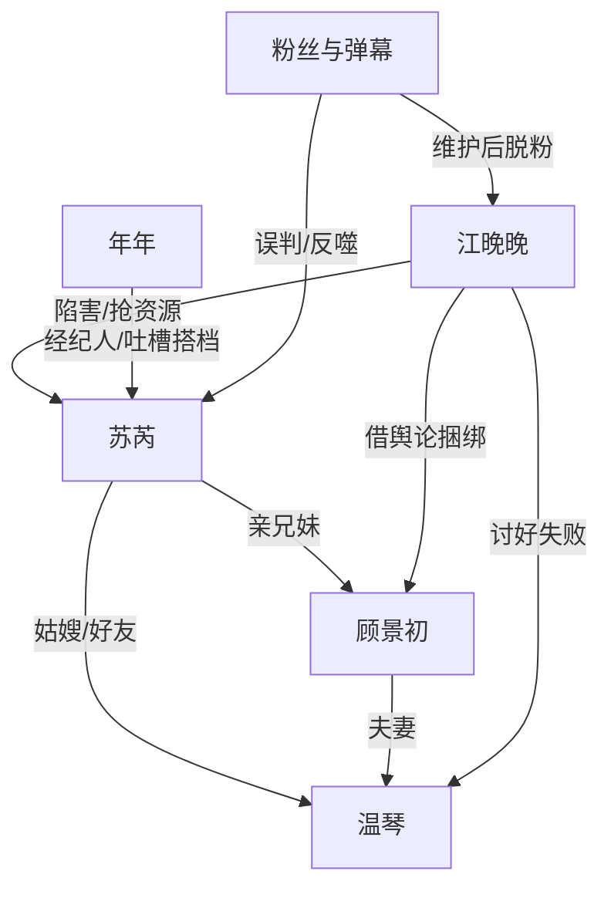

# 角色标签图谱

## 角色清单

### 苏芮 — 松弛关系户型清醒女主
- 叙事功能: 被污名化的主角、身份反转承载者、最终打脸执行人。
- 核心标签: 影帝妹妹、靠自己、吐槽役。
- 弧光: 全网黑小演员 → 综艺中被误读 → 实力与身份双重正名。
- 台词风格: 口语化、带梗、轻描淡写。
- 关键行为: 参加综艺、化解江晚晚套路、坐镇选角直播、引爆黑料。
- 读者情绪关系: 心疼、替她憋屈、期待她掉马、为她爽。

### 江晚晚 — 绿茶资源掠夺者
- 叙事功能: 情绪债制造者、打脸靶子、舆论操盘反噬样本。
- 核心标签: 装可怜、抢资源、买热搜。
- 弧光: 舆论受害者伪装 → 综艺翻车 → 选角失败 → 黑料爆雷。
- 台词风格: 欲言又止、指桑骂槐、柔弱外壳包攻击。
- 关键行为: 暗示苏芮抢资源、装晕车、陷害做饭、炒作女主。
- 读者情绪关系: 恨、烦、期待她露馅。

### 顾景初 — 断网影帝亲哥
- 叙事功能: 小三误会核心载体、最终身份官宣者。
- 核心标签: 断网、宠妻、嘴硬哥哥。
- 弧光: 被误会出轨 → 直播里持续制造误会 → 官宣妹妹。
- 台词风格: 直男、短促、家庭群式吐槽。
- 关键行为: 和苏芮酒店布置生日惊喜、综艺发消息、微博官宣。
- 读者情绪关系: 好笑、期待他知道真相、吃兄妹互动。

### 温琴 — 钢铁直女嫂子/国民经纪人
- 叙事功能: 正宫误会载体、护短者、职业权力背书。
- 核心标签: 京圈大佬女儿、飒、护短。
- 弧光: 被外界认为受害原配 → 直播中护苏芮 → 发合影澄清。
- 台词风格: 冷、直、少废话。
- 关键行为: 带走怕火的苏芮、菜市场拆绿茶、车内原谅苏芮。
- 读者情绪关系: 爽、安心、磕亲密关系。

### 年年 — 喜剧型经纪人
- 叙事功能: 外部危机放大器、吐槽搭档。
- 核心标签: 操心、崩溃、现实。
- 弧光: 以为要退圈 → 继续陪苏芮录节目。
- 台词风格: 夸张、职场打工人式崩溃。
- 关键行为: 提醒危机、吐槽温琴、制造“断头饭”笑点。
- 读者情绪关系: 好笑、代入打工人。

## 关系网络

## 角色功能对照表（供改编参考）

| 原角色 | 极致标签 | 叙事功能 | 读者情绪功能 | 改编时必须保留的 |
|--------|---------|---------|-------------|---------------|
| 苏芮 | 松弛关系户女主 | 被污名化后反杀 | 心疼、期待、爽 | 有顶级关系但坚持靠自己 |
| 江晚晚 | 绿茶掠夺者 | 持续制造情绪债 | 恨、烦 | 每个套路必须反噬 |
| 顾景初 | 断网影帝哥哥 | 身份牌终局揭露 | 好笑、补偿 | 前期必须造成误会 |
| 温琴 | 钢铁直女嫂子 | 正宫误会与护短 | 安心、爽 | 表面冷淡，实则偏爱 |
| 年年 | 崩溃经纪人 | 危机喜剧化 | 代入、轻松 | 打工人吐槽功能 |
