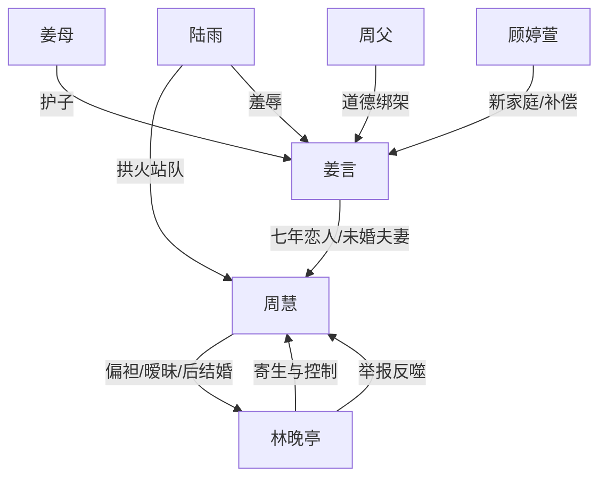

# 角色标签图谱

## 角色清单

### 姜言 — 清醒决绝前任 / 逆袭型受害者
- 叙事功能: 第一视角承压者、情绪债承载者、最终清算者。
- 核心标签: 克制、决绝、边界感强
- 弧光: 七年恋人 → 被逃婚羞辱 → 主动断联 → 事业新生与家庭重建
- 台词风格: 短句、冷、少解释，关键时刻直接判决。
- 关键行为: 撤销领证、退婚宴、搬家、放弃孩子、注销微信、无视周慧。
- 读者情绪关系: 前半心疼，后半痛快，最终认可他的冷漠。

### 周慧 — 虚荣摇摆背叛者 / 追妻火葬场核心
- 叙事功能: 主要施害者，也是后半报应承受者。
- 核心标签: 自私、虚荣、权衡利弊
- 弧光: 准新娘 → 逃婚者 → 求复合者 → 怨偶 → 社会性死亡 → 自毁
- 台词风格: 前期理所当然，后期卑微哀求，尾章自白暴露自私。
- 关键行为: 逃婚救林、改婚宴、逼姜言道歉、带林抢家具、跪雨求原谅、嫁给林、最终崩溃。
- 读者情绪关系: 恨、恶心、后期看报应。

### 林晚亭 — 病态绿茶男配 / 自毁型寄生者
- 叙事功能: 第三者、压力触发器、周慧报应的执行载体。
- 核心标签: 装弱、控制狂、寄生
- 弧光: 被照顾的“可怜人” → 威胁者 → 举报者 → 控制狂丈夫 → 自杀者
- 台词风格: 示弱、撒娇、威胁、歇斯底里。
- 关键行为: 跳楼威胁、装病、抢家具、吞药、举报周慧、婚后控制、割腕。
- 读者情绪关系: 厌恶，后期成为“恶人磨恶人”的工具。

### 陆雨 — 拱火闺蜜 / 羞辱放大器
- 叙事功能: 把私密背叛公开化、羞辱化。
- 核心标签: 嘴碎、拱火、道德绑架
- 弧光: 带人布置派对羞辱姜言 → 被泼酒 → 后续传递林晚亭自杀信息
- 台词风格: 阴阳怪气、站队周慧。
- 关键行为: 发朋友圈嘲讽、酒店当面羞辱、电话通知吞药。
- 读者情绪关系: 激怒读者，提供即时小爽点。

### 姜母 — 护子母亲 / 正义外援
- 叙事功能: 在家庭冲突中替男主撑腰，打破“男主孤立无援”。
- 核心标签: 护短、强硬、明理
- 弧光: 赶到新房护子 → 律所陪同清算
- 台词风格: 直白、泼辣、有民间正义感。
- 关键行为: 掌掴林晚亭，骂周慧，掰开周慧抱腿的手。
- 读者情绪关系: 爽、安心。

### 周父 — 传统道德绑架者
- 叙事功能: 增加家庭伦理压力，把姜言推向更彻底的决绝。
- 核心标签: 双标、面子、父权
- 弧光: 指责姜言不懂事 → 得知怀孕立刻改口求孙辈
- 台词风格: 训斥、命令、道德绑架。
- 关键行为: 阻止搬家，要求姜言体谅周慧，用孩子无辜绑架姜言。
- 读者情绪关系: 反感，加深对周家的厌恶。

### 顾婷萱 — 新生活证明 / 降维打击道具人
- 叙事功能: 证明姜言已真正重建人生，完成对周慧的最终碾压。
- 核心标签: 温婉、体面、稳定
- 弧光: 机场出现 → 花园岁月静好
- 台词风格: 温柔、自然。
- 关键行为: 挽住姜言，带儿子出现，问“这两个人，你认识？”
- 读者情绪关系: 补偿、安心、爽。

## 关系网络

## 角色功能对照表（供改编参考）

| 原角色 | 极致标签 | 叙事功能 | 读者情绪功能 | 改编时必须保留的 |
|--------|---------|---------|-------------|---------------|
| 姜言 | 清醒决绝前任 | 承压与清算 | 心疼到爽 | 不吵不求、用行动断联 |
| 周慧 | 虚荣背叛者 | 主施害者 | 恨与看火葬场 | 每次关键选择都选第三者 |
| 林晚亭 | 病态绿茶 | 触发器/报应工具 | 厌恶与讽刺 | 装弱、威胁、后期反噬女主 |
| 陆雨 | 拱火闺蜜 | 羞辱放大 | 小范围打脸爽 | 公开嘲讽与朋友圈证据 |
| 姜母 | 护子外援 | 正义支撑 | 爽与安全感 | 替主角撑腰但不抢主线 |
| 周父 | 道德绑架 | 压力加码 | 厌恶 | 面子与孩子绑架 |
| 顾婷萱 | 新生活证明 | 最终补偿 | 圆满 | 体面、温柔、孩子同框 |
